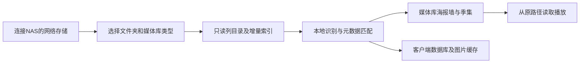

# WebDAV / SMB 只读媒体库与客户端刮削

2026-10-28[独立连接与原子编辑](../archive/handoffs/2026-10/2026-10-28-SAVED-CONNECTIONS-AND-ATOMIC-EDITING.md)：连接独立保存/旧库关联迁移、添加与编辑共用HTTP/HTTPS等表单、关联目录分区和全部关联库事务已接；旧库/原凭据保留。全215测试过/419输入双普通Debug，13/Pad/TV保留数据安装，三端编辑预填/取消与目录草稿取消过；13新包真实1文件A→B保存、墙更新及清临时库后完整迁移基线同。首诊断BrokenPipe/旧分隔符清理失败保留，独立清理及复验通过；连接改名原生输入超时未提交/原索引同，地址账号和多库提交仍待。原库149/3408/3408完整资料除新增connectionID外同，TV配置迁移变化单列/其他偏好同。用户已带走18，本轮零发现/安装/控制。0播放/NAS源写、30项14/5/11与114格不变。
2026-10-28[竞品连接参考与目录浏览](../archive/handoffs/2026-10/2026-10-28-STORAGE-REFERENCE-AND-FOLDER-BROWSER.md)：实际观察13 Infuse新增WebDAV表单/高级项、已有FTP目录及收藏重命名草稿取消；爆米花仅更新提示/TV仅清单，不夸大参考。三端共用添加来源选择、已有WebDAV登录复用、连接管理媒体文件夹入口及浏览选择路径草稿；独立连接/地址账号编辑仍未做。35定向0失败、418输入双普通Debug，13/Pad/TV保留数据更新及新流程草稿→取消/末首页实图过。TV前三驱动失败保留，fresh索引纠正旧movie预期后过；当前3408配置覆盖前已存在，不恢复旧149。13/Pad索引同旧批，TV同fresh3408基线，三机偏好同。18本批两次无线发现失败未安装，最后确认上一详情包。0播放/0目录提交/0NAS写，30项14/5/11及114格不变；FTP/SMB/全会话/Pad退出继续开放。

2026-10-28[详情信息区共用](../archive/handoffs/2026-10/2026-10-28-DETAIL-INFORMATION-LAYOUT.md)：MediaDetailInformation实际接移动/TV Jellyfin与网络库，统一演职→制作→推荐→来源/文件的顺序、制作文本和分区间距；TV演职标题共用Section，原遥控焦点保留。36资料回归过/418输入双普通Debug，四机保留数据更新，18仅无线安装。13/Pad/TV两入口同片实图已核，TV演员焦点往返成立；父级标记覆盖子级的中间失败已修正并保留，Pad另补视口实图，不以AX可见冒充屏幕可见。三机完整索引/原偏好同，0播放/0源文件写/无新114格P。用户再次要求完整参考Infuse/爆米花的连接与文件夹添加修改流程，下一优先落实该项，不能把此前有限首页观察算完成。

2026-10-28[共用准备执行与取消清理](../archive/handoffs/2026-10/2026-10-28-SHARED-PREPARATION-COORDINATOR.md)：PlaybackPreparationCoordinator实际接WebDAV双端/TV Jellyfin，统一初始执行、重复准入、当前性检查、迟到结果释放和当前错误；取消后的释放在独立未取消Task中执行且等待完成。65定向0失败、418输入双普通Debug，四机保留数据更新，18仅无线安装。13 WebDAV/TV两来源有限实播与正常返回已核，TV焦点Select暂停继续成立；Pad仅最新首页，旧416在播控制栏观察失败/主动停止保留，普通退出仍待。三机完整索引与原偏好同，无NAS写/114格新P；完整生命周期/FTP/SMB仍开放。

2026-10-28[共用播放准备](../archive/handoffs/2026-10/2026-10-28-SHARED-PLAYBACK-PREPARATION.md)：新增PlaybackPreparationGate并实际接WebDAV双端/TV Jellyfin，统一初始重复请求/取消迟到交付准入，源取消/释放仍由宿主负责。44＋14无重叠共58测试过，416输入双普通Debug/四机保留数据安装，18仅无线不启动；13 WebDAV与TV两来源同片名就绪后有限播放/正常退出已核。Pad3/10实帧成立但正常退出仍待，AX/驱动失败及主动停止均保留，最终首页/工具清理已核。三机149/3408/149索引完整JSON及原偏好同，无NAS写/114格新P；完整会话及FTP/SMB仍开放。

2026-10-28[端点凭据与人物图片](../archive/handoffs/2026-10/2026-10-28-ENDPOINT-SCOPED-CREDITS.md)：修复多地址已有登录凭据不同而误拒补图，精确编号/每端点自身凭据。13/Pad/TV同片真实人物照均已实看，缺图仍占位；Pad/TV保留原生等待后编辑预填→取消回墙通过，旧误导航/超时保留。Pad3,408/TV149索引完整JSON同、原偏好同。414输入/双普通Debug/39定向0失败，四机保留数据安装，18仅无线安装不控制。0播放/0 NAS写，不增114格P，UX-08/09仍进行中，完整播放会话/FTP/SMB继续开放。

2026-10-27[修改文件夹与共用操作](../archive/handoffs/2026-10/2026-10-27-LIBRARY-FOLDER-EDIT-AND-SHARED-ACTIONS.md)：414输入/双普通Debug/39定向0失败；WebDAV默认海报墙、移除独有列表、Jellyfin与网络库共用更多/刷新，新增完整路径先扫描后事务替换。13真实错误保149→原路径验证约160秒成功/绝对源文件集合相同；Pad/TV菜单与预填编辑实图成立，但取消未验、即时AX失败保留。四机最新包保留数据安装，18按用户使用中限制只安装不启动。TV头像样本9真实/1占位，13指定影片仍占位需定位，不能关闭头像项。无NAS写/新播放P，完整会话/FTP/SMB仍开放。

2026-10-27[返回图片保留与无线更新](../archive/handoffs/2026-10/2026-10-27-ARTWORK-RETURN-STABILITY-AND-IPHONE18-UPDATE.md)：共用网络图片解码LRU/同索引资料保留、27定向过，411输入双普通Debug，TV/13/18已覆盖；18普通启动实图已核，Pad不可连接。TV有限播放返回成立但无完整瞬时闪烁证据；13外部前台中断/0播放，头像尚未接。播放会话与NAS只读规则不变，114格不增P；用户新截图的工具栏收拢/头像继续。

2026-10-27[三端网络库精简与原盘资料补读](../archive/handoffs/2026-10/2026-10-27-COMPACT-LIBRARY-AND-CONSISTENT-CREDITS.md)：按用户新反馈，三端共用网络墙移除居中重复名、顶部统计和分类数量黄框，详情统一演职区/导演角色及制作文本，文件信息共用Disclosure默认折叠，移动Jellyfin同组件/去重复片名。修复BDMV详情遗漏影片目录NFO，复用扫描实际规则且读前后核版本/根范围/身份；19资料＋39分类图片只读定向回归过，双普通Debug/409输入。TV9c9012f…20:45:37、移动d5cfec4…13 USB20:45:55保留数据更新，TV普通片/原盘和13实图及文件信息展开已核；原盘缺本地封面仍未解决。Pad不可连接、18通话现场等待空闲回复，无最新包验收；播放会话迁移未实施，本轮0播放命令，不增114格P，30项14/5/11保持。

2026-10-27实际接续：[共用海报/详情/控制批](../archive/handoffs/2026-10/2026-10-27-SHARED-MEDIA-PRESENTATION-AND-WIRELESS-UPDATE.md)将Jellyfin与网络库真实接入MediaPosterCard/Grid及MediaDetailHero/Facts/ActionRow等共同组件，按需只读NFO补评分/时长/人物/技术参数，背景图只取已列出的本地候选。有限版本/范围复核非原子快照，纠错不复用旧标题演员；无NAS写或在线provider调用。FTP正式有界只读原语已有但App未接，SMB严格范围仍失败；统一呈现不扩大为这些来源已可用或全播放链已统一。

2026-10-26最新私有[FTP NFO/MLST事务](../archive/handoffs/2026-10/2026-10-26-FTP-NFO-MLST-AND-INDEX-TRANSACTION.md)已同授权会话核目录/读前MLST/指定≤64KiB NFO/读后MLST、精确路径/长度/EOF/226；49 NFO/旧库四核对＋43列表回归含14 ASan/双平台编译，140服务窗清理。未改生产Store经私有桥验证，仍非生产FTP配置/字面路径/账户来源或递归库/App；Codable密码与anchorDER仅测试，不得直接持久化。下一生产来源/凭据/路径模型与扫描，FTPS复用/真实兼容及SMB严格范围FAIL单列；属性提示非原子内容快照，早批“无MLST/NFO”按当时归档阅读。

2026-10-26最新私有[显式FTPS升级](../archive/handoffs/2026-10/2026-10-26-FTPS-EXPLICIT-STARTTLS-FRAMER.md)以公开Network framer在220/AUTH TLS/234完成后动态加TLS并markReady，信任通过才发凭据；显式控制/数据TLS、实际peer/原host及MLSD已走通。43最终场景含8 ASan、共用server SSLContext补3窗/双平台编译成立，49服务窗清理；强制session reuse仍522，未建立复用/真实NAS兼容，MLST/NFO/目录源/索引/App仍未接。早批“仅隐式/explicit不支持”按当时归档阅读，SMB严格范围FAIL保持。

2026-10-26最新私有[FTP MLSD条目](../archive/handoffs/2026-10/2026-10-26-FTP-MLSD-BOUNDED-ENTRY-PARSER.md)已在完整EOF/226后解析file/dir/可选版本，原样保留中文/空格/字面百分号，cdir/pdir不遍历，未知类型/链接/重复/晚坏行拒绝整批；50契约＋9网络窗含8 ASan操作/双平台编译，误接受非ASCII key的反例已修/保留。只独立原型，尚无显式数据升级/session reuse、MLST/NFO/目录源/索引/App；SMB最新[原生替换反例](../archive/handoffs/2026-10/2026-10-26-SMB-ROOT-LIFETIME-BOUNDARY.md)仍能越根且提交，严格范围FAIL，不能以版本/保留句柄承诺总保旧库。下方早批按当时归档阅读。

2026-10-26最新仓库外[FTP/隐式FTPS数据通道](../archive/handoffs/2026-10/2026-10-26-FTPS-PASSIVE-PEER-AND-DATA-TLS.md)已用Network实际控制peer固定数据IP、原host核数据TLS及控制叶一致，EPSV优先/PASV忽略声明主机；42最终场景含6 ASan和双平台原型编译，EOF/226/32KiB及取消/截止成立。原StreamTask控制源码未改，新后端仅隐式FTPS/明确plain；显式数据升级/session reuse/MLSD条目/MLST/NFO/库/App仍未接，SMB严格范围失败保持。早批“无数据通道”按当时归档阅读，不当最新能力。

2026-10-26新增仓库外[FTPS/FTP控制隔离](../archive/handoffs/2026-10/2026-10-26-FTPS-FTP-CONTROL-TLS-AND-CANCELLATION.md)：系统StreamTask显式/隐式TLSv1.3、严格主机/证书/凭据门槛、无降级、有界回复和取消/截止，28场景与双平台动态编译。普通FTP只显式配置，不自动回退；没有EPSV/PASV数据连接/目录/NFO/库/数据TLS或App交付。下一实际对端绑定和数据TLS/MLSD/版本事务；SMB严格选根范围失败不因本批改变，用户NAS/系统信任不改。

2026-10-26当前SMB**严格选根未通过**：[目录保留/范围失败](../archive/handoffs/2026-10/2026-10-26-SMB-PATH-PINS-AND-CONTAINMENT-FAILURE.md)证明祖先路径替换可使文本仍在根内而实际NFO READ在根外。保留祖先句柄/移除SHARE_DELETE/目录CLOSE读后校验只能在夹具模拟服从共享规则时阻止改名，强制本地改名仍4次外部READ；旧库虽保住，不当范围通过。13最终窗12范围成立/1失败，候选不接App，需要真实服务器和原子访问策略；不改NAS共享/权限绕过。独立推进FTPS/FTP传输隔离，下面早批编译/局部通过不扩大SMB交付。

2026-10-26最新私有[SMB可变区/所有权修复](../archive/handoffs/2026-10/2026-10-26-SMB-VARIABLE-SPAN-AND-PAYLOAD-OWNERSHIP.md)实证旧READ/CREATE短帧大声明等待及目录越界double-free；补命令内固定/可变区分配、READ请求容量和错误路径所有者，24窗含8 ASan/双平台编译通过。原型累计10个上游差异文件，仍未接App/签名嵌入；非全部解析/SMB3/并发路径证明，下一原子选根与其余真实兼容。FTP系列/新增客户端状态不变。

2026-10-26最新接受范围仅仓库外：[NFO版本/旧索引事务](../archive/handoffs/2026-10/2026-10-26-SMB-NFO-VERSION-AND-INDEX-TRANSACTION.md)在目录→CREATE→同FileId CLOSE POSTQUERY比较原FILETIME/大小/属性，未知/变化/缺有效标志不发布暂存；未改Store副本经私有桥核失败保留旧库，第二NFO失败不提交部分结果。29最终场景含2工具预期复核、ASan实际6窗/双平台动态编译，夹具与断言失败均留档。不是原子内容快照/并发路径证明，也未接生产SMB适配/签名嵌入/UI；下一并发选根、其余C分配和真实SMB3/许可，FTP系列及新增媒体客户端交付范围不变。下方同日早批“下一步”按当时归档阅读。

2026-10-26最新仍仓库外：[认证前地址回退](../archive/handoffs/2026-10/2026-10-26-SMB-PREAUTH-ADDRESS-FALLBACK.md)接有限顺序候选/总预算/认证前短预算与C阶段回报，首次SESSION_SETUP入队后停止候选切换；20候选＋3 DNS、ASan6窗17任务及双平台隔离编译成立。仅在未开始认证的不可用地址间回退，认证拒绝/等待/权限/取消/总截止保留失败且不试下一地址；未接App。下一NFO读后版本、索引事务/原子选根/真实SMB3与分发；并行Happy Eyeballs及后续DNS答案仍待验，不把顺序回退当全部网络策略交付。

2026-10-26最新仍仓库外：[原生DNS/数字连接](../archive/handoffs/2026-10/2026-10-26-SMB-NATIVE-DNS-AND-NUMERIC-CONNECTION.md)以独立查询生命周期＋数字C入口保留UNC原名，指定族解析、完整性/数量上限、同一剩余预算和取消释放已接原型。35主要窗口/ASan9窗20任务、真实loopback两族只读/LocalOnly记录8收9拒绝及双平台编译成立；36查询引用释放，自有发布引用/服务已收尾。未接App；旧getaddrinfo入口仍在，新路径的daemon初始化内部、地址自动回退、NFO版本/原子选根/SMB3/真实兼容及许可分发仍未验。以下同日早批实验按归档阅读，不覆盖此接受范围。

2026-10-26最新SMB边界仍仅仓库外：[认证错误与接收边界](../archive/handoffs/2026-10/2026-10-26-SMB-AUTH-ERROR-AND-RECEIVE-BOUNDS.md)已分离规范拒绝/畸形正文/静默，保留回调原NTSTATUS和非零终态，C增加256KiB帧/复合边界/ERROR ByteCount检查，继承缺签拒绝。18服务＋5前缀/ASan17窗28连接及双平台编译成立；原4秒失败保留并已定位，不再当未定认证慢。未签名/嵌入/接App，下一核同步DNS/IPv6/多地址、其余解析分配、原子选根/NFO版本和SMB3/真实兼容/许可，不以局部内存检查替代整条协议验收。

2026-10-26 SMB接续仅为[仓库外raw分页/NFO隔离](../archive/handoffs/2026-10/2026-10-26-SMB-RAW-DIRECTORY-NFO-ISOLATION.md)：高层opendir累积全目录且缺本实验所需重解析属性，改raw按页实验；123项/50001字节NFO、源不变、取消/截止实际断连接有证据。原固定C sign要求未拒绝缺签响应的负例已留档，socket.c私有局部补拒绝后正常/缺签/错签对照与双平台动态编译成立，未签名/嵌入/接App。认证失败仍4秒deadline，DNS/原子选根/回调竞态/传输层整包上限/NFO版本/SMB3加密和真实服务器及许可分发仍待验；不能将明文SMB2合成夹具当完整SMB支持。应用仍服务入口批11:09正常包，375本地输入不变。

2026-10-26来源扩展已接共享FileStationSource，读取当前DSM会话并按原子索引/本机覆盖保存，来源另持久化账号绑定；WebDAV已有凭据可选新文件夹。NAS根不自动全库导入、地址不变，File Station不发送PROPFIND。实际源码与验收边界见[本批](../archive/handoffs/2026-10/2026-10-26-NAS-SESSION-SOURCE-HUB-NATIVE.md)；FTP/SMB/在线刮削仍未接。

2026-10-26用户扩展：[统一来源与授权方案](UNIFIED_SOURCE_DISCOVERY_AND_ACCESS.md)将FTP/FTPS兼容及独立SFTP规划、当前NAS/File Station会话接入、已存连接复用与媒体服务识别纳入分阶段范围。现有WebDAV包能力不因此扩成已支持FTP/SMB；源文件只读不变。Emby/Plex/音乐服务先读取其已有资料，与文件夹客户端刮削区分，计划尚未接App。

核对日期：2026-10-26。用户要求通过NAS上的WebDAV/SMB读取指定文件夹、建立媒体库并刮削，**不得增减或修改原文件内容、文件名、目录与结构**。共享WebDAV目录/全扫描/本地索引、文件名/已有NFO识别及可恢复的本机纠错已接入双工程；13/Pad/TV最终包均过自有匿名夹具建库/编辑/恢复/移除。手机/Pad扫描取消有历史证据，TV扫描取消仍未验。SMB仅仓库外构建/取消预检，在线provider及独立库播放未交付；状态归[唯一总账](../project/PLAYBACK_EXPERIENCE_PRIORITIES.md)。

## 现场参考与当前库存

- 网易爆米花 Apple TV 2.6.12(58)：实际聚合海报墙、分类侧栏、设置中的“添加资源教程”已看。此轮没有进入教程内容、没有验证TV直接建连接/选目录；不能从手机流程推断TV已提供同样入口。
- iPhone13已安装的2.15.2(158)：实际“媒体库/资源库/我的/搜索”分层，资源库新增页分本地/网络/云盘存储，网络选项有WebDAV/SMB，Emby/Jellyfin是另一类来源。WebDAV空表单有名称、协议、地址、端口、用户名、密码、路径；SMB有名称、地址、端口、用户名、密码、路径。未按“确认添加”，未输入或复制凭据、未新建/导入/删除源。出现2.15.3更新提示时只按取消，未升级竞品。已进入现有WebDAV的真实目录列表（4行），未打开视频、选择新目录导入或保存连接。
- iPhone18库存2.15.13(169)，随后用户改接13/Pad，18参照未继续；不能把13旧版本流程写为18最新版实看。
- 开发者在[App Store说明](https://apps.apple.com/cn/app/id6480252695)中列明WebDAV、SMB及智能影片匹配。上述只支持其功能定位，**没有证明其内部刮削实现或所有操作绝无远端写入**；Nastart的只读约束由我们独立执行。
- Nastart原PlaybackIntent已有`smbFile/webDAVFile`来源枚举，LANDiscoveryService有`_smb._tcp`发现；2026-10-26新增共享WebDAV目录/扫描/本地索引与文件名/已有NFO识别，SMB与独立在线provider仍未接。已有Jellyfin图片/元数据与[高清补全设计](HIGH_RESOLUTION_MEDIA_ARTWORK.md)可复用部分展示语义，不等于独立刮削已实现。

## 用户流程与模块归属

“连接NAS”负责提供候选服务及连接入口；用户选定协议/地址并验证成功后，再选一个或多个文件夹作为库根。DSM登录SID不等同WebDAV或SMB凭据，不自动转发到另一个协议/端口。发现的LAN地址仅作候选，用户保存的域名＋端口保持为实际连接配置，不能静默替换，尤其延续iPhone18的既有约束。

| 层 | 共同规则 | 平台差异 |
| --- | --- | --- |
| NetworkSource / CredentialReference | 独立source UUID、协议、原始origin、选定根目录、Keychain引用；数据库不存密码 | Keychain和连接/文件夹选择呈现适配各平台 |
| ReadOnlyMediaSource | 只有列目录、读属性、按范围读字节和取消；不暴露创建/改名/删除接口 | WebDAV HTTP/XML和SMB传输适配器 |
| LibraryScanner / IndexStore | 同一代次/增量索引、完整扫描判定、错误分类和去重 | 后台执行时机及存储路径依平台 |
| MetadataMatcher / ArtworkStore | 同一文件名/年份/季集规则、匹配来源/置信度、手动纠正及缓存 | 视图/图片尺寸和焦点预取预算依设备 |
| PlaybackResource | 稳定源身份、原路径、认证作用域和有限range读取 | 接现有KS/AV路线；SMB字节桥接需专项验证 |

共同领域与扫描/匹配规则应进入同一可复用模块，由iPhone/iPad与TV共同编译；遥控器与触屏的目录选择/错误恢复分别适配。不能继续复制三份刮削规则，也不把这张模型表算已接产品。

## 不改NAS的执行边界

1. NAS只被读取：不改名、不移动、不复制或删除媒体，不建文件夹，不生成/覆盖NFO、海报、字幕、数据库或隐藏索引。已有NFO/本地图可作为只读输入。
2. 所有新增数据存于客户端私有数据库/缓存：标题、年份、季集、海报、来源ID、匹配纠正、扫描状态、播放书签。“重新匹配”只改本地绑定；移出本媒体库只改本地索引。
3. 扫描只在用户选定根目录及子目录内。链接、转义路径、百分号编码、Unicode和重定向都需校验，不能越界列出其他目录或把NAS认证头送给图片/元数据提供方。
4. 不因掉线、认证失败或扫描取消而将未读到的资源当作被删除；只有完整成功扫描才可更新本地缺失状态。旧代次不能提交新索引。
5. 读取大文件不先下载整片做hash；初始身份采用source UUID＋规范相对路径及size/mtime/ETag。不同协议指向同一文件不自动断言同一身份；重命名/多版本歧义通过本地重绑定处理。

当前WebDAV传输只暴露`PROPFIND`与专门受限的NFO `GET`，列目录显式用Depth:1和所需属性，逐层遍历，不依赖Depth:infinity；NFO的GET仅限已列出的选根内资料文件；后续视频/海报字节接口仍需独立审计。`PUT/MKCOL/DELETE/MOVE/COPY/PROPPATCH/LOCK`等不进入此模块。对读取属性与Depth的语义依据[RFC4918](https://www.rfc-editor.org/rfc/rfc4918.html)，当前PROPFIND及限NFO的GET已接产品，视频Range/HEAD等尚未接入，不能据资料读取承诺实际播放。

SMB适配器只申请列目录/读属性/读数据权限；打开已有对象使用`FILE_OPEN`，不允许OPEN_IF、CREATE、OVERWRITE、DELETE_ON_CLOSE或写/删权限。SMB2命令名CREATE同时用于“打开”，不能简单按名字把只读打开误判为创建；依据[微软CREATE定义](https://learn.microsoft.com/en-us/openspecs/windows_protocols/ms-smb2/e8fb45c1-a03d-44ca-b7ae-47385cfd7997)与[目录权限](https://learn.microsoft.com/en-us/openspecs/windows_protocols/ms-smb2/0a5934b1-80f1-4da0-b1bf-5e021c309b71)。具体客户端库、签名/加密能力与许可尚待审计，不默认当前FFmpeg包已有SMB播放能力。

## 刮削与播放的实际依赖

识别先用已有NFO或文件名/上层目录中的片名、年份、SxxExx/季集信息；中文名、特辑、多版本及同名片保留歧义。再由独立元数据provider匹配稳定ID，低置信度项显示待匹配，用户可本地纠正。Jellyfin已有ProviderID可作为其来源的精确关联，但独立WebDAV库不能假设总有Jellyfin服务。

TMDB等独立服务需我们可合法使用的应用凭据及来源标注；不复制竞品/Jellyfin内置密钥，不擅自注册付费服务。IMDb/豆瓣独立评分仍按[评分方案](MULTISOURCE_RATINGS.md)处理，不能把通用分数改标签。高清缓存沿[高清方案](HIGH_RESOLUTION_MEDIA_ARTWORK.md)的原图像素与稳定ID规则，不放大低清图冒充高清。

WebDAV可复用现有HTTP认证/有限Range边界；SMB必须先有可靠随机读取与取消/播放资源桥接。独立网络存储没有Jellyfin协商/转码服务这一默认前提，不能在模型中凭空承诺兼容转码、PiP/HDR或原轨输出。原[播放矩阵](../testing/PLAYBACK-FUNCTION-MATRIX.md)中的首帧、深seek、字幕/音频和退出仍逐项验。

本地媒体库不自动等于跨端同步。当前免费个人签名CloudKit权限仍受阻，先按设备保存索引/缓存；后续同步独立设计，不将共享数据库写进NAS媒体目录。

## 开发顺序与门禁

先做WebDAV：共享只读源契约→连接/文件夹选择→本地增量索引→已有NFO/图片读取→稳定ID刮削与本地纠错→实际播放。理由是可复用当前HTTP认证和Range基础；同批设计SMB契约，随后接经过只读权限审计的SMB适配器。NAS服务未启用或凭据不足时保留依赖，不修改NAS/VPN配置绕过。

第一份只读WebDAV客户端及扫描索引切片已实现（见下节），后续继续逐项验收，不将完整SMB、provider自动识别、所有格式、跨端同步塞进一个“已完成”标记。至少覆盖：

- 只有读权限的源仍能列目录；没有任何写方法/写权限请求；源文件目录清单、大小与修改时间无客户端改动。完整body校验用本机私有mock样本，不为测试在NAS媒体目录新增文件。
- root边界、XML命名空间/外部实体、编码路径、跨源重定向、401/403、超时/取消、半轮扫描及迟到结果有失败样本。
- 电影/剧集/季集/特辑/多版本/中文重名的解析和手动纠正可重复；无匹配/缺图可用，缓存有上限和离线回退。
- iPhone13/iPad/TV同规则、各自完整连接→选目录→入库→原位播放→暂停/seek/轨道/退出证据；每机先核最新包，不能用发现SMB广播、目录成功或内部时钟替代实际播放/帧时间/SUB/AUD。

详细设备安装与竞品UI流水放[月度交接](../archive/handoffs/2026-10/2026-10-25-READONLY-NETWORK-LIBRARY-AND-DEVICE-REFRESH.md)；原28项保持开放，新增网络媒体库一项后总29项；原114格不因本设计关闭。

## 2026-10-26 02:49目录批的代码与验收映射（历史）

共用本地包 `ios/Nastart/Packages/NetworkMedia` 由iPhone/iPad和TV两个工程直接引用：`Models/WebDAV`负责路径作用域、具名Depth1请求与207逐项解析；临时会话只允许PROPFIND、不跟随任何重定向、不绕过证书验证、不使用持久URL凭据；4MiB响应/25秒资源预算和取消有真实HTTP测试。`ReadOnlyLibraryScanner`逐层全扫描最多10万条/1万目录/相对64层；`NetworkLibraryStore`本地Application Support原子JSON快照/代次提交，失败取消/损坏库不会静默清空旧索引。当前没有增量更新、目录分页协议或数据库迁移能力。

`NetworkCredentialVault`按source UUID和确切规范地址在本机Keychain绑定凭据，WhenUnlockedThisDeviceOnly、不跨设备同步；JSON没有用户名/密码字段。`LibraryViews`共用连接、选目录、索引计数/取消/重扫/本机移除；媒体以文件名和“资料待匹配”显示，没有伪造匹配结果。公开AnyView工厂将具体View存储留在模块内，规避首版真机销毁崩溃，根因及更广系统/Release范围未证明。两个平台仅各自提供既有导航入口；原Jellyfin/设备文件播放路线未改。

完整成功指本次可观察的逐目录响应全部通过校验，不能证明服务器内部原子快照或路径别名的真实文件系统落点。服务器在扫描期间隐瞒条目或把根内路径映射到链接，客户端不能仅凭WebDAV响应识别所有情况；应用本身仍不发送任何写方法，不因部分403/取消提交缺失资源。

最终15项测试与两工程普通Debug构建通过；13最新普通包完成自有只读夹具选根、3视频索引、重启保留、403时索引逐字节不变、恢复及UI移除。6源文件的内容/大小/mtime/路径/结构不变，16次请求全PROPFIND/Depth1、未请求未选Other目录。TV已安装/普通首页和表单有限验，填表自动化未完成；Pad旧安装协调器阻塞，不能继承手机验收；18离线未装本批。没有真实NAS WebDAV登录/SMB/NFO/海报读取、刮削provider、独立网络库播放或跨端同步。详细失败、签名/安装与收尾见[本批交接](../archive/handoffs/2026-10/2026-10-26-READONLY-WEBDAV-LIBRARY.md)和[结果](../testing/results/2026-10/2026-10-26-readonly-webdav-library.json)。

## 2026-10-26 后续资料批：当前接受实现

`LocalMetadata.swift`共用文件名片名/分隔年份/SxxExx/0季特辑及双集提示，保留数字片名歧义，结果明确标为待确认。`NFOSidecarSelection`单目录一次建立查找表，同stem优先，歧义不选；只有一个非剧集视频才回退movie.nfo，不套用tvshow.nfo。`NFOReader`读取movie/episodedetails的标题、年、简介/CDATA、季集和明确类型的imdb/tmdb/tvdb ID，拒绝实体/DOCTYPE、截断、过深、重复关键字段或冲突ID；thumb/url/episodeguide不访问，不将ID称为在线匹配。当前仅[Kodi电影NFO](https://kodi.wiki/view/NFO_files/Movies)和[单集NFO](https://kodi.wiki/view/NFO_files/Episodes)的上述字段子集，多根/新多集NFO布局、tvshow.nfo层级和评分/演员/图片尚未接。

`WebDAVClient.readNFO`只允许已选择根目录内的NFO路径，用没有目录尾斜杠的文件URL；专门GET传输只接受200、不跟随重定向或绕过TLS验证，流式512KiB上限/单请求取消与25秒资源预算。整轮资料预算32MiB/4096份，目录原预算保留。已声明过大、损坏或有歧义的NFO显式回退文件名；已列NFO的403/网络错误与取消不提交半轮、旧完整索引保持。旧条目没有metadata字段仍兼容；不读视频来做完整hash，不下载海报。

`NetworkLibraryStore.shared`在应用进程内共用一个actor。手机/Pad仍是Application Support原子快照；电视实际写此目录发生Cocoa513，经无敏感诊断确认后改为Caches可重建快照＋UserDefaults中不超过64KiB的连接小目录（仅UUID/名称/规范地址/所选根）。密码仍在确切地址绑定的Keychain；元数据和媒体列表不放偏好。缓存丢失时恢复连接但清空上次完成标记、显示待扫描；移除后旧缓存不能复活源，损坏数据失败关闭，不以空库覆盖。缓存恢复仅做隔离单测，没有强制真机系统清理/压力或永久离线保留验收。平台存储依据[Apple tvOS指南](https://developer.apple.com/library/archive/documentation/General/Conceptual/AppleTV_PG/)及实际错误；不把旧指南容量当所有系统已实测值。

界面共用资料来源、年/季集/简介/原路径、坏NFO提示及显式仅本机移除，电视提示缓存可能被清理、可重扫恢复；手机/TV已有入口保持。32测试和双工程普通Debug通过，最终13/Pad/TV都完成自有匿名夹具选根→4视频/2 NFO→移除；手机/Pad取消旧库逐字节保持，13另有NFO403旧库保持与恢复/重启证据。TV实际NFO/季集/简介/重启/移除成立，取消脚本两轮失败保留且停止重复，不称通过。9源文件和3目录前后内容/大小/mtime/路径/结构0变化，53次请求只有29 PROPFIND及24 NFO GET，无Outside子目录/视频/海报。Pad安装阻塞已解除，18离线未装本批。详[最新批次](../archive/handoffs/2026-10/2026-10-26-LOCAL-NFO-METADATA-AND-TV-STORAGE.md)和[结果](../testing/results/2026-10/2026-10-26-local-nfo-metadata-tv-storage.json)。

SMB、在线provider/手工纠错、海报墙、增量、独立库播放与跨端同步仍未交付；当前已有NFO只读识别不是完整在线刮削验收。没有修改原AV/KS播放路线或给原114播放格新增P。

## 后续接入决策（2026-10-26资料批收尾）

此节是接入前核对及后续实现边界，不是已接入能力。本次只更新文档，03:53普通包仍对应当前应用源码；没有加入依赖、注册服务或读取/复制第三方密钥。项目源码按文件名核对未发现独立TMDB客户端/应用凭据配置；这不证明本机其他私有位置没有授权，真实联网前需从项目自己的私有配置取得。

**先做本地纠错。** 在共享包中独立保存用户覆盖层，源UUID＋原路径为键，附大小/mtime/etag等可用版本指纹；重扫不改用户选择，版本变化/缺失信息显式待复核，移除源同时移除对应覆盖。原始文件名/NFO识别结果单独保留、可恢复，显示顺序为用户覆盖→已有NFO→文件名提示。取消/保存失败不破坏旧层，TV缓存丢失仍保留有界小型覆盖；没有足够容量时明确失败，不挤进已接近上限的连接目录。本地改标题/年份/季集不需要在线凭据，不把手填ID叫作已验证匹配，也绝不写回NAS。

**在线首候选为TMDB，尚未采用。** [官方入门](https://developer.themoviedb.org/docs/getting-started)要求项目账户申请并接受API条款；[官方FAQ](https://developer.themoviedb.org/docs/faq)分别列明非商业使用、商业许可及关于页来源标注要求。当前未核到本项目可用授权，不能借用竞品或Jellyfin密钥，也不据此断言项目一定属于某种许可用途。真实联网前落实适用授权和来源展示；无token时保留离线资料/纠错，不能把401或缺配置当“无匹配”。

按[应用认证](https://developer.themoviedb.org/docs/authentication-application)使用独立Bearer头，不发NAS凭据、原路径或整个目录；搜索只发送用户确认的片名/年份，剧集分系列和季集身份。按[搜索→详情](https://developer.themoviedb.org/docs/search-and-query-for-details)保留候选供纠正，不直接接受首结果。现有NFO裸tmdb ID没有电影/系列/单集命名空间，尤其episodedetails不能据ID推定系列，需详情核实后才绑定。providerID、类型、语言、来源、获取时间与用户覆盖分开保存，超时/限流/取消保留旧资料；具体请求预算待实现及测试确认。海报以后按[配置返回的尺寸与路径](https://developer.themoviedb.org/docs/image-basics)接既有高清缓存规则，不能宣称当前已有海报墙。

**SMB候选为AMSMB2，尚未加入工程。** [上游README](https://github.com/amosavian/AMSMB2#license)说明Swift包装与静态包含的libsmb2许可不同，并要求App Store分发动态链接；本次所见[Package.swift](https://github.com/amosavian/AMSMB2/blob/90737c486c9d1a6ed1c1d4307060587c7bb0dfec/Package.swift)声明动态产品、Swift tools 6.0及iOS/tvOS平台。这是作者说明及清单事实，不代表本项目已完成分发许可、构建/嵌入/签名验收。观测master为`90737c486c9d1a6ed1c1d4307060587c7bb0dfec`；libsmb2独立master为`727feaaa6d0f4fed1bae57745fbc2c5db9a30e64`，后者不是已确认的AMSMB2子模块版本，不能把两个分支头拼成锁定依赖。

实现只读适配前还须完成三项：

1. 明确锁定包装/实际C依赖与许可材料，分别验证两工程动态嵌入和真机签名；[libsmb2官方](https://github.com/sahlberg/libsmb2)有同步/异步/RAW接口，不因上层Swift async就认定底层可即时取消。
2. 不把SDK对象编码进客户端索引。所见[SMB2Manager实现](https://github.com/amosavian/AMSMB2/blob/90737c486c9d1a6ed1c1d4307060587c7bb0dfec/AMSMB2/AMSMB2.swift)的Codable/NSSecureCoding会编码password，debugDescription包含连接身份。适配器只持有运行期私有对象，索引仅自有描述，凭据仍独立Keychain；不记录SDK对象。上游连接默认不强制加密，签名/加密策略须明确配置并验证，不能假定自动满足。
3. 封装层不暴露上传/改名/删除等SDK写接口，检查实际只读打开权限与FILE_OPEN；SMB路径不直接套WebDAV的URL百分号规则。路径穿越、符号链接、DFS/重解析越选根和跨端点凭据都需拒绝或经明确作用域验证。用自有夹具记录请求/文件清单不变，覆盖拒绝、断网、取消和随机读；真实NAS无需为此修改权限/VPN。目录/NFO成功仍不代表SMB播放已交付。

接续顺序为共享本地纠错及隔离测试→最新包逐机更新/回归→有项目授权后在线候选与来源展示；SMB先在隔离原型核动态链接/权限/取消，再决定工程接入。TV取消自动化继续保留待验，不以本节设计补记通过。以上不增需求编号，不改变播放矩阵或原AV/KS路线。

## 本机纠错接受实现与SMB预检（2026-10-26后续）

上节“先做本地纠错”现已实现，详[本批证据](../archive/handoffs/2026-10/2026-10-26-LOCAL-CORRECTIONS-AND-SMB-PREFLIGHT.md)。`LocalMediaCorrection.Values/Fingerprint`与`NetworkLibraryStore.saveCorrection/restoreIdentification`共用：源UUID＋原路径、独立原资料、用户覆盖优先、etag或大小＋mtime版本提示不足/变化则待复核、旧条目表单拒绝保存。总覆盖256KiB，与连接配置64KiB分预算，手机/Pad存原子快照，TV单一v2持久目录值同时存配置/覆盖，旧v1只在成功写后迁移；索引仍Caches。没有将服务器版本提示冒充内容哈希，没有把手工片名绑定原NFO的在线身份/简介。扫描提交只换raw files，源移除同时清理覆盖。

共享SwiftUI表单及行采用full-width/plain/矩形点击区域，原胶囊裁切和Pad空白不响应候选失败已留档。42项逻辑测试与三端最终包电影标题/年份的编辑、保存、恢复、移除成立；初版包另有草稿取消逐字节不变/重启保留，Pad版本标记变化待复核成立。真实季集全输入法、TV存储清理及TV扫描取消没有借此验收。SMB/在线候选/海报/播放仍未加入该模块。

SMB仓库外预检锁定AMSMB2 `90737c486c9d1a6ed1c1d4307060587c7bb0dfec`，实际C子模块为`aedafb2c8742c83188e27841e270fdaad6035d41`；iOS/tvOS各生成arm64动态framework且平台核对成功，未签名/嵌入宿主/运行真机，不是本项目分发验收。[FileHandle](https://github.com/amosavian/AMSMB2/blob/90737c486c9d1a6ed1c1d4307060587c7bb0dfec/AMSMB2/FileHandle.swift)有readOnly/FILE_OPEN映射基础，但通用对象仍有写能力、编码凭据以及不同链接处理入口，不能直接暴露给业务；也不先调用经IPC写请求枚举共享的通用路径，先明确用户指定share的只读目录适配。

自有macOS loopback只收协商不答复，3秒超时、约250ms后取消Swift任务，实际取消后还等2748.2ms才返回NSError；监听和连接已关闭。这一窗及[Context同步等答复/continuation实现](https://github.com/amosavian/AMSMB2/blob/90737c486c9d1a6ed1c1d4307060587c7bb0dfec/AMSMB2/Context.swift)反证不能用Task.cancel直接承诺中断底层。后续先在独占连接/原始异步适配实现真正中断与截止时间，再验具体权限、拒绝越根、重解析/DFS和随机读；没有改NAS来绕过。Nastart依赖清单未变，TMDB项目授权仍需落实，不能把预检叫作完整刮削。

随后仓库外RawSMBProbe已用固定C源码验证专属队列/poll取消/单调截止及context销毁：macOS协商等待取消后4.999ms返回CancellationError，500ms截止用例521.2ms返回deadline，服务端两窗均观察连接关闭。原型iOS/tvOS动态库编译/平台核对过，但未签名/接App。当前只连literal loopback，不含DNS/认证/目录/NFO/文件或回调竞态验收；下一步扩有界只读目录与实际权限/越根用例，不能把原型当已交付SMB扫描/播放。

## 2026-10-27 FTP路径首个正式值类型

[本批](../archive/handoffs/2026-10/2026-10-27-IPAD-EXIT-ORIENTATION-FTP-PATH.md)新增共享`FTPPath`：绝对UTF-8/TVFS子集，原名字节保持，不经URL百分号解码；按字节相等/Hash/键/完整分量比较，防止Unicode规范等价合并不同服务器名字。拒绝实际越级、空分量、反斜杠/控制字符和CRLF/NUL，append/JSON恢复重验；64层/8192 bytes。6新增、完整81测试通过，双普通Debug已编译签名更新四机（18锁屏启动待验）。

该类型尚未被传输/凭据/索引/UI消费，不改变WebDAV模型/既有库，也不代表FTP已可连接。仅词法范围，不保证服务器链接/别名、并发改名下原子范围或内容快照；下一接协议/原端点/账户/选根绑定、Keychain及真实目录/NFO适配。FTP原型严格子集、FTPS复用522及SMB根外READ失败继续保留。
