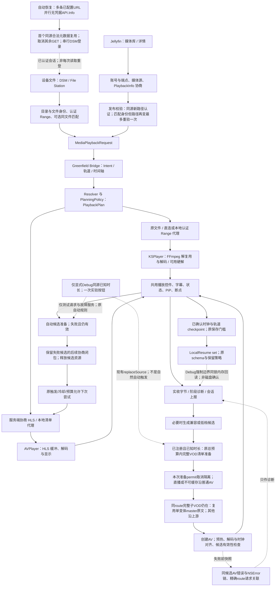

# 当前视频播放技术路线

2026-11-08 iOS 网络媒体库已接入共享原流代理。`NetworkLibraryPlayerPresentation`注册本次桥接地址并保留原始网络来源、文件扩展名和同一个播放 trace。取消或迟到结果回收代理 lease，正常关闭由 UIKit 播放呈现释放，PiP 最小化时持有。注册失败时使用原桥接地址。`WebDAVPlaybackSession`统一允许4个活动客户端，满额返回空体503。外层代理固定在本次桥接能力，续窗继续使用现有32MiB范围契约，HEAD结束时不续窗。桥接交付诊断标为`bridgeDelivery`，从源端吞吐估计中排除。真实远端网络仍由来源上下文识别。去桥接与可消费启动预读尚待实施。见 [阶段记录](../archive/handoffs/2026-11/CODEX-2026-11-08-NETWORK-SOURCES-SHARED-PROXY-PHASE1.md)。

2026-11-08 Codex接受共享代理Range前置修复（[当轮记录](../archive/handoffs/2026-11/CODEX-2026-11-08-RANGE-PREREQUISITE-AND-DEVICE-BASELINE.md)）：`DevicesView.swift/MediaRangePolicy`严格解析单范围，非法/多范围及Int64溢出不再替换为文件头；有界端点运算避免溢出。后缀范围先发有限`bytes=0-0`，验证206及精确Content-Range后在响应头阶段取消，再按总长度读取正确尾部；强ETag或Last-Modified可用时带If-Range，后续总长度变化拒绝。尾部超过32MiB沿既有连续响应串行续窗，非法请求本地416且不读上游。原始流响应校验窗口末端/Content-Length/identity编码，续窗异常终止已有响应。新建空白模拟器8项定向、5项补充（继承夹具时长修正后）及1项12次异常交换通过；正常Debug最终bb4d已冻结并保留安装13/Pad，627c实际片头基线不当最终包播放验收，真机范围以当轮记录为准。网络媒体库注册共享代理、桥接四连接、去桥接及真实字节预读仍待接入，不把本前置当这些功能已交付。

2026-11-01 [诊断隐私源码核对](../archive/handoffs/2026-11/2026-11-01-DIAGNOSTIC-PRIVACY-AND-PERSISTENCE.md)：DiagnosticLogStore.record → redactedDetails → DiagnosticLogEntry.detail → append/NSLog/原持久化队列；显示/exportLine走redactedDetail，与数据导出共用已知敏感文本规则，诊断不使用独立host启发式。表达式缓存；结构化计时/状态/追踪字段黄金值、18隔离store/entry/导出例及130报告工具例通过，未做真实播放/性能验收。entry结构、750ms/错误刷写/clear与播放生产时钟/路线/引擎/缓存保持，旧缓存原文未迁移；这不是旧数据静态安全或严格匿名验收。

2026-10-29 09时接受源码核对（离线候选）：[共用跳转执行](../archive/handoffs/2026-10/2026-10-29-SHARED-SEEK-COMMAND-EXECUTION.md)。NetworkMedia.PlaybackSeekCommandExecutor → GreenfieldKSPlayerRenderer.connectControls / GreenfieldVideoPlayerView.connectAVControls / TVKSPlaybackControls.seek / TVPlayerControlsModel.seek，四适配直接调用同一个完成执行器；isCurrent核原生身份及PlaybackSeekState.owns，拒绝旧/重复/离场回调，依序清待完成、恢复最新播放意图和刷新时钟。KS ready/seekable派发autoPlay=false，恢复读layer.wantsPlayback，未ready不写库待启动意图；原字幕/AV时间偏移保持。旧TV假原生红测复现暂停被捕获autoPlay覆盖，现转绿，非真机故障归因；库核心/性能参数未动。430输入一致，32模块/61TV过、移动33过1PiP跳过，双签名Debug/无签名Release编译及核签候选完成未安装。用户已恢复离线整合，NAS与真机仍暂停；原生渲染/预热/服务协商仍适配，0真实性能验收，不增114格P。

2026-10-29 08时源码核对：[共用seek与换源边界](../archive/handoffs/2026-10/2026-10-29-SHARED-SEEK-AND-HANDOFF-BOUNDARIES.md)。NetworkMedia.PlaybackSeekState → 移动GreenfieldPlaybackControls（两引擎）/TVPlayerControlsModel/TVKSPlaybackControls，实际接target/begin/complete/invalidate；手机既有duration−0.1秒边界成为TV相同规则，TVKS改读实际时钟，明确generation拒绝旧完成。PlaybackHandoffBoundary → 移动canReplacePlaybackSession及TVUnifiedPlaybackSession.replace/install，加载前/后核时间线，迟到候选走PlaybackSessionLifetime.discard，保原资源。原生派发、暂停预览/字幕、完整预热/兼容替换仍平台适配；KS底层autoPlay捕获仅待受控审查，未改核心。428输入、26/55全过、移动33过1PiP跳过，双Debug/无签名Release编译与签名候选核过，未安装/无真机或性能验收。

2026-10-29 07:40接受源码核对（离线候选，未真机验收）：[共用会话资源批](../archive/handoffs/2026-10/2026-10-29-SHARED-PLAYBACK-SESSION-LIFETIME.md)。同一个 NetworkMedia.PlaybackSessionLifetime<Resource> 已接 GreenfieldVideoPlayerModel.start/stop 与 TVUnifiedPlaybackSession.prepare/install/replace/stop；移动用 PreparedSession 保存当前 finishingPlan，TV用来源Resource的release及退役报告屏障。同步停止renderer后交所有权，再异步串行退役；迟到结果拒绝交付并独立释放。移动 GreenfieldVideoPlayerView.replaceSource 已移出DEBUG，实验UI/诊断仍DEBUG。全工程无引用的 TVPlaybackSession、TVNASPlaybackSession 与专属诊断源码已移除，电视来源只能进现有 TVUnifiedPlaybackView/Session；前文旧映射为历史。原生renderer/控制和移动预热／TV换源适配仍各自存在，不能称完整生命周期和性能策略全部同源。426输入、两端签名Debug/无签名Release编译过，18/54/15定向分别过，首测试夹具失败保留。新包未安装，用户Container Manager修复期间暂停NAS/真机，本批无播放/蜂窝/性能P；既有缓冲与验收缺口保留。

2026-10-29 07时核对：[TV未连接入口](../archive/handoffs/2026-10/2026-10-29-TV-DISCONNECTED-PAGES-AND-WIRELESS-UPDATE.md)新增 TVNASViews.TVStorageEntry → 既有 networkMediaLibraryView / NetworkMediaDestinations → TVNetworkLibraryPlayer → TVUnifiedPlaybackSession；DSM可选，仅影响FileStation来源可用性，不另建播放策略。TV最新版已保留数据安装并核普通首页与未连接UI，18最新版已无线安装但未启动；下述01时TV待装仅为历史阶段。内网DSM两步认证后仍通用失败，未取得实际登录资源证据；本批0播放/0蜂窝，不增加播放验收，完整renderer运行控制、Release与大文件性能仍待。

2026-10-29 当前源码接入（待真机验收）：[统一接入批](../archive/handoffs/2026-10/2026-10-28-UNIFIED-PLAYBACK-INTEGRATION.md)。移动 Jellyfin/设备文件/直连视频的 Greenfield 展示与来源桥已移出 DEBUG 限制，音频保留既有音频宿主；网络存储也进入同一 Greenfield 宿主。TV 三入口→TVPlaybackSourceAdapter→TVUnifiedPlaybackSession→直接引用同一 URLPlaybackSourceResolver/PlaybackSessionCoordinator/PlaybackPlanningPolicy，KS/AV 仅保留平台适配。两端续播使用同一 LocalPlaybackResumeStore；KS 的原缓冲/探测/seek/请求头配置已原值抽出 PlaybackKSOptionsPolicy，双方直接引用。完整 renderer 运行控制仍有平台适配，不能称完整生命周期已全部统一或 Release 真机交付。此前电视旧独立会话映射仅作历史，旧源码尚留、入口已改。当前424输入双端签名Debug/无签名Release均编译通过，13/Pad已保留数据安装普通Debug；13 WebDAV S19已见真实画面、暂停/继续与返回，缓冲仍在。TV当前仍423首版，遥控系统失败/未重登DSM，最新包待装；Release未签名安装或真机验收。不据编译或内部时钟增加性能 PASS。

2026-10-28[来源接线与证据复核](../archive/handoffs/2026-10/2026-10-28-PLAYBACK-SOURCE-CONTEXT-PRECHECK.md)：6.1修正存储与媒体→JF只传当前地址的问题，改交同一服务完整候选；普通Debug/13定向测试过，13保留数据更新/普通启动，JF入口有界等待未就绪，0播放/0切网，切网原失败待验。旧两窗目标字幕实际在约12秒提交；菜单失败/提前恢复不等功能失效，原失败保留。两条测试残留字幕书签已定向恢复、覆盖及普通启动后再核；419输入本批单行来源接线变化，核心未改、无新114格P，继续6.1。

2026-10-28[有限优选结论](../archive/handoffs/2026-10/2026-10-28-PLAYBACK-ROUTE-SELECTION.md)：6.1 Sol基于13当前普通Debug的S19约128.8GB Wi-Fi/4G及38.6GB H264/M2TS有限证据，选定设备文件/Jellyfin现有Greenfield共用核心，KS原流优先＋必要AV/HLS兼容，供各来源/三端统一；不宣称入口全面最快。18个窗口含失败/截止，音轨物理响应、字幕异步切换、同点续播及三端/Release仍有缺项。第二次NAS重启等待997秒后单次HEAD有响应，13再次同包覆盖/普通启动，JF代表格式入口未就绪不作播放失败；21:00自有媒体停止、原Wi-Fi实连/图标、工具设置恢复/会话清理已核。419源码零漂移、统一尚未实现、114格不增P；用户随后明确当前保持6.1，先收窄证据/改动/验收，仅关键核心优化任务就绪时再提示切Astra6（详见同批交接末节）。

2026-10-28[真机优选首窗](../archive/handoffs/2026-10/2026-10-28-PLAYBACK-ROUTE-SELECTION.md)：用户限定大体积/代表格式、有限优选由6.1 Sol执行；13最新普通包fresh覆盖/偏好同，S19已实测KS原流→自动12Mbps AV/HLS，不能按纯原流排名。首seek工具404、0有效seek/主动停止均保留。18:50用户报NAS死机，已停自有App/恢复设置/删自有会话，未切蜂窝；等约十分钟重启后先核服务，不密集重连。未改播放实现、无优胜/新114格P。

2026-10-28[播放链路统一准备](../archive/handoffs/2026-10/2026-10-28-PLAYBACK-UNIFICATION-PREPARATION.md)：核六条实际路线及历史对照限制，419源码零漂移；现有26项准备/取消/WebDAV边界测试独立重建通过，首次skip-build缺二进制失败保留。未改播放实现、未新装包或开始真机/蜂窝窗口，无性能优胜或新114格P。准备材料完成；真机对照与链路优选仍由6.1 Sol执行，优选后的核心修改/优化才提示切Astra6。

2026-10-28配置核对：[独立连接批](../archive/handoffs/2026-10/2026-10-28-SAVED-CONNECTIONS-AND-ATOMIC-EDITING.md)增加连接目录和library.connectionID，但播放器仍使用具体库精确address/root与该库Keychain记录；新关联字段不替代播放端点或凭据。连接参数事务先建立完整替换索引，再切换本机身份/清旧缓存；本批0播放，不扩大下文播放路线/呈现验收。

2026-10-28[共用准备执行与取消清理](../archive/handoffs/2026-10/2026-10-28-SHARED-PREPARATION-COORDINATOR.md)：PlaybackPreparationCoordinator实际接WebDAV双端/TV Jellyfin，统一初始执行、重复准入、当前性检查、迟到结果释放和当前错误；取消后的释放在独立未取消Task中执行且等待完成。65定向0失败、418输入双普通Debug，四机保留数据更新，18仅无线安装。13 WebDAV/TV两来源有限实播与正常返回已核，TV焦点Select暂停继续成立；Pad仅最新首页，旧416在播控制栏观察失败/主动停止保留，普通退出仍待。三机完整索引与原偏好同，无NAS写/114格新P；完整生命周期/FTP/SMB仍开放。

2026-10-28[共用播放准备](../archive/handoffs/2026-10/2026-10-28-SHARED-PLAYBACK-PREPARATION.md)：新增PlaybackPreparationGate并实际接WebDAV双端/TV Jellyfin，统一初始重复请求/取消迟到交付准入，源取消/释放仍由宿主负责。44＋14无重叠共58测试过，416输入双普通Debug/四机保留数据安装，18仅无线不启动；13 WebDAV与TV两来源同片名就绪后有限播放/正常退出已核。Pad3/10实帧成立但正常退出仍待，AX/驱动失败及主动停止均保留，最终首页/工具清理已核。三机149/3408/149索引完整JSON及原偏好同，无NAS写/114格新P；完整会话及FTP/SMB仍开放。 核对源码：NetworkLibraryPlaybackView.task/NetworkPlaybackOwner→PlaybackPreparationGate；TVPlaybackSession.prepare/stop→同一门禁。Range/AV/KS、来源协商与进度上报仍按下方既有映射，未统一完整生命周期。

2026-10-28[端点凭据与人物图片](../archive/handoffs/2026-10/2026-10-28-ENDPOINT-SCOPED-CREDITS.md)：修复多地址已有登录凭据不同而误拒补图，精确编号/每端点自身凭据。13/Pad/TV同片真实人物照均已实看，缺图仍占位；Pad/TV保留原生等待后编辑预填→取消回墙通过，旧误导航/超时保留。Pad3,408/TV149索引完整JSON同、原偏好同。414输入/双普通Debug/39定向0失败，四机保留数据安装，18仅无线安装不控制。0播放/0 NAS写，不增114格P，UX-08/09仍进行中，完整播放会话/FTP/SMB继续开放。

2026-10-27[修改文件夹与共用操作](../archive/handoffs/2026-10/2026-10-27-LIBRARY-FOLDER-EDIT-AND-SHARED-ACTIONS.md)：414输入/双普通Debug/39定向0失败；WebDAV默认海报墙、移除独有列表、Jellyfin与网络库共用更多/刷新，新增完整路径先扫描后事务替换。13真实错误保149→原路径验证约160秒成功/绝对源文件集合相同；Pad/TV菜单与预填编辑实图成立，但取消未验、即时AX失败保留。四机最新包保留数据安装，18按用户使用中限制只安装不启动。TV头像样本9真实/1占位，13指定影片仍占位需定位，不能关闭头像项。无NAS写/新播放P，完整会话/FTP/SMB仍开放。

2026-10-27[返回图片保留与无线更新](../archive/handoffs/2026-10/2026-10-27-ARTWORK-RETURN-STABILITY-AND-IPHONE18-UPDATE.md)：共用网络图片解码LRU/同索引资料保留、27定向过，411输入双普通Debug，TV/13/18已覆盖；18普通启动实图已核，Pad不可连接。TV有限播放返回成立但无完整瞬时闪烁证据；13外部前台中断/0播放，头像尚未接。播放会话与NAS只读规则不变，114格不增P；用户新截图的工具栏收拢/头像继续。

2026-10-27后续[网络库精简批](../archive/handoffs/2026-10/2026-10-27-COMPACT-LIBRARY-AND-CONSISTENT-CREDITS.md)仅改共用墙/详情/文件信息及按需NFO读取，播放传输、准备和AV/KS/桥生命周期未改，0新播放窗。完整会话收敛仍按上一接受映射继续，不将计划或新增UI组件当播放链已统一。

2026-10-27接受实现更新：[共用媒体展示批](../archive/handoffs/2026-10/2026-10-27-SHARED-MEDIA-PRESENTATION-AND-WIRELESS-UPDATE.md)。TV Jellyfin与WebDAV经同一TVPlaybackPresentation/TVPlaybackControlling展示，后者KSVideoPlayerSurface仅渲染；网络库准备仍是NetworkPlaybackOwner→WebDAVPlaybackSession→临时loopback→宿主，TV Jellyfin仍TVPlaybackSession→client.prepare/report/stopEncoding。移动网络入口仍MediaPlaybackRequest→greenfieldPlaybackCover，Jellyfin普通兼容BuiltInMediaPlayerView及DEBUG greenfield分支必须区分；未将DEBUG接口称Release交付。真实TV/13 MKV有限控制和正常退出成立，AV/KS解码与认证/Range路线未替换。完整准备/取消/代次/退出/续播生命周期尚未收敛到单一共同权威，下一迁移保留来源协商/凭据与引擎能力适配；三端信息与操作语义一致，仅必要触摸/遥控差异。下方带日期历史不覆盖此映射。

2026-10-27[音轨区分与iPad暂停跳转](../archive/handoffs/2026-10/2026-10-27-DISTINCT-AUDIO-TRACKS-AND-IPAD-PAUSED-SEEK.md)：TV与移动触控面板补音轨序号/源标题/当前选择，原ID及选择动作保持；TV/iPad真实WebDAV三轨切换恢复与普通退出实图成立。Pad另窗暂停18→33→18、保持暂停/实画变化、恢复播放及同PID退出有限成立，精确源帧/听音未验。399输入/双普通Debug；TV b2b3ea7…/27签名17:32:02覆盖，Pad最终cdd82a1…/30签名17:40:22覆盖，13未发现/18未动。原索引149/3408完整同、最近覆盖前偏好15/19同，会话恢复删除/TV自有Runner停/Pad原Runner保留；最终普通首页实看。30项14/5/11、114格不增P。 核对映射：TV KSVideoPlayerView.audioButton；移动LaunchpadView.audioTrackOptions/trackList和Greenfield触控覆盖；WebDAVMediaResource→本机Range桥→原播放器路线保持。

2026-10-27[TV音轨/字幕与源帧参照](../archive/handoffs/2026-10/2026-10-27-TV-WEBDAV-TRACK-MENUS-AND-FRAME-REFERENCE.md)：共享KS菜单补中文名称/当前值/稳定标识，字幕Off改关闭字幕。TV新普通Debug d7b97f0…/8cea50f…/399输入/27签名，16:52:12 fresh保留数据覆盖；真实保存WebDAV无搜索窗音轨5.1→立体声→恢复、字幕关→恢复、倍速菜单收起及两Menu同PID回详情有限成立，实图已看；听音/字幕完整性/精确seek未验。10MiB参照截止/165部分帧及低相关错配保留失败，未据此认定seek缺陷或通过。原149索引/15偏好同、会话设置恢复/Runner停；首收尾Home失败保留，后普通启动台实看。移动35f3bf8…仅构建/30签名未安装，Pad/13仍2deb、18离家未动。30项14/5/11、114格不增P。 核对源码映射：KSVideoPlayerView.audioButton与KSVideoPlayerViewBuilder.subtitleButton/playbackRateButton；NetworkLibraryPlaybackView→TVNetworkLibraryPlayer/KS及Range桥路线保持。

2026-10-27[TV截图干扰与真实返回对照](../archive/handoffs/2026-10/2026-10-27-TV-WEBDAV-SCREENSHOT-INTERFERENCE.md)：同一普通Debug包/真实WebDAV文件/无搜索路径，XCUIScreen A正常一次Menu返回→DVT截图B三次不返回→XCUIScreen C含暂停继续后一次正常返回，均核同正PID/实际图。支持截图方式相关的调试干扰，具体系统消费Menu机制未证，不把所有旧失败洗成工具问题。正式播放路线未改，仅DEBUG准备页替换夹具；TV d8e9df5…/27库fresh覆盖，最终普通启动台实看、149索引/15偏好同、自有会话/Runner/夹具清理，Pad/13/18未动。114格不增P、30项14/5/11保持。 核对映射保持NetworkLibraryPlaybackView→TVNetworkLibraryPlayer/KS与精确Range桥；本批改变的是DEBUG对照和验证方法。 后续同包XCUIScreen seek窗已见00:10→00:34→00:24及对应不同画面，控制层打开/隐藏后两次Menu正常回详情。读时钟包含自然播放和动作/取图开销，未匹配源帧，不当精确±15秒或性能验收。

2026-10-27[TV嵌套与本地返回对照](../archive/handoffs/2026-10/2026-10-27-TV-NESTED-AND-LOCAL-EXIT-CONTROLS.md)：仅扩展显式DEBUG隔离场景，14种条件/16窗一次Menu同正PID返回，含嵌套/全屏/合成隐藏/本机H264及视图建层；不能复现真实WebDAV，正式退出未修。首驱动异步误判/多发键两失败保留，已改等待dismiss与正AUT PID门槛。最终TV普通Debug df96adf…/27库15:23:50 fresh保留数据覆盖，15:32普通启动台/原149索引/15偏好同，自有会话/Runner/本机夹具已清；Pad/13/18未动。114格不增P、30项14/5/11保持。 源码映射仅NastartTVApp.DEBUG对照根/会话；正常NetworkLibraryPlaybackView→TVNetworkLibraryPlayer与KS/Range路线保持。

2026-10-27[TV WebDAV返回事件观察](../archive/handoffs/2026-10/2026-10-27-TV-WEBDAV-EXIT-EVENT-OBSERVATION.md)：实际事件日志中3次Menu未进入内外返回处理器；原生keyWindow/焦点存在，PlayPause后焦点到TVSlide。移动handler至最终方向处理后的候选无改善，临时观察及候选全部撤回，399源码与开工前同。最终普通Debug TVf14dbc7… fresh覆盖/普通首页，原149索引/15偏好同、自有Runner/会话/缓存清理；手机/Pad/18未动。TV退出未修，不增114格P；用户无TMDB产品建议为先稳定只读库/播放器，离线NFO/图兼容、在线补全商用许可单列。 本批未接受播放链变更；回退后Range/认证/解码/现有surface处理器恢复原映射，DEBUG原生焦点采样也已移除。以下为带日期历史。

2026-10-27[WebDAV承载与控制](../archive/handoffs/2026-10/2026-10-27-WEBDAV-PLAYBACK-HOST-AND-CONTROLS.md)：DVT两栈定位海报墙主线程重复分类，改actor按完整库快照后台投影/复用，移动接统一UIKit全屏承载及来源owner生命期。131模块测试/399输入/双普通Debug，移动2deb713…、TV984d999…。Pad真实NAS不同原生帧、显现控制/同PID普通返回，13缓冲后出图/同PID普通返回有限成立。TV3/10/30出帧但Menu/完成焦点失败，FocusState候选无改善已撤回；最终TV包按内层状态流程3次Menu仍未退出、原生主动停。18离家hands off；114格无新P、30项14/5/11。 接受映射：NetworkLibrariesModel.refresh → MediaCatalogCache actor → published catalogs → wall/series/season；NetworkLibraryPlayerPresentation → greenfieldPlaybackCover，NetworkPlaybackOwner明确close/最终释放时撤销桥。TV渲染与Range/认证/解码参数不改，失败焦点候选还原。以下是带日期历史。

2026-10-27[独立WebDAV直接播放首切片](../archive/handoffs/2026-10/2026-10-27-WEBDAV-DIRECT-PLAYBACK.md)接受映射：`WebDAVMediaResource`从精确已索引/选根内单文件及大小/强ETag或HTTP日期创建能力，有限≤1MiB GET/精确206及正文/版本校验；`WebDAVPlaybackSession`以随机loopback token提供连续已知长度200/206并按窗口续读，首窗校验后成功、中途失败关闭不完整body，stop撤销/取消；`NetworkLibraryPlaybackView`按库UUID取原Keychain登录并管理生命期。移动`LaunchpadMediaShortcuts`交既有Greenfield、TV`TVNetworkLibraryPlayer`复用KS设备文件渲染；凭据不进解码URL，不走DSM/Jellyfin回退。旧AuthenticatedMediaStreamProxy/HLS/AV/KS参数未改，旧元数据DAV操作默认无新响应校验。单个成员可选，ISO/原盘主片/分段串播、File Station索引、稳定续播/下一集/sidecar尚未接。399输入/129测试/双普通Debug；Pad合成MP4正常退出有限过，真实NAS MKV3/10/30不同画面但WDA查询超时后主动终止，普通退出与听音/帧时间/其余端未验。不是完整格式或Release验收，114格无新P。

2026-10-27[TV季集/空系列原生接续](../archive/handoffs/2026-10/2026-10-27-TV-SERIES-AND-EMPTY-CATALOG-NATIVE.md)补TV真实18文件两季的保存→剧→季→单集、本机编辑/恢复，Pad单集夹具移类后空季/空剧/恢复，无App源码或AV/KS/Range链修改、无视频GET。沿原普通Debug393输入/113既有测试，本批逐机fresh覆盖TV/Pad；原149/3,408库相同、临时库/服务已清。属于资料/导航有限验证，114播放格不增P；独立网络库播放/FTP/SMB及完整跨端边界仍未交付，历史控制超时保留。

2026-10-27[海报同端布局与季集](../archive/handoffs/2026-10/2026-10-27-POSTER-LAYOUT-PARITY-AND-SEASONS.md)：Jellyfin集/搜索与网络库共用实际窗口布局，手机3列、Pad竖4横5/上限960、TV沿既有密度5（支持3/4/5），标题/画布/间距对齐，TV按需搜索不自动弹键盘。113测试/393输入/双普通Debug，移动fa4c98…、TV831f47…，三机fresh覆盖/普通启动及配对截图；13真实18文件两季→单集详情已过，临时库已移除。TV季集保存/上层导航控制未验，保留失败不盲调。最终原索引Pad3,408、13/TV各149完整同；TV仅catalog Data字节差但JSON同，密度/其他偏好同。18离家hands off，无独立库播放/FTP/SMB交付或114格新P，30项14/5/11保持。

2026-10-27[分类与剧集层级](../archive/handoffs/2026-10/2026-10-27-MEDIA-CATEGORIES-AND-SERIES-HIERARCHY.md)：电影/电视剧/动漫/待分类、剧名→季→集、选根内tvshow.nfo/总海报与单集-thumb分离、本机类型/季集纠正展示已接；TV同页选目录显式焦点修复。最终111模块测试/391输入/双普通Debug，移动fa423b…、TVa62980…，Pad/13/TV fresh覆盖及空启动/19、26、14偏好同。Pad真实3,408文件/178作品/59剧目录/56总海报路径/2,308图片路径，三层和样本图片实看；13/TV实际认证/指定子目录149文件完成，最终保存库分别8/6张可见海报。2,308仅索引，不是全部图已看。TV/13剧集层级、本机纠错原生专项及全主题仍待；无NAS写/独立库播放/FTP或SMB交付，18离家hands off；30项14/5/11、114格不增P。

2026-10-27[海报升级与逻辑影片](../archive/handoffs/2026-10/2026-10-27-POSTER-UPGRADE-AND-LOGICAL-MOVIES.md)：Pad自有夹具复现旧库自动补图0/手动2，修根页push取消；新增原盘/保守CD分段及附加视频展示投影、选根内电影目录已有NFO/图片继承，物理文件保留。100测试/388输入/双普通Debug过，移动280b18…、TVb53fe5…；Pad/13/TV fresh覆盖及普通启动、19/26/14偏好同，18离家仍4e包hands off。留存149文件离线投影112主卡＋1附加、2原盘含22/16流，真实NAS封面未验收。Pad新包夹具实看4图/5主卡＋1附加、8文件列表全保留；旧schema自动升2/6物理图片引用，不再手动整理，源同/0媒体写/库移除/停服。三机无已保存WebDAV，真实NAS需连接信息，13/TV针对性回归继续；30项14/5/11与114格保持。

2026-10-27只读图片首片：[本批](../archive/handoffs/2026-10/2026-10-27-OFFLINE-ARTWORK-AND-CONTROL-AUDIT.md)仅改网络库本地海报/NFO呈现及受限图片GET/FileStation只读download，没有视频Range/AV/KS/音字幕链变化。93测试/双普通包/18紧急安装成立，真实海报与分组用户报告失败，未作播放或海报真机验收、不加114格P。13旧包scene-update watchdog另记，不因主动安装重启干扰抹去。

2026-10-27方向策略核对：[iPad退出方向与FTP路径批](../archive/handoffs/2026-10/2026-10-27-IPAD-EXIT-ORIENTATION-FTP-PATH.md)接受`NastartApp.swift → PlayerOrientationController.setPlayerActive(false)`按设备恢复默认方向：iPad `.all`且不请求强制几何，iPhone仍portrait。普通97da576e…包Pad S01横屏续播3/10秒实图、完成回同详情及1180×820窗口保持已核，守卫未强停；最终a34a6a…包该源码哈希相同，只追加尚未接传输/UI的FTPPath，逐机正常首页另验。TV935d2e…；18最终无线Complete/lookup但锁屏启动待验。AV/KS/Range/音字幕协商未改，不扩大到全部方向/分屏、听音/完整字幕/逐帧或新增114格P。

2026-10-27认证分类修复：WebDAV的Basic/Digest无凭据/重试被拒时，取消挑战前保留HTTP401，修正Foundation返回URL取消（实见-999）造成的误导。真实目录/NFO两新增测试先4断言失败，修复后75项0失败；双普通Debug并逐机覆盖，18实际无线安装/lookup/正常首页与27偏好保持成立。仅只读目录/NFO错误语义改变，凭据origin/证书/跳转和AV/KS播放链不变，S01有限播放证据仍标前包、不新增114格P。详[iPad接回批](../archive/handoffs/2026-10/2026-10-27-IPAD-RECONNECTED-WIRELESS-IPHONE18.md)。

2026-10-26 核对：本批AV/KS引擎与播放路由未改；Jellyfin首页书架按实际宽度排完整卡片。iOS `Info.plist` 为用户自填完整域名HTTP来源启用 `NSAllowsArbitraryLoads`，移除会覆盖该值的 `NSAllowsLocalNetworking`；默认新连接仍HTTPS、TLS系统证书验证及WebDAV精确端点/不转发跳转凭据逻辑保持。tvOS原先同策略未改。此全App网络策略会影响HTTP媒体来源允许性，但本批只读目录/界面调试，无HTTP视频、蜂窝、首帧或Release呈现验收，不增加播放PASS；详[跨端与WebDAV批](../archive/handoffs/2026-10/2026-10-26-CROSS-PLATFORM-CARD-RULES-WEBDAV.md)。

2026-10-25原轨阶段：[TV源目录与候选接手](../archive/handoffs/2026-10/2026-10-25-TV-SOURCE-TRACK-CATALOG-AND-HANDOFF.md)已接 TVModels.TVSourceTrack/Selection→TVJellyfinClient 固定源/索引协商→TVPlaybackSession 世代/意图快照→暂停候选ready/绝对seek→AVPlayer接手与旧会话清理。47逻辑＋11UI完整通过，S01换流与S03同cue ASS有限验证；S03内部接手19.508秒，PGS实际切换/听音/全格式仍待验。文件KS/移动Range与完整Intent未统一，28/114保持。

2026-10-25核对：[TV详情语义入口批](../archive/handoffs/2026-10/2026-10-25-TV-DETAIL-ENTRY-FOCUS-COMMITS.md)仅改TVViews详情焦点：userInitiated默认区域入口、小型横排真实挂载与Down首项；DEBUG原生焦点轨迹替代仅最终落点断言。TVPlaybackSession/文件KS稳定路线及移动Intent/Range/缓冲/原始音字幕协商均未改，0媒体，不当新播放路线或Release验收；原28开放/114格保持。

2026-10-25 20:32：TV按完整顺序改显式焦点及横排记忆，最终40逻辑＋7无媒体UI、真机44逐键闭环通过；旧跨区可达不足及两候选/错API顺序夹具失败保留。iPad横竖hero/图内圆点/完整参数已优化，首版横屏标题裁切经实图发现并修；最终普通移动包已13/Pad逐机保留数据安装与实图/返回核对，源510/570零漂移。TV自有Runner停；Pad仅自有HTTP会话已删除/原方向设置恢复，未知Runner保留，13未知Runner不改。0媒体/蜂窝，28/114保持。

实际接受映射：TVDetailView/TVMediaShelf/TVPersonCard明确焦点目标及确认后的横排记忆；移动LaunchpadView的JellyfinHeroCarousel/HeroSlide同画布与JellyfinMetadataFlow自然宽。固定AV/KS、Range/缓冲/音字幕协商未改；本批为详情导航/布局，不关闭原矩阵。

2026-10-25 19:45：TV首演员Up空间缺口已补焦点区域，普通新包9896b4c9/27签名19:30保留数据安装；40逻辑＋6无媒体UI、真机详情31方向与四根页/子页32检查完成。包括首/末演员Up及相似区上下，非所有动态界面/帧时间验收。两次自有Runner停/设置恢复，TV偏好与上一批末0变化，手机0操作。18条海报抽样确认源分辨率不一；白夜旧500×750但提供方可取中文1200×1800，实际图片下载解码通过，高清补全尚未接入产品。28开放／114格保持。

接受实现映射：TVViews.TVDetailView/TVMediaShelf及TVNASViews偏移操作组focusSection，原网格最小揭示不改；DEBUG内存夹具仅测试。高清图片仍原Jellyfin展示路线，候选可用不当产品已接入；解码/Range/缓冲/音字幕协商未改。

2026-10-25 19:20：三端详情精修已用普通新包逐机实看；共用海报/元数据格式、手机续播与重播同行、分类优先实际背景图。TV40逻辑＋5无媒体UI过；真实网格23次方向核对与最小滚动有证据，非帧时间验收。Pad黑屏经唤醒恢复、原因未知，最终详情和返回实看；自有Runner/设置已收尾。新报首个演员Up失效，当前继续全局方向键审查；新增高清海报/独立刮削调研。28开放／114格保持，未改播放传输，源音字幕切换及原弱蜂窝问题仍开放。

源码映射：AppTheme.MediaDetailDesign/NastartMediaFact共同格式与样式；LaunchpadView.Jellyfin详情/TVViews.TVDetailView只读展示，TVModels.TVDetailStream解码来源参数，TVJellyfinClient.libraryArtwork只读背景图。固定AV/KS解码、Range、缓冲及选流未改，40＋5不替代实播矩阵。

2026-10-25 15:39实际接受/源码映射：[TV层级与遥控器批](../archive/handoffs/2026-10/2026-10-25-TV-CONTEXT-NAVIGATION-AND-REMOTE.md)沿TVDetailView→owning cover→TVPlayerView/TVPlaybackSession→TVNativePlayer→固定TVAVVideoSurface/AVPlayerLayer，onExit先面板后finish/stop不变；TVNativePlayer去顶X/静音、音轨菜单静音备用，TVPlaybackTimeline＋label-only TVPlaybackTimelineStyle显示滑块焦点。TVHomeView→TVRootNavigationShell根生命周期控制Tab，子层NavigationLink/Back保持原父层。PlaybackControlDesign.restartSymbol由三端详情共用。字幕矩形、解码/协商/20Mbps H2641080/Range/缓冲/40秒不变。S01有限实际出画及退出、38逻辑＋5UI已核；蜘蛛侠3仍准备/旧Menu失败不改写，完整播放/Release验收未完成。

2026-10-25 15:04：[源轨身份、播放意图与诊断校正](../archive/handoffs/2026-10/2026-10-25-SEEK-PHASE-AND-TRANSPORT-SCOPE.md)完成：旧late metrics 144项62归属误标已按发出记录校正；共享UI丢绝对源音轨/字幕ID及sidecar导致文件HLS准备拒绝已修，缓冲actual=false误当用户暂停已改读取AV/KS真实意图。9/10/12三组定向分别过（不相加成全量）；普通a4477a45最新保留数据装13/Pad、570输入/30签名/安装偏好0变化。13真实早期+15已HLS重建并startsPaused=false、实际继续电影/内部推进162秒/普通返回；三窗均停自有媒体和syslog、原网Selected＋Wi-Fi图核，其他偏好保持。完整声音/帧时间/格式族/并发、KS长等待与持续几KB仍开放，28/114不关闭。TV新增KS只读接口未重建，不以11:14旧包当当前源码回归。 实际接线：SharedBuiltInPlayerView→MediaPlaybackRequest.runtimeStateForSourceChange→文件HLS requestForVerifiedRuntime/verifiedTracks；GreenfieldVideoPlayerView.replaceSource→controls.wantsPlayback→AV avWantsPlayback/KSPlayerLayer只读wantsPlayback；finish后selectedTransportScope不清除。没有修改Range/码率/缓存/40秒；当前是局部实际修复，非全播放路线已共享。

2026-10-25 13:25：[蜂窝大文件与受限连接复用](../archive/handoffs/2026-10/2026-10-25-CELLULAR-FILE-SEEK-TRANSPORT.md)完成8定向测试，普通Debug主SHA f453254b已保留数据装13/Pad（12:51/13:02，570输入/30签名、安装偏好0变化）。13真实4G两轮文件各40次seek，pinnedRoute分别18/3条连接复用；末正/反内部恢复AV 9832/1451、KS 6009/9443ms，JF新包±15为1543/733ms，起点/轨道/路线不同不排名，持续几KB/s尚未稳定复现。受限pool只同route/origin、沿原CertificatePinStore策略，单任务取消/路线撤销隔离；KS一窗引擎确认4040ms、缓存就绪9186ms，网络/解码尚非单一根因。两机S01双入口实图/普通返回已核，Pad浮窗呈现仍缺；每窗自有媒体停/原网Selected＋Wi-Fi图核，Pad Runner已停、13未知Runner未改。非Release/全格式/并发/音听/帧时间验收，28开放/114格保持。 实际源码映射：AuthenticatedMediaRangeProxy.Route注册→PlaybackPinnedRouteTransport同origin URLSession；AuthenticatedMediaProxyTransfer.start/startUpstreamTask按pinnedRoute/systemShared/isolated取transport、各task.delegate继续独立；Route unregister/expiry只invalidate自身pool。现为已安装局部验证候选，未改变Range/缓冲/40秒/选流/码率或TV路线。核对2026-10-25。

2026-10-25 11:20：[播放控制与同款动作](../archive/handoffs/2026-10/2026-10-25-TV-TRANSPORT-PARITY-AND-MEDIA-ACTIONS.md)实际接受映射：TVDetailView owning cover→TVPlayerView/TVPlaybackSession→TVNativePlayer/TVAVVideoSurface→固定AVPlayerLayer；TVPlayerControlsModel观察AV/有限seek，pendingSeek累加目标、seekGeneration隔离旧完成回调；onExit先面板后finish/stop。局部UIKit responder失败已移除。解码/20Mbps H2641080/Range/缓冲/40秒未改，完整Intent/Plan/Route/会话仍独立。共用15秒/倍速/圆形控制及继续/从头同款按钮，TV JF固定AVPlayerLayer＋应用菜单；当前普通新包37逻辑＋4严格无媒体UI通过。实际S01 11次回退165秒准确，同cue菜单前/开/后字幕bbox一致/实图已看，菜单上移此场景修复；两级返回同PID稳定。本轮完整音轨/字幕/声音/帧时间和TV文件控制仍待验，保留旧失败；原10偏好不变/设置GET恢复/自有Runner已停。13与新Pad已装同一最新移动包，Pad重连及设备旧清理已核，18外出暂缓。28开放／114格不关闭。

2026-10-25 09:30实际路线核对：[本批源码与证据](../archive/handoffs/2026-10/2026-10-25-SHARED-DESIGN-AND-TAB-FOCUS.md)TVDetailView.fullScreenCover→TVPlayerView(onClose owning playback=nil)→TVNativePlayer.Coordinator.requestFinish（幂等、复制finish强持有至下轮主队列）→host close/stop。这是当前关闭候选接线，未通过稳定实播退出验收：S01/JF 3/10秒原生出画，第一次Menu仍影片、第二次瞬时详情，同PID；后续详情返回时再次出现播放器，已主动终止自有媒体并正常重开首页。35逻辑/3无媒体UI不能替代此失败；无Release、完整SUB/AUD或帧时间结论。TV文件KS退出原实现保持；本批未改选流/20Mbps H2641080配置、解码、Range/缓冲/40秒。共享AppTheme/主次按钮只影响内容UI，TV子页面去重复返回栏但保留onExitCommand/dismiss，播放器生命周期问题另列。

2026-10-25 07:15接受[作者位图坐标共享](../archive/handoffs/2026-10/2026-10-25-AUTHORED-BITMAP-AND-DEVICE-REFRESH.md)：KS SubtitleDecode标记作者画布位图→SubtitlePart.imageDisplayFrame→SubtitleViewportGeometry.videoFrame/imageRect→同源SubtitleBitmapLayer分别被移动GreenfieldSubtitleOverlay与TV KS VideoSubtitleViewport调用。先映射origin/size后裁切，零点有效，旧未定位图片/文字保持原流且排除定位图片，模型直接观察避免clear残留。13移动定向＋TV35逻辑/2无媒体UI通过；真实作者cue未验，13两窗输入超时/迟到内部事件不作呈现验收，Pad0播放。TV系统AV/烧录、ASS作者排版及完整Intent/Plan/Route/会话仍独立；未改解码队列、Range或缓冲阈值。

2026-10-25 05:23接受[共用字幕视频区域](../archive/handoffs/2026-10/2026-10-25-SHARED-SUBTITLE-GEOMETRY.md)：移动PlaybackSubtitleViewportPolicy为KS SubtitleViewportGeometry别名，原Greenfield/外置布局沿同源规则；TV文件KSVideoPlayerView的VideoSubtitleViewport独立观察timeModel/引擎尺寸与fit/fill，实际调用相同videoRect。父State初版真片返回失败已替换；最终S03/S01返回与停止均核。仅矩形共享，TV字号/边距、ASS/位图origin、AV系统/烧录、编码黑边仍独立/未修；当前普通TV包及手机尚未新装边界见归档，Release仅编译，不改Range/解码/选流/40秒。

2026-10-25 05:00接受[TV视频焦点返回](../archive/handoffs/2026-10/2026-10-25-TV-EXIT-EVENT-PROBE.md)：`KSVideoPlayerView.playView`在tvOS焦点surface注册onExitCommand，与root共用handleTVExit原分支；TVNASPlayerView.onDisappear沿原session.stop/reset清理。观察版实片Menu无exit，而改后S03/S01各1次Menu回原目录/同PID、surface exit及stop.finished已核。DEBUG有界trace/无媒体夹具不进入Release；Release仅编译通过、完整播放与字幕三端契约未统一。前批已回退方案保持历史，不接受callback/window手势；解码/字幕布局/选路/Range/缓冲阈值未改。

2026-10-25 03:22核对：[TV返回两轮实验已回退](../archive/handoffs/2026-10/2026-10-25-TV-PLAYER-EXIT-INVESTIGATION.md)。候选onExit/直接fullScreenCover绑定及原生Menu手势都未获普通返回实图，不能写成接受路线；TVNASViews与KSVideoPlayerView逐字节恢复原实现，稳定508输入重建/保留数据安装，正常首页及无媒体网络页Menu返回已核。没有接受字幕/选路/解码/Range/40秒变更；两窗主动终止而非普通退出，真实失败/作者定位与三端共享契约继续开放。

2026-10-24 23:51核对：[三端代码映射](CROSS_PLATFORM_CODE_CONSISTENCY.md)及[本批现场](../archive/handoffs/2026-10/2026-10-24-CODE-AUDIT-AND-SERVICE-HEALTH.md)明确移动设备文件/JF沿Intent→Plan/Route→Greenfield/代理生命周期；TV文件是TVNASFiles→FileStation download URL→KSVideoPlayerView，TVJF是TVJellyfinClient.playbackProfile→TVPlaybackSession/AVPlayer。共用KS/FFmpeg并非共享全链路；TV20Mbps/H2641080p配置仍原样。移动字幕视频矩形/作者定位与TV整屏/系统烧录存在分叉，本批未修改字幕/选流/解码/Range/40秒。移动仅连接后健康检查立即触发/逐项发表，最新13/Pad普通包已装，157执行/1跳过/0失败；不是播放/Release验收。TV同22:40包23:10 MKV实图推进，但三次Menu后仍播放；已主动终止/清理并正常重开首页，普通退出失败尚未修复，不能用内部时钟或强杀当呈现/返回验收。

2026-10-24 21:38接受[三端主题/媒体入口](../archive/handoffs/2026-10/2026-10-24-GLOBAL-THEMES-AND-MEDIA-ENTRY.md)：移动DeviceSummaryPanel内快捷卡沿原FileBrowserView与MediaLibraryRouter，JF排除developerConsole；TV沿TVNASFiles/TVJellyfinEntry。统计只读根共享目录及JF Limit=0 Movie总数，不触发播放/转码、不下载影片。主题画布与卡片覆盖内容页面，系统播放内容不着色。解码、Range、自动选路/候选、40秒/缓冲及TV既有20Mbps H264配置均未改；本批0媒体、非播放/Release验收。

2026-10-24 12:00实际证据路线核对：[原生静置/AX/切换对照](../archive/handoffs/2026-10/2026-10-24-HOME-INDICATOR-CONTROLS.md)沿10:57实现，无源码/构建/新测试；13同包本地KS与真实本地KS→AV均静置隐藏横条，AX轮询也未复现常驻，不根据未证child委托/系统覆盖层假设改产品。真实PGS新窗仅原流两图横条隐藏，单次候选点击无应用回调/预热/提交，不当候选已验或40秒失败；旧遮挡保持。接受实现/流程映射沿11:05，下一步实际命中证据而非盲改缓冲/画布。

2026-10-24 11:05接受Debug证据路线：NastartApp.swift的PlaybackLabPlayerView通过PlaybackLabGreenfieldPresentation调用普通greenfieldPlaybackCover，沿GreenfieldPlaybackPresenter/GreenfieldPlaybackHostingController全屏/关闭/PiP所有权，不再NavigationStack直嵌；首次呈现标记避免关闭后重弹，底页覆盖不提前释放代理，实际stop负责资源。20定向（含真实UIKit呈现/释放、DSM和解码）通过，10:57普通包已13安装/正常首页及S19手动候选。7原生图Home横条仍在、30秒英文仍被覆盖，承载统一不是字幕修复；AV采样stall0不当完整呈现，原流转圈保持。普通产品路线/Release、NAS地址/缓冲/Range/40秒未改。详[本批](../archive/handoffs/2026-10/2026-10-24-LAB-FULLSCREEN-PARITY.md)；下方10:05旧诊断根描述按历史源码理解。

2026-10-24本批离线核对：09:23旧包PGS候选英文底行与Home横条重叠，Debug根直接NavigationStack/播放器，普通GreenfieldPlaybackPresenter的host已有隐藏横条策略；无承载实现变更或正常同cue验收，不将烧录字幕当文本样式调整，后续候选证据先统一承载。

2026-10-24 10:05认证入口核对：[固定DSM地址](../archive/handoffs/2026-10/2026-10-24-DSM-FIXED-ADDRESS.md)在AppStateStores的StoredNASCredential保存usesOnlyConfiguredAddress，restoreDSMConnection开启时仅配置baseURL准备/认证并禁止发现LAN认证回退，finishDSMConnection保留标记；LaunchpadConnectionViews提供开关/记忆。旧记录默认false。DSM卡片来自session.baseURL；可选视频LAN选路及Jellyfin外网认证回退独立，现有DSM会话前台刷新不等同网络切换后迁移。19定向通过，09:48普通包13/Pad安装/正常首页核过，18未装/未启用，本批0媒体，不能称Release或蜂窝/域名真机交付。播放解码/切换路线沿09:40接受实现。

2026-10-24 09:40核对：`GreenfieldAVPlayerWarmup.prepare`仅DEBUG成功保留其已解码`AVPlayerItemVideoOutput`，`installPlayerItem`接手复用同一输出；失败/取消释放、Release原移除保持，未改等待/forward/连续储备/40秒/Range/NAS/自动路线。实际解码/接手/后续帧回归先失败再通过，10定向正式成功；09:23包13/S19显式手动窗配置边界均output1/empty=no、评估等待67ms及后续原生画面，原流多次转圈/字幕底部重叠保留，非普通自动/Release/流畅验收或供给不同提速A/B。详[本批归档](../archive/handoffs/2026-10/2026-10-24-HANDOFF-OUTPUT-AND-DSM-ROUTES.md)。

2026-10-24 08:52核对：[手动Debug深起播修正](../archive/handoffs/2026-10/2026-10-24-MANUAL-LAB-DEEP-RESUME.md)仅让PlaybackLabLaunchRequest.makeRequest在同源/有限时长手动配置准入后给原流携带totalDurationSeconds，GreenfieldPlaybackBridge原比例→绝对起点路线不变；7定向XCTest/15预检，08:37普通Debug已13/Pad保留数据更新。13实际4000.148秒原流→12Mbps真实NAS候选22.826秒事件间提交/末1:07:38已看，接手后内部waiting990ms保留，非普通自然自动或完整无感验收。原流/候选生产流程、40秒、就绪储备、Range、NAS及Release路线均未改；Debug时长与手动按钮不能写成Release能力或旧失败已修。

2026-10-24 07:49实际路线核对：[真实NAS手动候选](../archive/handoffs/2026-10/2026-10-24-REAL-NAS-CANDIDATE-HANDOFF.md)沿既有显式Debug→replaceSource→完整VOD预热→AV解码/对齐/提交，13/S03/S19真实原片KS并行准备成功；无实现/流程/源码映射改变，接受实现仍06:31。2Mbps从头/提前私有协商不代表普通自动、深位置或Release验收；S19 empty计数含playing且时钟推进，不据此盲改AV等待/缓冲。

2026-10-24 07:28实际路线核对：本批[真实NAS/格式证据](../archive/handoffs/2026-10/2026-10-24-REAL-HLS-AND-FORMAT-REGRESSION.md)无实现、流程或源码映射变更，接受实现沿下述06:31。13/S03、S19实时协议协商2Mbps H264/AAC/PGS Encode，经既有显式Debug proxy/prewarm/AV各见master/media1上游+1缓存命中及实际电影/字幕；不是普通入口/自然候选/原流并行或Release验收，内部first_frame12.191/4.922秒不当显示首帧或配对收益。S03首片等头仍10.363秒，40.005秒alignment失败/7300ms继续开放。普通四格式有限KS回归及S18片源短转场核对不改变引擎/布局实现。lab根NavigationStack直接承载GreenfieldVideoPlayerView，与普通GreenfieldPlaybackHostingController的Home指示条隐藏不同，lab英文遮挡不外推普通全屏回归。

2026-10-24 06:31接受[单变体VOD主清单复用](../archive/handoffs/2026-10/2026-10-24-VOD-MASTER-REUSE.md)实现：PlaybackVODPlaylistCache仅在同route/完整URL的子VOD条目仍在时返回单变体master原文，子条目逐出后父条目立即不可读；同容量上限，沿原鉴权/会话query继承、URI及当前seek重写。多变体/独立音字幕/key/未知EXT/跨origin等不复用，直播沿原路。不改分片、Range、预算/40秒/解码或NAS。45 XCTest/15预检通过，06:20普通Debug已保留数据安装13/Pad并核正常首页和S01双入口有限基线；13实际本地AV窗master/media各1次上游并各命中1次、不同画面已看。Pad文件3秒黑场转圈与末stall1保留；18未更新。尚非Release或真实NAS/PGS性能验收。旧条目“master再请求”按其历史构建理解，流程/源码映射同步如下。

2026-10-24 05:24接受仅Debug的[自动重试本地验证入口](../archive/handoffs/2026-10/2026-10-24-AUTOMATIC-RETRY-DEVICE-LAB.md)：PlaybackLabLaunchRequest显式AUTOMATIC_RETRY、同源有限HLS、互斥手动候选/代理预热，给测试原流与候选接入真实码率规则/trace后续loader。原自动采样/触发/冷却/预算、失败上下文隔离、40秒/就绪/释放未改；fixture制造503和供给条件，未注入capacity或强制请求。40 XCTest/15预检通过，05:05普通Debug安装13；本地实际自动20→8Mbps首候选失败后，从失败候选trace继续8→4Mbps并提交，取消窗无第二协商/提交且上游连接关闭。8/4仅协商上限、同一预编码H264/AAC，证明接线，非真实编码质量/NAS/PGS或Release性能。普通空环境关闭/Release不编译；S01/JF普通30秒基线与环境恢复已核。下方旧批“重试尚未触发”为历史范围，真实PGS40.005秒失败及7300ms仍开放。流程/源码映射同步如下。

2026-10-24 00:30接受源码修正核对（37项定向/15预检通过，三台本包已安装，13/Pad有限普通回归完成；真实重试分支尚未触发）：自动候选未提交而准备失败时，`PlaybackFailedCandidateRetry`仅保存该候选的`compatibilityFallbackRequestLoader`；下一次尝试沿其自身码率上限及trace供给协商，避免仍用原流闭包重复12Mbps。仅在取消/seek/PiP/轨道与待切源校验通过后记录；源UUID和独立ticket隔离旧结果，预测恢复撤回ticket，不保存候选播放器/tracker。原资源释放、两次实际尝试/最多两次恢复退回、冷却、40秒总限和提交门槛保持。详[修正与验证](../archive/handoffs/2026-10/2026-10-24-FAILED-CANDIDATE-RETRY.md)，不等于真实PGS或Release性能验收。

2026-10-23 23:40仅[供给边界验证](../archive/handoffs/2026-10/2026-10-23-NATURAL-CANDIDATE-TRANSFER-AUDIT.md)，无实现/流程/源码映射变更：既有GreenfieldAVPlayerWarmup在后续已缓冲范围充足时走PlaybackBufferedHandoffSeekPolicy追赶并提交；低原流储备、候选持续供给受限时按原总截止/原就绪门槛失败保留旧播放器。真实清单后到解码事件包含等头及正文，不是CPU解码计时；同一输出的两消费者读取不当两次转码。合成控制不等于真实NAS/Release交付，未改40秒、缓冲、对齐、Range或信任策略。

2026-10-23 23:10路线核对：[本轮证据](../archive/handoffs/2026-10/2026-10-23-KS-AV-S01-AND-PAD-UPDATE.md)无App修改，实际实现/流程/源码映射沿21:48。Debug合成连续H.264/AAC MKV明确KS原流→AV/HLS候选，经现有replaceSource/prepareManifest/prepare/decodedFrameAndClock提交（清单183ms、对齐5151ms）；不扩大为Release/NAS/HEVC/TrueHD/PGS或无感音画。正常S03自然策略另有attempt1，清单12.059秒、解码34.323秒落后19.041秒，40.005秒alignment失败未提交，证明真实候选成本仍是开放问题，旧7300ms再缓冲未修。13/S01两入口实际图/普通退出只属局部基线；三台当前包安装/普通首页已核、Pad媒体未做。既有40秒总预算/失败保留旧播放器/取消隔离/缓冲/Range/信任均未变。

2026-10-23 22:31追加同包本地总预算反例：候选清单32.433秒准备、33.083秒解码，40.008秒alignment阶段deadlineRemaining=0，未对齐/未提交且保留原流；末图Original Lab/00:49，稀疏黑场图不当连续呈现或声音验收。22:29:38全部实验资源停止，22:30:23–31恢复空环境正常NAS首页，22:30:59源包/25完整偏好两读全同/WDA1/1/auto10/2/Home Wi-Fi/host0独立核完。仅本地显式Debug控制，不改App/包或真实7300ms再缓冲结论；18安装与首页已完成。

2026-10-23 22:20接受Debug验证入口及[有限本地真机证据](../archive/handoffs/2026-10/2026-10-23-CANDIDATE-DEVICE-LAB-AND-IPHONE18.md)：PlaybackLabLaunchRequest要求显式开关/greenfield/同源HTTP(S)/候选m3u8/有限时长，冷注册不取流；GreenfieldVideoPlayerView单次按钮调用现有replaceSource，不改变自动规则。普通空环境隐藏、Release不编译。20方法正常通过/15预检，21:48包13/18均保留数据安装并实图核普通NAS在线首页；13手动快/慢AV到AV候选分别11.463/36.473秒对齐并提交（慢清单25.550秒），取消清单阶段10.710秒失败/未提交、上游结束。仅重复短TS/局部图与内部时钟，不当真实KS/PGS切换、无感性能或Release；真实7300ms再缓冲仍失败。流程/源码映射同步如下，21:48为最新，旧18未装/首页暂缓仅历史。

2026-10-23 21:29追加同包13/S03/JF普通KS窗：实际3/10秒转圈、内部7300ms再缓冲，90策略决策attempt0、无候选准备/提交；只补正常路径及当前失败，不改下述实现或认定候选真机验收，详同批归档。

2026-10-23 21:20接受[候选完整VOD准备与取消隔离](../archive/handoffs/2026-10/2026-10-23-CANDIDATE-VOD-PREPARATION.md)：GreenfieldAVPlayerWarmup在创建AV item前，为已注册/已知有限时长清单执行既有完整VOD文本预热；纳入原40秒HLS总预算，候选失效/取消/过期只取消本次准备拥有的上游transfer，不影响同route独立读取者、其他路线或原播放器。直播/不可缓存沿普通AV，媒体分片/解码/对齐/提交仍后置。18定向/共享XCTest正常通过、15预检/141报告测试通过；20:53普通Debug已安装13且S01双入口正常KS基线实图已核，但未触发该候选，慢清单真机接手与旧6400ms再缓冲未验/未修。生产共用源码改变，仅Debug构建/验证，非Release交付。流程及源码映射同步如下；下述“未改App/18:00保持”均各旧批历史。

2026-10-23 20:13仅[自动策略规则核对](../archive/handoffs/2026-10/2026-10-23-IPHONE13-ADAPTATION-GATE-AUDIT.md)：实际PlaybackStallDownshiftPolicy为10秒保护、不在保护内累计，之后连续8秒/三次短stall/累计12秒；PlaybackPredictiveGracePolicy初始qualified body可3秒后放行，仍需非buffering/推进及各预测条件。本窗没有自动请求，62次实际Swift重放仅事件时钟近似一致性，不改策略或交付性能优化。主机报告补predictiveDeliveryCapacity，128测试通过；18:00普通App/174输入保持，最后13真机现场仍19:29。

2026-10-23 19:35仅[离线口径与现场核对](../archive/handoffs/2026-10/2026-10-23-IPHONE13-WAIT-ANALYSIS-AND-LIVE.md)：未改App/路线/18:00普通包。主机reserve报告按trace/plan/请求generation/local epoch及样本单调时钟拆等待，矛盾保持未知；seek报告把明确暂停预览输出与含主动暂停的时钟恢复分列，127主机测试通过。MEPlayerItem容量检查配置0.05秒，Debug容量等待日志采样0.5秒，不能把后者当播放器固定延迟。13现场19:24文件窗10秒电影画面有转圈、同窗内部6400ms再缓冲，后续实际出画/普通退出仅有限证据；供给与4秒恢复储备分别保留，未接受门槛/flush/Range优化或Release交付。

2026-10-23 19:08接受Debug观测实现及有限持久诊断切片：[过滤/真实队列观测](../archive/handoffs/2026-10/2026-10-23-IPHONE13-SEEK-FRAMES.md)在KSSeekFrameDiagnostics中区分track willSeek revision/实际codec flush local epoch/捕获的decode token，拒绝退休flush与旧回调；MEPlayerItemTrack沿既有过滤分支记转换后discard/accepted-before-push/push-return。CircularBuffer锁内只读最多64帧值元数据，实际post-filter timebase/duration/origin计算PTS区间union/span/gap，未知不猜FPS；GreenfieldKSOptions只在已有有界容量采样附加目标匹配快照，super决定原样返回。队列和probe顺序分锁，非原子；push-return是阻塞API返回而非入队/呈现。9定向XCTest/15预检/117报告测试通过，18:00普通Debug18:03已保留数据安装13；首窗9持久记录实见目标过滤12/19、实际队列各16与1/1000声明单位，六张切轨图/普通返回已看，起播标称3秒黑场保留；实时logger提前断开0capacity副本，后续容器再读一致不冒充实时双核；Release无新probe/快照/日志，不改双flush/seek/选轨/缓冲/Range。同包[暂停切轨有限切片](../archive/handoffs/2026-10/2026-10-23-IPHONE13-PAUSED-AUDIO.md)已核保持暂停/明确恢复与普通退出；8持久capacity记录对应8实时身份，但实时字段不完整，0完整副本匹配。13455ms内部恢复计时含用户主动暂停，不能当切轨卡顿；无新增播放行为变更或完整呈现/声音验收。Pad/18不继承本包，18尚未更新。

2026-10-23 17:28仅[离线观测核对](../archive/handoffs/2026-10/2026-10-23-IPHONE13-SEEK-CORRELATION.md)，无播放实现/构建/安装变更：FFmpegDecode的packet日志在send返回后、frame日志在过滤/转换/seek接受和入队前；原始frame数不能当可用储备或显示帧。新包ready前已17/21原始frame，旧恢复窗首frame到ready仍2.149秒且首key包早目标0.940秒；尚无显式frame timebase/过滤接受与丢弃证据，不由此确定根因或宣布优化。下一步缺失观测仍属计划，未写为已交付；当前接受实现仍下述16:32普通Debug及对应有限真机结果。

2026-10-23 16:45接受诊断接线：[有界队列观测](../archive/handoffs/2026-10/2026-10-23-IPHONE13-SEEK-CAPACITY.md)的GreenfieldKSOptions.playable原样返回super结果；Debug限定PlaybackSeekCapacityObservation在既有seekPlayback前绑定请求generation/uptime，等KS isSeek后每0.5秒最多20条等待加1条终态、10秒截止。记录音/视频packet/frame/FPS/计数推算时长与KS全局loadedTime；顺序读取非同锁原子快照。seekCapacityObserver(for: plan.id)绑定固定计划派生的既有8位planID，回主线程核当前plan/seek generation/ready；首版提前读未配置controls.planID导致零记录，失败保留后已修正并补初始化顺序回归。4定向XCTest/15预检/112报告测试通过，16:32普通Debug16:34已保留数据安装13，S03文件4→1→4实际图/普通退出、六条队列样本及原偏好已核；仅本窗视频储备门槛证据，不作卡顿修复/声音/显示验收。Release无此覆写与日志，不改缓冲/seek/选轨。Pad/18仍06:52，不继承本包结果。

2026-10-23 07:33接受诊断接线：LaunchpadView.swift的PlaybackSeekBar接收request.playbackTraceID，在既有Slider的onEditingChanged中、原commit(position)之前记录Debug限定seek_input_boundary：editing开始/结束、App本地normalizedPosition、durationSeconds、computed target及uptime；不增加逐帧日志，不改position更新、seek提交、缓冲或时轴。证据限定为App回调，不能当物理松手/真实显示或Release能力。正常Debug已编译/签名，15预检通过；07:36:58仅13已保留25完整非诊断偏好覆盖安装，13/S19/S03文件有限深seek与S03/JF对白PGS/ASS/PGS及同key保存已核；原生图不代替逐帧/听音/完整字幕/PiP验收。Pad/18仍06:52包，不继承新诊断回归，18正常首页按用户暂缓。

2026-10-23接受实现核对：[文件本地准备](../archive/handoffs/2026-10/2026-10-23-FILE-LOCAL-ORIGINAL-RACE.md)已把DevicesView的串行同文件Jellyfin查询→DSM LAN验证接入现有PlaybackOriginalRouteRace，两条完整原流检查并行、首个成功者获选并取消另一项；外层蜂窝公网优先、身份/Range/取消和owner门槛不变，不并发转码或降低码率。12定向/15预检通过，06:52普通Debug已逐台保留数据安装13/Pad/18；13/S19与S03原生10/30秒实际片头及普通关闭已看，3秒均黑场，LAN72/57ms、另一查询92/75ms取消。内部首帧信号不等同显示首帧，非严格配对提速、全矩阵/Release交付。Pad最新S01文件3/10/30实际画面与普通关闭已看、JF新包仍工具阻塞；13 S01双入口有限回归亦已看。18用户暂缓解锁核首页。具体流程/源码映射见第3节，原始失败保留。

2026-10-22 07:20：同05:26普通包已[保留数据安装18](../archive/handoffs/2026-10/2026-10-22-IPHONE18-CURRENT-UPDATE.md)，Complete/lookup及25偏好保持；原生锁屏/正常启动失败分开保留，尚无最新18首页或媒体验收。无播放源码/路线改变，不扩大此前13 ASS小窗有限证据。

2026-10-22 06:57：[当前包ASS小窗](../archive/handoffs/2026-10/2026-10-22-CURRENT-ASS-PIP.md)复用05:26普通包，13/S03/JF三张原生PiP3/10/30秒实际中英可见；一次显控后无暂停按钮，零Pause/Resume/Restore，不继承旧包往返。主窗恢复被系统目标前台守卫拒绝的失败保留，另一次正常PGS播放已恢复36原轨道/其他偏好，仅一进度变化；两窗共2 Play/1 PiP，自有App/采集/守卫均停，最终源包/auto10/2/Home无PiP及Wi-Fi已核。无新源码/构建/安装/测试，18暂缓、28项开放。

2026-10-22 05:45：[Pad同包正常首页](../archive/handoffs/2026-10/2026-10-22-IPAD-CONFIGURED-RESTORE.md)现场身份/173输入/签名重核，原生安装分配RSD失败保留，既有USB配对Install明确Complete/lookup、18完整偏好保持。复用05:26包，无新构建/WDA重装；单owner原生RSD/DVT一次正常空参数启动，15秒NAS在线、30秒DSM/Homepage/JF在线，其他服务警告不当全健康。已应答停止本窗PID/原生缺席、采集结束/Home Wi-Fi已看；0媒体，WDA仍未ready/未交互，18用户暂缓、28项开放。

2026-10-22 05:35：[真实保存窗口](../archive/handoffs/2026-10/2026-10-22-TRACK-SAVE-MEMORY-WINDOW.md)复用05:26普通包，13/S03/JF一窗1 Play/0 PiP，外部同key从ASS5到PGS7，正常close/disappear均ready/无pending seek、提交且同锁内存match，最终外部entry时间与disappear完全一致。旧保存故障未复现或归因，不当修复；片头无cue、不计完整SUB/AUD/流畅度。36原轨道/其他偏好保持，仅一进度更新；App/自有采集/守卫已停、Home Wi-Fi已看，18暂缓、28项开放。

2026-10-22 05:29：[自动恢复配置地址准备](../archive/handoffs/2026-10/2026-10-22-CONFIGURED-ENDPOINT-RESTORE.md)已接DSM入口前置选址：多个已保存URL并行无凭据API.Info→复用首个合法结果/取消其余→串行凭据POST，不改媒体端点竞争、超时后不重发或播放器路线。151项L0/1既有跳过/0失败，05:26正常包13仅核空环境NAS在线首页/我的一致；单窗约4.725秒不作速度预算或18/Release验收。

2026-10-22 02:46：[保存观测](../archive/handoffs/2026-10/2026-10-22-RESUME-SAVE-OBSERVATION.md)已接真实checkpoint/可选同锁内存回读/Debug强制边界安全字段；143项L0为142通过/1既有跳过/0失败，另11项既有resume/recording通过、15预检。02:35普通包仅13于02:38保留数据安装、25完整偏好一致；空环境启动DSM恢复timeout、最后AX缓存/DSM未连接，NAS在线首页与媒体保存窗未验，0 Play/0 PiP。记住地址的Mac无凭据探测TLS也未完成但未绑定实际keychain端点，不定根因/不改NAS。App/采集已停、偏好/Wi-Fi/包/当前session已核，Pad/18仍15:39历史、18暂缓，28项开放。

2026-10-22现场核对：[S01系统X关闭](../archive/handoffs/2026-10/2026-10-22-PIP-SYSTEM-CLOSE-S01.md)复用原KS PiPDelegate关闭→pip_stopped/restoring=false→model.stop/route revoke→closePresentation，实际Home无窗且激活回原详情；未改实现/流程图/源码映射。当前19:52包仅13的S01/SDR/Off有限关闭切片，不代表完整PiP/音字幕/Release交付。

2026-10-22离线补证：[轨道保存边界](../archive/handoffs/2026-10/2026-10-22-TRACK-SAVE-OFFLINE-BOUNDARY.md)确认旧失败窗seek完成后2.783秒才派发关闭，不能单独归为pending seek未完成；缺同进程保存门槛/内存entry快照，外部plist不等同内存提交。零新实现/设备/媒体/测试，不加等待或同步写盘、不改验收状态。

2026-10-22证据核对：[本地清单边界](../archive/handoffs/2026-10/2026-10-22-LOCAL-MEDIA-PLAYLIST-BOUNDARY.md)未改变App路线。现有initial AV lab直连/生产代理的慢清单均失败；代理完整缓冲→重写→header/body发送路径在body处报posix54，相同字节快速直连实际出画。候选warmup未被此lab调用，不将结果当候选根因或流式交付已实现；第2/11/12节实际实现保持。

2026-10-21 20:08接受实现核对：[候选错误链诊断](../archive/handoffs/2026-10/2026-10-21-CANDIDATE-REQUEST-DIAGNOSTICS.md)每route64条URI摘要精确请求关联→同候选失败前末4 errorLog/access资源/至多4层NSError安全快照，清单原发送回调分计上游收与header/body完成；具体流程/源码映射见第2/11/12节。136项L0/1跳过/0失败，19:52正常Debug已在13安装/首页与真实失败窗核诊断接线；无超时/重试/交付/PiP/字幕行为改动，不是Release或功能/性能修复。两层错误无URI仍未知，不能把root绑定当失败子清单身份。

2026-10-21 19:49：[候选请求诊断](../archive/handoffs/2026-10/2026-10-21-CANDIDATE-REQUEST-DIAGNOSTICS.md)已接route内精确关联、AV失败快照和清单收/发分计；132项L0/1跳过/0失败、15预检，19:36正常包仅13保留数据覆盖/空环境首页NAS正常，25项偏好一致。一窗1 Play/0 PiP已正常退出：媒体清单仅上游437124/1529038bytes，client header=false/body=0，item失败后才撤route；errorLog为空/access URI缺失，未定位具体AV失败资源，不作播放修复或P。36原轨道/其他偏好及Home/Wi-Fi清理已核。Pad/18仍15:39历史包，18按用户安排暂缓，28项开放。

2026-10-21 19:09：[PiP往返与PGS候选失败](../archive/handoffs/2026-10/2026-10-21-PIP-FAST-INPUT-ROUNDTRIP.md)沿用15:39普通包，零源码/构建/安装。13/S03/JF的ASS系统暂停/继续/恢复全屏各一次实际效果与画面成立，只计有限功能切片；旧stale不归单纯延迟，系统X关闭/完整SUB/AUD等待验。PGS下一窗显控无按钮、零系统指令；进入PiP前AV/localHLS候选item失败/-1008、等待帧阶段27.376秒后结束且未提交，主KS原流后续仍缓冲；不归字幕或PiP，不重播同条件。 离线候选trace又绑定master清单完整873bytes/7.229秒，media清单仅上游收170692/1527158bytes、未重写/完整发送、未见分片请求，item失败后才撤route/-999；clientReadEnded仅对端写方向EOF，不证明接收停止。三窗2 Play/2 PiP，36原轨道/其他偏好、清理/Wi-Fi及19:05包/WDA回读已核。18已最新安装但用户选择稍后首页核验，不再切前台或催促，28项开放。

2026-10-21 18:39设备证据更新：[18晚间更新](../archive/handoffs/2026-10/2026-10-21-IPHONE18-EVENING-UPDATE.md)已保留数据安装现有15:39普通包，无新实现；25项完整偏好一致，新保存主登录/FileStation均成功。实际首页未核（其他用户App前台，用户选择稍后验证），不把日志成功当UI或性能/原片呈现验收，也不再将18描述为仍05:31旧包或仍离家。

2026-10-21 18:24后续：同批复用既有App session指定系统目标，已读真实PiP浮窗并按现场矩形显控；暂停尝试1返回stale、未确认效果，无继续/恢复，不算往返通过。八窗合计6 Play/3 PiP，最终显式PGS/36轨道/其他偏好、无App/Home无PiP/Wi-Fi/WDA设置回读已核；全部自有流量/守卫结束。先处理瞬态按钮输入，不再同路径重复媒体；详见[本批归档](../archive/handoffs/2026-10/2026-10-21-ASS-PIP-NATIVE.md)。

2026-10-21 18:10仅证据核对：[正常包ASS PiP](../archive/handoffs/2026-10/2026-10-21-ASS-PIP-NATIVE.md)沿用15:39包及既有外置文字→pipExternalSubtitle→固定PQ合成路线，无新实现。13/S03/JF空环境系统小窗3/10/30秒实际中英可见，补声明范围内外置文字呈现；系统session创建超时、零暂停/恢复，完整闭环/18原图/Release/全格式/音画/帧时间/长稳仍未验。上一批真实竖屏ASS补证另见[归档](../archive/handoffs/2026-10/2026-10-21-PORTRAIT-VISIBLE-PANEL.md)，旧两轮失败保持，不能沿用旧“无真机竖屏呈现”描述作为当前全部证据。

2026-10-21 15:39接受实现：[认证响应准入](../archive/handoffs/2026-10/2026-10-21-AUTH-AMBIGUOUS-RESPONSE.md)在DSMClient.login的POST成功解码后要求非空白SID，否则missingSession结束；shouldRetryLogin不再接受invalidResponse，阻止端点轮换与AppDataStore.restoreDSMConnection的LAN重登。明确102/103/104兼容回退、建连前失败回退及绝对18秒取消保持，既有FileStation提前发布顺序保持。125项L0/1跳过/0失败、13/Pad正常包首页/目录已核，故障反例仅本地URLProtocol；未证明18旧timeout来源或端到端提速，未改视频/字幕/PiP输出。

2026-10-21 12:26接受实现：[NAS文件会话提前发布](../archive/handoffs/2026-10/2026-10-21-NAS-COLDSTART-COMPARISON.md)仅改AppStateStores.swift的finishDSMConnection：主登录已发布 → 并行LAN发现/附加FileStation → FileStation完成后校验所有权并publishFolderSession同步连接与文件读取者 → 原LAN发现完成再校验、合并地址并发布 → 原快照/凭据/最终发布。可选发现不再阻塞FileStation来源就绪；快照仍按原顺序，不提前宣称所有接口健康。121项L0/1跳过/0失败，13/Pad新正常包首页/目录已核；13实时同pair在LAN后发布前1886ms已就绪，不当端到端性能改进或历史119根因证明。播放器/字幕/PiP输出链本批未改，原回归缺口保持。

2026-10-21本批源码核对：[竖屏字幕比例](../archive/handoffs/2026-10/2026-10-21-NAS-RECOVERY-CAPTION.md)在现有视频矩形→PlaybackSubtitleViewport链上加入textPointSize（视频高6%，限制12–20pt）→SwiftUI environment→PlaybackSubtitleText，内置/外置文字共用；位图/视频矩形底锚点/PiP与HDR路线保持。124项L0/1跳过/0失败、15预检通过，07:14普通Debug已构建签名并更新13/Pad、实际核正常首页；真片竖屏切换两轮未确认，尚无新包真机字幕呈现验收。18按用户离家约束等回家再更新。NAS连接状态与POST绝对截止属于App连接层，不能据此声称播放等待或NAS成功速度优化通过。

2026-10-21 05:31接受实现：[普通Debug兼容HDR字幕](../archive/handoffs/2026-10/2026-10-21-PIP-PQ-NORMAL-DEBUG.md)已接默认，Release仍关闭。FFmpegDecode滤镜前侧数据/正确归一化mastering24bytes、VT提交前source快照 → VideoVTBFrame → KSPictureInPictureFrameContext → MetalPlayView.set → KSOptions.pictureInPictureFrameTransformWithContext → 完整owner/active/弱引用工厂 → GreenfieldPiPPQAdmission → GreenfieldPiPFixedPQBank → GreenfieldPiPSubtitleCompositor。旧二参API保留，新入口nil直接原帧；inventory只键名/类型/长度，不导出payload。

固定4K x420/PQ/2020、已检查侧数据与静态mastering才准入；Dolby仅已知HDR10兼容7.6/8.1基础层。字幕RGB按同进程实测白点在线性2020归一化，alpha/原片不缩放；输出10-bit PQ/正确大端静态24bytes，不复制原RPU或CLL/FALL，非杜比动态输出交付。唯一长寿命池、四持有/别名校验，若出现第五新surface即停用且不再申请第六个，不冒充全App内存硬上限。Debug默认准入、显式环境0退回保护，Release/HLG/不支持条件及任何校验失败沿原帧。14项L0正常通过，最新普通包Pad小窗两图中英PGS可读；13普通输出true但两稀疏图无cue不计呈现P，额外竖屏两次零媒体失败保留。全屏视频矩形修复保持，18已安装同包、用户其他App前台保留；外置文字/完整闭环/听音/帧时间/长稳及18原片仍待验。旧正常Metal静态payload布局审计问题独立保留。

2026-10-20 23:03接受实现：[字幕视频矩形定位](../archive/handoffs/2026-10/2026-10-20-IPHONE18-CAPTION-VIDEO-RECT.md)：KS naturalSize / AV presentationSize → GreenfieldPlaybackControls.subtitleVideoSize → PlaybackSubtitleViewportPolicy的fit/fill可见矩形 → PlaybackSubtitleViewport → 内置文本/位图与外置文字；按视频底边留12pt，只有实际触及屏底才加safe-area，未知几何不画错位字幕。旧整屏底锚点已替换，按钮布局/传输/HDR策略不改。18旧用户测试的4K PQ外置文字确被hdrPQPreserved跳过，HDR PiP字幕仍未交付。

2026-10-20 21:39源码核对：[系统PiP实际指令诊断](../archive/handoffs/2026-10/2026-10-20-PIP-PAUSE-OBSERVATION.md)已接普通Debug包。KSOptions.pictureInPicturePlaybackChanged → KSMEPlayer.applySystemPictureInPicturePlayback（原play/pause后同步采实际状态、位置、uptime）→ MainActor上的完整owner/active/弱引用核对 → pip_system_playback_changed。GreenfieldPiPDelegate的pip_started及生命周期runtime补完整owner/uptime基线；不更新controls.isPlaying、不改播放/HDR行为，尚无真实新包PiP暂停验收，非Release交付。

2026-10-20核对：[USB/session工具集成](../archive/handoffs/2026-10/2026-10-20-WDA-USB-SESSION-INTEGRATION.md)仅改主机诊断工具，36项单测/8私有集成及13设置页只读通过；未改App或播放路线。控件/截图字节变化不作实际暂停/恢复电影证据；缓存诊断异步保存与短planID边界单列，不改变完整UUID帧归属或HDR保护。

2026-10-20离线核对：[WDA边界及Mac真实附件](../archive/handoffs/2026-10/2026-10-20-WDA-QUERY-ACTION-BOUNDARY.md)不改App/框架或当前路线。Mac生成Main10硬件36帧看到PQ静态数据随CV及description保持、HLG Auto有逐帧RPU而None无；原CV与重建description的键可不同，不由此断言产品丢失/杜比交付。仍缺目标iOS完整上下文与字幕修改后动态策略、资源归属，现有PQ/HLG原帧保护和完整UUID帧归属保持。

2026-10-20最新：[PiP帧归属修复](../archive/handoffs/2026-10/2026-10-20-PIP-FRAME-OWNERSHIP.md)已接实际工厂，active/完整plan UUID/弱owner先于cue/cache，KS/AV开始设身份、断开失效。10定向9通过/1模拟器PiP不可用跳过，15预检；16:16普通Debug一次构建，13/Pad均保留数据覆盖并核空环境首页。S01三媒体窗/13文件API119阻塞，基础四单元未全过；Pad/JF及13原流S19系统按钮回App，13延迟字幕变化可见，退出/控件工具失败均保留，不算完整PiP验收。13 PQ位图仍被保护跳过；共享IOSurface别名/移附件已否定token全局预算，未接产品。媒体及自有Pad Runner/守卫已停，原Wi-Fi/偏好/零新增崩溃核实；28项开放。会话离线复核已完成：同一新附加/已发布pair的snapshot2/browser6均119，否定仅browser旧会话；后续新pair成功、失效来源未知，不盲重登/重播或构建。

2026-10-20接续核对：[字形/PGS和样本持有](../archive/handoffs/2026-10/2026-10-20-HDR-PIP-GLYPH-AND-LIFETIME.md)只新增离线CLI探针，实际App路线不变。当前Mac profile白已约203编码nit，不能盲乘2.03；跨池各四缓冲可被下游同时持有199.1MB，不当全局预算。[接线门槛](../development/HDR-PIP-COMPOSITION-CONTRACT.md)明确格式/色彩/代次/资源/失败回退，另有共享预留/CVBuffer附件寿命七类与十二代次原型，补Mac离屏显示层持有/flush观察但未接产品/iOS PiP，非生产预算；PQ/HLG保护仍保留。

2026-10-20后续核对：[HDR PiP池/alpha离线边界](../archive/handoffs/2026-10/2026-10-20-HDR-PIP-POOL-AUDIT.md)八组Mac原型保持同10-bit420与显式三类色彩标签，验证中性高亮、常量alpha及threshold4；未接入`GreenfieldPiPSubtitleCompositor`，实际仍SDR BGRA池、PQ/HLG保护返回原帧。不能以Mac4K资源、盲拷DV附件或灰阶样本宣称真机交付。

2026-10-20 14:33核对：[真实清单数值观测](../archive/handoffs/2026-10/2026-10-20-REAL-MANIFEST-TIMING.md)已接入现有`PlaybackHLSRequestDiagnostics.playlistFields`，只输出唯一正整数TARGET与首个有限正数EXTINF，缺失/无效为unknown；报告仅保留有限数值，清单/传输/普通入口/等待策略不变。14:20普通Debug在13普通双入口得到TARGET5/首EXTINF4.004，首片单GET；新值不追填旧窗。ready与后续供给重叠，不支持盲改等待或声称性能交付，普通primer仍停用。

2026-10-20本批核对：[真实代理诊断六窗](../archive/handoffs/2026-10/2026-10-20-PROXY-LAB-CONSUMER.md)只增加NastartApp.swift中显式Debug lab PROXY/PREWARM与route清理，普通入口、代理、AV等待与片长策略不改；13:50普通Debug/13数据保留安装已核。实际AV经代理master冷/预热仍双GET，media延迟单GET；读结束随清单时长布局变化，不是固定4秒超时或产品提速证据。旧真实清单TARGET/首片EXTINF仍未知，不能以hls_time4/均值替代；普通primer仍停用。

2026-10-20 13:12核对：[本地消费者/供给边界](../archive/handoffs/2026-10/2026-10-20-IOS-LOCAL-HLS-CONSUMER.md)没有产品实现变化；09:47包保持。既有Debug lab为AV直连HLS，未经过认证代理；媒体清单延迟窗单GET、master三窗双GET不能归责代理或支持安全合并/替换master。旧蜂窝item ready与后续供给重叠，ready→playing约23/26ms，不能将首片完成至0.5秒clock全算解码等待；源码/实际路线映射保持，primer普通入口仍停用。

2026-10-20 停用结论：[单字节候选真机结果](../archive/handoffs/2026-10/2026-10-20-STARTUP-SEGMENT-PRIMER.md)13 S03蜂窝JF/文件内部9.657/6.224秒、stall1，确有206/1byte和同输出各单一编码任务，但未证明可靠收益；JF首片约4秒后客户端重发，随后旧发送EPIPE，非重复转码。两入口已恢复原清单预热调用，09:47普通停用包已覆盖13/Pad并核首页/Wi-Fi，7定向/30工具/15预检；此前09:06四窗仅候选历史。下一步手机受控请求边界，不能断言通用4秒超时；18离家不操作。

2026-10-20 当前候选：[共用单字节首片准备](../archive/handoffs/2026-10/2026-10-20-STARTUP-SEGMENT-PRIMER.md)已实现，仅蜂窝从头/完整同源VOD/真实首片0，route单次且独立5秒取消、异常Range/重定向/续播隔离；7项iOS/30项报告工具/15预检通过，09:06普通包已构建签名。13已覆盖并看空环境首页、S01 JF普通退出，其他回归接续；性能收益尚未验收。18离家仍06:48包，不挪用旧安装结论。

2026-10-20 蜂窝接续：[首片重叠收益边界](../archive/handoffs/2026-10/2026-10-20-STARTUP-OVERLAP-BOUNDARIES.md)离线复核当前绑定窗口：首片派发前JF/文件3.902/3.086秒，等头回调2.699/2.141秒；完整清单后才primer的排程重叠上限仅1.172/0.471秒，非实际提速。清单前缀方案还缺可信VOD/URI到达/取消及续播反例，不直接固化；首片后还在取后续片，不归为纯AV等待。未新增产品实现或真机P。

2026-10-20 PiP核对：[重新连接与路线专项](../archive/handoffs/2026-10/2026-10-20-RECONNECTED-PIP-ROUTES.md)确认13 S19/Jellyfin原流4K PQ已有位图cue却被`hdrPQPreserved`跳过；Pad转码H264/PGS烧录PiP有字幕，两条路线不可互验。当前SDR合成/PQ-HLG保护未改；10-bit保亮原型仅Mac离线可行性，非产品/杜比验收。系统PiP无公开自定义拖动条接口，App内小窗另评估。

2026-10-20最新：[输出关联诊断](../archive/handoffs/2026-10/2026-10-20-CLIENT-OUTPUT-CORRELATION.md)已修Params观测缺口，13 S03真实蜂窝双入口分别21/34请求精确对应唯一编码任务；首片等头2717/2199ms，内部推进8.583/6.909秒，预算/字幕不同不作提速比。5项iOS定向/28项报告工具/15预检及06:48普通Debug签名核验通过，13/Pad已覆盖，18也已[USB安装及正常首页验证](../archive/handoffs/2026-10/2026-10-20-IPHONE18-USB-INSTALL.md)。用户带18离家，后续仅13/Pad；所有蜂窝已停流并实际恢复原Wi-Fi。1字节首片准备仅协议可行性，未产品实现/性能验收，28项仍开放。

2026-10-20当前：[同片S19内网补窗](../archive/handoffs/2026-10/2026-10-20-S19-LAN-COMPARISON.md)双入口45秒原流KSPlayer，内部3.836/2.143秒、maxStall0，原Wi-Fi/轨道偏好/零新增崩溃已核；与蜂窝HLS不同输出分列，字幕内容仍待验。[分片时长对照](../archive/handoffs/2026-10/2026-10-20-SEGMENT-DURATION-COUNTEREXAMPLE.md)10次尝试/9个完成媒体窗/1个清单守卫失败已收尾：S03取齐4.004秒媒体，2秒片约1.96～1.98秒、4秒片约2.42～2.57秒，但S19的2秒完整清单声明5.67MB，触发工具3MiB上限且未取媒体，不盲改segment4/min1。旧蜂窝大清单单次0.582/0.709秒，不能解释全部起播等待；App已允许清单压缩协商；[初始零定位反例/主日志补证](../archive/handoffs/2026-10/2026-10-20-AV-ZERO-SEEK-AND-SERVER-LOG.md)未支持删除零定位或“重请求即重启编码”，客户端直接任务绑定仍缺，未做新产品修复/真机验收。19日22:20包不变，13/Pad已覆盖，18数据服务重置未发包；28项开放。早期日期保留历史状态。

2026-10-19 19:15接续：[18更新与有界回归](../archive/handoffs/2026-10/2026-10-19-INSTALL-AND-BOUNDED-PLAYBACK.md)：周期调度已删除，18最新同签名程序安装及数据/正常首页已核。13固定2Mbps PGS诊断6.391秒、首片等头2321ms，Off工具失败未配对；原Wi-Fi/空环境/轨道恢复，零新增崩溃。Pad正常JF内部起播3.705秒/文件5.526秒；文件静态预测触发后容量恢复仍提交，maxStall=1；既有Debug reserveOnly隔离窗已完成，结果与限制见交接。候选容量恢复撤回规则尚未实现；产品及17:16包不变，28项开放，不把诊断开关视为交付。

核对日期：2026-10-23（本批核对Debug切轨观测，未改路线沿前次核对）。本文描述当前工作区的实际实现，是持续维护的技术说明；架构方向见 [ADR 0002](../adr/0002-single-playback-optimization-mainline.md)，开发进度与计划见[开发状态](../project/DEVELOPMENT_STATUS.md)，需求编号及验收状态仅见[任务总账](../project/PLAYBACK_EXPERIENCE_PRIORITIES.md)。单批失败、测试原始值与安装身份分别保存在当批交接和私有证据中。

2026-10-19 18:21离线归属复核：[S03日志审计](../archive/handoffs/2026-10/2026-10-19-S03-CELLULAR-SESSION.md)确认4份服务端声明同一片源54,005,939,750bytes/相同ETag，但缺PlaySessionId/请求身份，不能回填客户端任务归属或冷启动耗时。下一步条件明确为既有Debug仅JF固定2Mbps、从头PGS/Off诊断（未执行、非产品优化），须先排除活动媒体任务；无新请求/构建/设备动作，28项开放。

2026-10-19 18:13实测：[S03蜂窝会话窗口](../archive/handoffs/2026-10/2026-10-19-S03-CELLULAR-SESSION.md)13双入口各从头45秒，内部起播JF7.821/文件6.741秒；首片均单GET等头2362/2628ms，旧15秒故障未本窗复现但未修复。JF4Mbps/PGS7、文件10Mbps/Off不作严格配对；33次只读会话补JF DeviceId/S03关联，文件未上报Playing不作无流判断。两轮已停流并核原网络/Wi-Fi；事后另项目活动任务报告Mac首片探针，不能排除重叠，不作干净性能环境。四份服务端日志未绑定归属，产品/17:16包未变，28项开放。

2026-10-19 17:49离线核对：[输入快照审计](../archive/handoffs/2026-10/2026-10-19-SEEK-INPUT-SNAPSHOT-AUDIT.md)确认两窗精确时长同为7165.01秒，差异在seek_started已提交且UI文字吻合，整数50%掩盖不同落点；尚未定位WDA/控件松手偏差。产品及17:16包未改、无新设备/媒体请求。严格seek配对继续受阻，从头PGS/Off首片调查独立推进，28项开放。

2026-10-19 18:24最新：[PGS/Off首片协议对照](../archive/handoffs/2026-10/2026-10-19-PGS-FIRST-SEGMENT-PROTOCOL.md)14窗已按独立会话收尾；Mac私网三次/条件约2.2秒，公网curl单窗/条件约2.44秒、连接后约2.21秒。公网Python慢值被IPv6顺序建连干扰（一次7.43秒ENETUNREACH后IPv4成功），不能重标旧iPhone复用h2的15秒等头。首片均相同H264852×480，非真机/字幕/听音验收；产品和17:16包不变，28项开放。

历史接受改动（2026-10-19 11:26）：共用测速协议分帧校正和精确发布拒绝诊断继续保留；此前“近期系统信任证据放行”实验未触发成功分支并已撤回。当前新增的同源认证复核不依赖该实验，不删除旧自签/端点/路径发布门槛，详见[历史撤回](../archive/handoffs/2026-10/2026-10-19-PUBLICATION-REJECTION.md)。

历史（2026-10-19）：普通Debug包17:16:11构建，HEAD `4de732dd645b36671becff992cdef1d0163fd1e4`加修改；ios差异`139d9310d91cf0643129a51bfeaa4d2238499e8049086dbf6f50626ea806b5be`，173输入/29库/IPA核验，本批13/Pad/18均保留数据覆盖并实际看普通首页；早期17:17记录仅作历史。产品实现与13:42包同源，仅测试fixture更新触发当前源码构建；两种输入候选均失败撤回，无新播放链路改动，不是Release交付。

## 1. 实施范围与平台边界

| 范围 | 当前实际情况 |
| --- | --- |
| iOS/iPadOS 普通 Debug 调试包 | 设备文件、Jellyfin、直接视频入口使用 Greenfield 主线；共用控件，按条件选 KSPlayer 原流或 AVPlayer/HLS |
| Release | Greenfield 默认入口迁移及旧架构删除尚未完成，源码仍有条件编译边界；不能拿 Debug 真机结果代表发布包 |
| 旧架构 | 代码及部分依赖暂存用于迁移回退；界面上的新/旧架构选择已移除，历史偏好保留但不用于当前 Debug 路线选择 |
| Apple TV | 2026-10-24核：[原生 tvOS](../../tvos/README.md)已签名安装并实际普通启动；新增DSM/文件入口，与已有JF/AVKit并存。目标按[功能对照](../project/APPLE-TV-FUNCTION-PARITY.md)尽量对齐手机；文件已接共享KSPlayer/KSMEPlayer/FFmpeg，未接手机Range代理；DSM登录/新首页已真机核，实际大MKV已有短窗出画/遥控返回，完整音字幕/格式仍待验，不能宣称完整移植 |

“原流优先”是在认证、媒体格式、所选音字幕和网络可供给能力允许时优先原流。蜂窝不必然转码，Wi-Fi 也不必然直放；HLS、认证代理与系统播放器是同一主线内的分支。客户端本地代理不等于在手机上转码。

### Apple TV 已接受实现（核对 2026-10-24）

2026-10-24 18:02补充：JF播放由 `TVPlaybackSession → TVNativePlayer/AVPlayerViewController` 承载，系统音字幕菜单保留；支持默认/运行倍速、前后15秒、从头、适合/填满与路线/实际尺寸信息。默认倍速只作用新JF会话，退出仍停本会话编码/上报。普通文件继续KSPlayer/FFmpeg。真实MKV与JF短窗出画及失败/退出边界见[UI与播放批](../archive/handoffs/2026-10/2026-10-24-TV-UI-PARITY-AND-PLAYBACK.md)；不是声音、完整帧时间或HDR/杜比验收。旧下文18逻辑为历史，当前20逻辑+1UI。

TVLoginView → TVDSMClient通过API Info发现接口 → POST认证 → TVNASAccount/SID独立Keychain → TVHomeView概览/文件及始终可见的Jellyfin入口。认证、元数据及文件初始请求保持填写的origin，普通API拒绝跨源重定向、证书系统校验。旧会话通过API目录刷新接只读容器/套件/反代发现，权限失败显式提示；只按实际公布端口匹配反代，Jellyfin公共信息探测不携带DSM凭据，验证成功才预填地址。TVNASFiles分页/目录筛选 → File Station Download open URL → TVNASPlaybackSession → 共享KSVideoPlayer.Coordinator/KSVideoPlayerView → KSMEPlayer/FFmpeg；本机断点按服务器+账号+路径隔离，退出先存有效位置、暂停、resetPlayer释放轨道与播放器。尚未接移动端Range代理。JF继续PlaybackInfo → 原生MP4/协商HLS → TVPlaybackSession/AVKit，新增Audio协商配置、Audio流端点与音乐专辑/歌手目录；原进度/退出上报及自有编码清理保持。18逻辑/协议+1UI测试通过；15:39首个新包漏嵌动态KSPlayer导致DYLD启动失败已留证，补工程Embed Frameworks后27个二进制签名/覆盖/空环境启动及DSM首页已核。实际视频、音频、字幕和输出仍须独立TV真机验收。

## 2. 总体链路

图中顺序是职责关系，不意味着每次启动都串行执行全部步骤。部分原流认证探测、字幕解析与已有预热可并行或复用；最终只提交仍属于当前用户请求的结果。

## 3. 两个入口的准备差异

### 设备文件

NAS冷恢复由`DSMConnectionOperations.login`启用配置地址准备，`DSMClient.login`在凭据POST前选择已配置可达地址；单地址与手动登录保持原序。API.Info仅证明DSM兼容接口，不证明同NAS身份；POST认证与旧所有权校验仍是准入条件，未知认证结果不自动跨地址重发。详见[认证路线](AUTH_ENTITLEMENT_STRATEGY.md)。

入口在 `DevicesView.swift`：从 DSM 会话构造 File Station 读取地址，读取文件大小、扩展名及相邻目录信息，按需要解析旁挂字幕。目录失败、登录失效、字幕解析和媒体下载分别诊断，不能都计作播放器解码慢。

原流交给解码器前需通过认证 Range 校验，排除登录页或 API 错误 JSON。本地优先分支中，同文件Jellyfin查询/验证与DSM LAN Range使用现有PlaybackOriginalRouteRace并行，取消败者后由外层再次核当前准备所有权；仅将获胜Jellyfin路线标记为Jellyfin原流，不由迟到查询覆盖。可用 Jellyfin 原流与 File Station 原流的竞争仅针对**同一个已验证文件**，不竞争启动多个转码器。蜂窝且已有合格公网 HTTPS 候选时，文件路线优先尝试公网，避免先耗在不可达私网；失败后仍有受控回退。

设备文件在当前 Debug 路线可查找同 NAS 上的 Jellyfin 对应文件，核对路径/文件身份、大小等证据后，取得媒体信息及必要的兼容 HLS。不是按影片标题相似就替换文件。没有匹配、没有有效登录或轨道无法验证时，不能宣称已具备与 Jellyfin 相同的回退能力。Release 不继承该 Debug 能力结论。

本地断点与音字幕偏好按 NAS、账号和文件版本隔离；“从头播放”覆盖本次起点，保留明确的字幕关闭选择。增长中的 TS 录制有独立身份及长度规则，不可套用普通静态电影完整长度校验。

### Jellyfin

媒体库详情携带服务端条目、媒体源、时长、码率、轨道和用户进度。`JellyfinLibraryStore` 在 `LaunchpadView.swift` 中按当前端点、网络及用户选择构造播放请求，向服务端协商可用原流/直传/HLS及音字幕处理方式。

已有详情预热的原流探测只在媒体、端点、网络和有效期匹配时复用；不为每次点击额外串行等待新的测速。认证成功的同文件原流候选可竞速选用；协商转码、创建本地代理和打开解码器在选定路线后进行，不把所有备选源同时播放。

开启既有证书覆盖且原库为拥有自身凭据的公网HTTPS时，`preparedLibraryReference`在本次媒体准备期间并行读取该源的认证服务器/账号身份，结构化子任务在最终发布校验前收尾。若准备期间蜂窝路径变化，`revalidatePreparedLibrary`在当前路径重新认证同端点，要求同服务器/账号、原凭据/登录/请求所有权有效且新探针期间路径稳定，才刷新本次快照并复用媒体。Wi-Fi/HTTP/私网/备选端点/未知路径不借此放行；缺参考、过期、取消或身份变化保留拒绝。原证书授权不改，未知身份不由其他端点证明，失败释放准备资源。`authenticationAttempt`分型取消/所有权/身份/未知网络/匹配身份但路径变化；每次原库复核最多2探针，仅原库`authenticate`的第一轮pathChanged最多再验一次（外层最多一次重准备规则未变），新探针仍须同身份、当前所有权及稳定已知蜂窝路径。第二次再变与其他错误不重试放行；备选端点仍单次。新增第二探针仅L0覆盖，当前真机只见一次293ms复核成功，原13:19探针中再变路径失败保留；不称整体性能验收。

若服务端未返回可播放源、认证失效、网络请求失败或准备取消，应保留具体阶段错误；“无法准备播放”不能直接归结为服务器 FFmpeg 故障。服务端源轨道 ID 与播放器本地轨道 ID 需映射，不能混用列表序号。

## 4. 网络判断与自动选流

`PlaybackNetworkObserver` 使用 Network.framework 路径快照，区分 Wi-Fi、蜂窝、受限、昂贵及未知路径，并维护路径代次。源端点另行记录公网/私网、协议、端口、认证与证书策略。

必须分开以下概念：

- 连接 Wi-Fi，不代表正在访问 NAS 内网；公网域名可能走公网、回环或分流。
- 播放地址为 `127.0.0.1`，只说明经过进程内认证代理；实际公网/蜂窝归属看上游及 URLSession 指标。
- 可见下载速度、短探针测速、源平均码率、HLS目标码率是不同量。平均码率还不能覆盖片段峰值需求。

选流综合所选音字幕的解码能力、私网路线、实测容量的有效性与新鲜度、原流需求及显式选择。短探针连接/首字节等待不能直接当成稳定下载带宽；只有满足正文计量条件的样本才有资格否定原流可持续性。过期、跨路径或未知样本不作为可靠容量依据。

预算估计与预测证据分开：低分位完成传输容量仍给选档/恢复预算提供保守提示；运行中“带宽明显不足”的预先换流，不再让单个首片响应前等待长期充当持续低供给证据，而用最近三项完成传输多数值。两段合格正文窗口本身已含确认条件，仍按原规则。真实持续缓冲与储备耗尽触发不依赖凑齐三片，不以此取消弱蜂窝恢复。

静态预测候选从load等待期间起复核新鲜供给、原流推进与储备；连续三个实际推进观测至少2秒，预测依据消失且储备健康才撤回，真实持续不足/耗尽不撤回。`PlaybackPredictiveRecoveryPolicy`及`GreenfieldVideoPlayerView.replaceSource`共用该规则，保留用户意图/轨道/seek/PiP代际校验。`PlaybackDownshiftAttemptBudget`只给已确认恢复的纯静态候选退回一次当前ticket，最多两次；普通失败/反应式恢复仍两次，总准备工作最多四次，预测冷却不变。详见[撤回规则](../archive/handoffs/2026-10/2026-10-19-PREDICTIVE-CANDIDATE-WITHDRAWAL.md)与[次数反例](../archive/handoffs/2026-10/2026-10-19-PREDICTIVE-ATTEMPT-BUDGET.md)。这是当前Debug候选实现，未证明初始零速或真机撤回收益已解决。

当前有自动必要降档/兼容回退、缓冲储备和供给不足预测；预测失败有冷却及用户手动选择边界。播放中自动升档尚未实现，手动清晰度菜单暂缓，但相关接口与换流代码保留。不能把某个最低档不卡顿当成画质验收。

## 5. 传输、清单代理与缓存边界

`AuthenticatedMediaStreamProxy` 与 `AuthenticatedMediaProxyTransfer` 当前位于 `DevicesView.swift`，由两个入口共用。其职责是携带认证及已授权证书策略读取上游，提供本地播放地址、受控取消、实收计量和阶段观测；不是通用下载加速器。

| 路径 | 实际职责与约束 |
| --- | --- |
| 原文件 Range | 校验上游 206、Content-Range 起止与总长度；有限上游窗口、精确续传偏移、短 EOF/重试边界；当前 Greenfield 注册原流要求有限客户端响应，不再把历史 continuous chunked 当所有路线唯一形态 |
| 连续响应兼容分支 | 既有 chunked/续窗能力仍有条件保留；按实际计划记录客户端与上游语义，不能给有限响应伪造整文件长度 |
| HLS 清单 | 重写已注册清单的子资源到本地认证路线，保持上下文与内容时间映射；VOD 文本可预热/缓存，直播不能当静态 VOD 处理 |
| 清单时长诊断（10月20日核对） | `DevicesView.swift` / `PlaybackHLSRequestDiagnostics.playlistFields`→`playback_phase_report.safe_fields`：TARGET唯一正整数、首EXTINF有限正数；异常/主清单unknown，不改变原清单，不能用均值或hls_time补值 |
| 候选完整清单准备（10月23日核对） | prepareManifest仅已注册根/有限正时长，沿既有prewarmVODPlaylist和完整ENDLIST文本缓存；总截止从prepare入口起算40秒，不额外增加预算；取消本次permit关联的transfer，保留同route独立读取者，直播/不可缓存返回普通AV |
| 单变体master复用（10月24日核对） | 只登记原文与同origin/同route子清单完整URL的依赖，每次读取须子条目仍为完整VOD；子逐出/路线注销不再命中。多变体/独立rendition/未知EXT/key等继续上游，既有8MiB总/4MiB单条界限和读时URI/seek重写保持；不代表分片已就绪或真实NAS提速 |
| HLS 分片 | 通过代理取真实分片，独立记录请求、响应和正文；清单预热完成不证明任何媒体分片已下载或可解码 |
| 停止/取消 | 按路线及会话释放在途任务与清单状态，旧请求不能覆盖新会话；TCP 写侧正常 EOF 不能单独当客户端取消证据 |

10月23日静态核对连接策略：`AuthenticatedMediaProxyTransfer.start()`在`allowsSelfSignedCertificates=false`时选现有静态ephemeral transportSession，否则每transfer单独建URLSession、由session级认证回调处理限定host信任。当前文件预览实际日志selfSigned=on、上游HTTP，仍走独立分支；HTTP后续重定向到HTTPS的策略也需保留。新连接metrics不证明已有空闲连接可复用，尚未更改会话共享/信任或交付提速，具体边界见[同包离线核对](../archive/handoffs/2026-10/2026-10-23-IPHONE13-PAUSED-AUDIO.md)。

实际播放器仍管理自己的网络读取、包队列及缓冲。核心的 `PlaybackIOContext`、`RangeCacheStore`、`PreloadCoordinator` 定义范围与预加载职责，但当前默认 `ObservingPlaybackIOContext` 只观察意图，不能物化字节；其 `preload` 调用不证明已下载，`read` 也不是生产取流入口。不要把这层描述为已经建成的统一磁盘缓存、离线下载或通用字节预读系统。

真正的预热需分别举证：原流认证探测复用、VOD 清单文本缓存、候选播放器媒体缓冲/解码。三者缓存对象和验收边界不同。

当前清单实现核对（12:51）：完整文字清单允许URLSession协商解压，Range/二进制仍identity；原始ENDLIST VOD仅按route+上游URL缓存，读取时重新应用当前seek偏移并重写URI。既有三窗各只读一次大媒体清单，后续本地命中，重写44～58ms；master再次请求是807～882字节小响应。解码后2.5～2.8MB与线上流量不能混用。8项本地fixture通过，未新增性能补丁；不能盲删用于避开AV初次清单等待的预热，详见[审计](../archive/handoffs/2026-10/2026-10-19-MANIFEST-PATH-AUDIT.md)。

## 6. 引擎与渲染

| 实际路线 | 当前主引擎 | 边界 |
| --- | --- | --- |
| 原文件 directHTTP / localRangeProxy / localFile | KSPlayer | 由本地集成的 FFmpeg 解复用与解码，按编码/设备能力使用硬解或软件路径；实际输出需独立核验 |
| 当前协商并经本地代理的 HLS | AVPlayer / AVPlayerItem | 系统处理 HLS 缓冲、解码和显示；不能由播放器类型推断服务端是否重编码了音视频 |
| ISO | ISOPlaybackAdapter 读取 ISO9660/UDF 索引及主标题，映射可播放区段，再进入播放链 | 不是完整蓝光菜单；具体镜像/格式单独验收 |
| 计划模型中的 localHLS / remuxedHLS | 按 PlanningPolicy 选择系统分支 | 模型枚举存在不表示已交付通用手机本地重封装/转码服务 |

`GreenfieldKSPlayerRenderer` 对接共用控件及 KSPlayer，底层修改在 `ios/Nastart/Packages/KSPlayer`。 `GreenfieldPlaybackControls.pictureInPictureFrameTransform(for:transform:)`用完整`renderingPlanID`、active和弱owner过滤退休回调，再进入既有字幕变换；KS/AV的`connectControls`调用`beginSession`设置plan UUID，`disconnect`先清身份，renderer退休清理也核同UUID。返回nil沿原有KS路径提交原帧；SDR合成及PQ/HLG保护保持。硬解启用、帧被接受、向渲染器提交、屏幕真实呈现分别观测；文件名含 HDR/DV/Atmos、识别到编码或解成 PCM 均不证明对应显示/音频输出已实现。

元数据边界（10-20静态复核）：frame上的`isDovi`/静态`edrMetaData`未传给当前仅接收CVPixelBuffer/时间的PiP变换；Metal层EDR赋值与sample-buffer路径分开。硬解像素可能自带附件，实际可用性未知，不能把局部DOVI侧数据读取或PQ标签当完整DV处理。原PQ/HLG保护保持，候选接线须先满足[帧上下文/资源门槛](../development/HDR-PIP-COMPOSITION-CONTRACT.md)，本批无产品链路变化。

## 7. 起播、续播与准备耗时

准备阶段包括入口数据/目录与认证、原流或兼容路线、可选文件匹配、服务端协商、清单/分片、打开媒体、索引/解码、实际显示。首次等待期间没有媒体正文，速度可能无样本或为零；应按阶段定位，不能仅靠“0 KB/s”断言客户端没有发送请求。

桥接层把 `MediaPlaybackRequest` 转成 `PlaybackIntent`，保留来源、轨道、连接上下文、起点及替代资源。Resolver/PlanningPolicy 生成含路线、时间轴、字幕、启动、恢复、PiP 与换轨策略的 `PlaybackPlan`，再由视图模型安装引擎。核心 plan 内的准备计时不一定包含点击前后所有入口等待，应与入口请求时间关联。

续播使用绝对内容时间；HLS 从深位置创建流时还要计入服务端时间偏移。已安排的初始定位不能因 item ready 再重复触发，未确认的 seek 位置也不能直接覆盖保存进度。

## 8. 快进回退与字幕时间轴

原流由解码器执行定位与队列刷新；AVPlayer 路线可以在现有 item 定位，必要时由 `serverSeekRequestLoader` 重新协商服务器起点。缓存内定位、未缓存定位及重新生成 HLS 应分组记录。

用户拖动提交后增加 seek 代次；旧异步结果、位图帧及字幕显示令牌不能重新污染新时间轴。字幕需要清除旧 cue，再按新位置恢复；“旧字幕消失”与“目标位置正确字幕出现”是两个不同的边界。相关保护已有实现，但最新 Jellyfin 深 seek 仍观察到旧 cue 残留，不能称此问题已解决。

暂停中定位必须保留暂停意图；播放中定位后需要持续推进，不能只凭一次 `playing` 事件或进度条跳转判成功。大于 4 GiB 的字节偏移、尾部索引、长时间轴和连续快速定位都是大文件专项，不由 ±15 秒小跳覆盖。

## 9. 音轨、字幕与候选换流

优先在当前引擎内选择可用轨道；支持的 PGS/DVD/DVB 位图字幕走本地解码显示，文本/外置字幕按轨道和来源处理。需要服务器兼容、烧录或换音频格式时，通过请求加载器准备新源。并非所有字幕都必须转码，也不能承诺所有源切轨都无需网络等待。

兼容换流与自动回退尽量让旧流继续播放，后台准备候选；AV候选在创建item之前先执行`prepareManifest`：只对注册根与已知有限时长准备完整VOD清单，原总40秒预算包含该阶段；每100ms核当前候选/取消/截止。失败返回nil且不创建AV，live/不可缓存返回false后继续普通AV。完成后才采当前live clock/储备计算目标、设置playlist start，再创建静音AV、取得解码帧、积累连续缓冲并追赶内容时钟。提交前复核源/请求代次、seek/PiP/用户暂停意图和候选有效性，失败则释放候选，不能夺走当前会话。

候选提交不只看 `readyToPlay`；需结合已解码帧、连续缓冲与对齐条件。当前接受实现中，AV 预热阶段为对齐可临时关闭 automatic waiting；安装并正式接手播放时**立即恢复 `automaticallyWaitsToMinimizeStalling = true`**，已预热 item 的 forward buffer 目标为 3 秒，冷 item 初设 0.5 秒。这些是当前代码值，不是性能承诺。

2026-10-19 延后恢复 automatic waiting 的实验在两个蜂窝入口接手后持续暂停，已撤回；不能将失败参数写入现行路线。候选解码后等待缓冲/追赶、实际音频恢复、完整字幕及无感换流仍待验。

## 10. 控件、速度、会话与退出

共用播放界面呈现时间、实收下载速度、网络类型、电量及缓冲下速度。`PlaybackDownloadMeter` 计媒体上游实收正文，按来源连续样本求速率，包含对应预取；不额外发测速请求。无可用样本显示未知值，可靠连续样本没有增量才是零速。它不是运营商计费、整机网络总量，也不是片源码率。

轨道、字幕关闭、倍速、方向及断点需保留用户意图；菜单布局、横竖屏/黑边下字幕位置、PiP 完整往返仍分别验收。不要因状态条已显示就关闭播放性能问题。

`MediaPlaybackPreparationController` 和 tracker 管理准备取消、started/progress/stopped、失败与资源释放。普通退出应保存已确认进度、停止属于本会话的编码/请求并回到正确页面；PiP 保留与最终退出不同。服务端 Sessions 没有 NowPlaying 或 TranscodingInfo，不能单独证明所有 FFmpeg 进程已退出。

保存实际链：GreenfieldVideoPlayerView的close/disappear/scene/native/PiP边界 → PlaybackLocalResumeCheckpoint沿原ready/seek/resume时钟与source/key门槛、原轨道推导 → LocalPlaybackResumeStore.save。原clock两秒cadence与set/通知顺序不变；Debug强制边界可同锁比较set后同key内存entry，有限结果invalidTimeline/encodingFailed/submitted与match/mismatch/notObserved分列，完整owner/entry参考秒用于本机外部plist关联。submitted不保证内存匹配，内存匹配也不保证磁盘/冷启动耐久；不导出key/URL/账号/凭据。Release不启用该回读/事件，本批没有Release呈现或耐久验收。

## 11. 诊断分层与当前优化靶点

| 阶段 | 应记录与关联 | 不能替代的证据 |
| --- | --- | --- |
| 点击至页面/准备 | 点击、页面呈现、目录/匹配/认证/协商各阶段、取消 | 点击成功不等于页面已出现 |
| 请求与上游 | transferID、任务序号、请求发出、响应头、首正文、完成/取消、bytes、协议及实际网络 | 只按时间接近不能绑定到同一分片；请求发出不等于服务端生成完成 |
| 解复用/解码 | open、stream info、初始 seek、包读取、首次 decode 调用、accepted frame | decode 调用不等于成功出帧 |
| 缓冲与换流 | 连续储备、旧/新内容时钟、候选 ready/aligned/commit、恢复及稳定推进 | playing、ready 或 submission 不等于屏幕呈现/声音恢复 |
| 候选失败与清单交付 | 原候选失败前errorLog/access资源及至多4层NSError；route内64条URI摘要精确关联、重复/截断/撤销为unknown；清单上游已收、客户端header/body发送完成分别计 | 错误码不等于失败URI；root绑定不证明媒体子清单失败；本地NW发送完成不证明AV解析/解码；旧playlist deliveredBytes仅上游已收 |
| 本地保存边界 | 原保存门槛、完整owner、实际源轨道、set结果、同锁内存回读与entry参考秒；仅Debug强制边界记录 | set调用/内存匹配不等同磁盘持久化；外部plist旧值不单独证明未内存提交；普通clock不新增事件 |
| 用户体验 | 可辨首帧、seek 后新画面、字幕正确内容、实际听音、完整显示帧时间 | 稀疏截图不证明全程流畅，内部 first_frame 不等于屏幕首帧 |

关联工具包括 `playback_phase_report.py`、`playback_seek_phase_report.py`、`playback_handoff_alignment_report.py`、`playback_server_log_report.py`，入口见[脚本导航](../../scripts/README.md)。服务端诊断只读且有界，凭据、原始 URL、设备标识和日志不写入共享结果。

最新 S19 同机同点观察中，LAN 为 KS 原流，真实蜂窝自动转为 AV/HLS；深 seek 内部恢复从约 2.6～2.8 秒变为约 6.0～10.8 秒。蜂窝首个定位请求约 1～2 ms 已发出，首正文却约 2.9～4.0 秒后到达，之后仍有分片传输与缓冲/解码等待。每条件仅一窗、缓存未知、顺序未交错，不能当严格配对或验收结论。原始值及失败见[当批交接](../archive/handoffs/2026-10/2026-10-19-PREPARED-HANDOFF-WAITING.md)。

下一优化靶点为首片生成/首字节、后续分片供给、到解码与连续储备的完整边界；尚缺准确的客户端会话与服务端编码进程绑定。不能据现有证据断言 NAS、运营商或某一个缓冲参数就是根因。

2026-10-19后续[手机端链路评估及三窗](../archive/handoffs/2026-10/2026-10-19-CELLULAR-LINK-ASSESSMENT.md)显示实际4G短窗公网约38～44Mbps，不能证明弱无线或稳定原画容量；当前item深seek首正文仍约2.94/3.26秒，首片完成后到内部恢复约3.05/1.87秒，含后续供给/解码/储备。文件20Mbps/Off、JF本窗10Mbps/8-Encode，前批4Mbps不代表固定JF输出；本批Wi-Fi失败及目标差异保留。实现未改，不将测速或内部恢复当验收。蜂窝测试后已停止播放并实际恢复原Wi-Fi，后续正常/失败退出均执行此清理。

最新JF候选窗在兼容流准备后两次因`ownershipChanged`丢弃（账号/会话仍当前），未发布到播放器，优先核`playbackContextIsCurrent`及公共蜂窝保留策略的精确拒绝条件。不能把此45秒停在详情归为首片解码，不能直接取消账号/信任/跨端点校验；路径变化是否实质切网及具体拒绝项尚缺。

准备结果发布观测：`preparedPublicationRejected`记录现有策略的具体拒绝原因、路径代次、网络类型、端点是否相同及自签覆盖是否启用等布尔/枚举，不记录原始URL或凭据，不放宽现有发布门槛。13已实测旧拒绝原因；新增`preparedLibraryRevalidationStarted/Attempt/Revalidated/Rejected`区分本次同源新路径认证，记录耗时、attempt/maximumAttempts/willRetry、具体结果及是否重新协商，不包含原始地址或凭据。

### 蜂窝等待的具体优化方案：待证实与实施

当前不能把所有慢起播/定位都解释为“候选接手慢”。冷启动、现有AV item定位和后台候选换流是三种场景，分别绑定请求与会话；只在存在对应候选事件时计入准备/对齐/提交开销。

同批蜂窝深seek的阶段拆分如下，均为近似值及内部恢复口径，不是屏幕呈现验收：

| 入口 | 首请求发出 | 首正文前 | 首片正文 | 首片结束至内部恢复 | 首片大小 |
| --- | --- | --- | --- | --- | --- |
| 设备文件 | 约2.3ms | 约3.95秒 | 约1.78秒 | 约5.05秒 | 约10.11MB |
| Jellyfin | 约1.9ms | 约2.90秒 | 约0.48秒 | 约2.63秒 | 约2.16MB |

最后一段同时包含后续取片、解码与缓冲，可能并行，不是纯客户端“空等”；前三段也不能分别与其他计时口径重复相加。[后续离线复核](../archive/handoffs/2026-10/2026-10-19-AUTO-CONTINUE-AND-ENTRY-NEGOTIATION.md)已按完整trace确认文件最终HLS请求20Mbps/尺寸上限1920×1080，JF4Mbps/H.264视频3.36Mbps；文件fallback记录字幕Off，JF最终协商字幕8/Encode。持久偏好不变不等于实际字幕相同，首片大小不能当同档网络速率比较。分片实际时长、服务器生成及公网首字节仍需补证。

| 优先级 | 具体工作与方案 | 证据/采用条件 |
| --- | --- | --- |
| 1：补齐端到端归属 | 精确绑定本次客户端路线/转码会话、目标分片、服务端请求及编码日志，分开生成等待、网络首字节与客户端调度；比对两入口相同轨道/内容点的实际输出 | 服务端只读有界；缺绑定保持未知，不靠时间相近或任务名猜测 |
| 2：统一可持续起始路线 | 已发现文件首次回退以源需求为上限、JF以兼容预算为上限再严格降档，需先区分首次兼容与HLS继续降档的语义；已有可靠不足证据时直接请求可持续兼容流，避免先开注定失败的原流再换；能力足够仍保留原流 | 不直接把20/4Mbps任一值当统一答案；不按片名或蜂窝一刀切降画质；冻结实际音字幕/输出，保留画质底线 |
| 3：压缩首片关键路径 | 先去掉证实无必要的重复认证/协商/清单读取或会话重建；核对首片时长与编码/关键帧约束，若确实造成首片过大，再评估现有服务端API支持的分片/编码协商 | 每次只改一个有反例的公共规则；不擅改NAS/反代配置，不盲目缩短所有分片或并发多个转码器 |
| 4：减少媒体已到后的等待 | 关联后续分片到解码及连续储备；定位后取消过期请求，复用仍有效的item/连接；若需候选，复用当前预热与时钟对齐，避免重复准备/二次seek | 实际证明等待冗余才缩减；不能以只播放一帧、声音缺失、旧字幕或随后的反复卡顿换首帧数字 |
| 5：同条件验证与回退 | 按测试矩阵用S03/S19双入口对照LAN/真实蜂窝，报告屏幕首帧、深seek、零速分布及至少30秒/代表十分钟稳定性 | 先固定预算与非退化条件；普通自动路线体验和同路线诊断分开，失败保留；验收后才能称优化有效 |

当前最有依据的方向是减少不可持续原流试错、首片生成/输送负担和可证明冗余的准备，保持足够连续储备；不是保证某个缓冲秒数就能获得最优体验。目标是消除客户端可避免的串行等待，并使每一段剩余等待可解释。具体首帧/seek秒数预算待同条件重复基线后确定，不预先承诺蜂窝等同内网。

本批三窗已按同trace/transferID/task精确绑定：准备媒体清单2.5～2.8MB、传输2.158～3.510秒；首视频片等头2.027～2.559秒，深seek目标首片等头2.675～3.373秒；完成后还含后续取片与缓冲/解码等待。响应头等待不等同转码耗时；清单关键路径优化仍待源码审计，不是已经跳过或流式化。详见[分段表](../archive/handoffs/2026-10/2026-10-19-PREPARED-LIBRARY-REVALIDATION.md)。

新增计量边界：`DevicesView.swift`的URLSession metrics经`PlaybackResponseBodyDiagnostics`输出最后transaction接收（含协议/编码）、解码后量、Content-Length/Content-Encoding及状态；编码仅白名单枚举或other/unspecified，缺失不当0，不回显任意头值。13实测清单分别接收2,791,287/2,554,647 bytes、解码2,785,149/2,549,031 bytes，支持本窗无显著压缩收益；JF因准备丢弃重试又传一份。不能推广所有服务器压缩状态或运营商计费。新鲜身份结果分型/仅路径变的最多一次重验已接线并通过L0，新增第二探针真机仍未触发；当前S03一次认证成功后首片迟到是独立反例，不把它再归为认证重做。

本批供给复核：S19三个保存窗口的233片均connectionReused=yes、代理背压0，首片request-end→headers仍2～3秒；首片完成到时钟的大部分尾段存在后续分片请求回调包络，与解码并行，不当纯客户端空等。新S03 JF清单约1.8秒/认证518ms已成功，首片却三次GET、第一等头15.392秒；选中PGS7烧录，文件Off，因果仍待同条件核查。离线报告现已保留认证Attempt/拒绝原因、编码/字节观测；仅分析工具变化，App策略不改，详见[供给证据](../archive/handoffs/2026-10/2026-10-19-SEGMENT-SUPPLY-AND-S03.md)。

准备链10月20日14:33后离线核对：JF`playbackRequest`在媒体准备期间观察路径变更后以`revalidatePreparedLibrary`单次439ms复核，保留原转码；两个入口各一次大媒体清单上游、一次本地命中。空环境Debug hold不等待；方向重试另起Task，不在发布请求调用栈串行sleep。实际intent→ioOpened约1ms不代表媒体已解码，后续AV清单/取片另计。未发现已证可删除等待，详见[同批准备链审计](../archive/handoffs/2026-10/2026-10-20-REAL-MANIFEST-TIMING.md)。

## 12. 源码定位

诊断流程（仅Debug显式环境，非普通入口/Release）：`PlaybackLabPlayerView`默认保持lab直连；PROXY=1先注册现有认证代理，PREWARM=1另预热完整VOD文字后才创建播放请求，系统AV再通过代理读本地fixture。准备失败/取消、播放器或lab释放均经tracker注销该route；外部资源保留原URL、起点仍为0～1归一化。此能力不修改线上清单或发起新的媒体协商，未证明用户提速。

| 职责 | 当前文件 |
| --- | --- |
| DSM冷恢复配置地址准备、元数据取消与串行认证 | [DSMClient.swift](../../ios/Nastart/Nastart/Core/Stores/DSMClient.swift) / prepareAuthenticationEndpoints、authenticationEndpointInfo、login；[AppStateStores.swift](../../ios/Nastart/Nastart/Core/Stores/AppStateStores.swift) / DSMConnectionOperations.login；不改变媒体端点准入 |
| 显式Debug lab直连/认证代理/完整VOD预热与取消释放 | [NastartApp.swift](../../ios/Nastart/Nastart/App/NastartApp.swift)，PlaybackLabPlayerView / PlaybackLabLaunchRequest；普通入口不走此诊断分支 |
| 设备文件准备、同文件匹配、Range/认证代理 | [DevicesView.swift](../../ios/Nastart/Nastart/Features/Devices/DevicesView.swift) |
| Jellyfin 媒体源、协商及请求加载器、preparedLibraryReference/revalidatePreparedLibrary（有界复核接线） | [LaunchpadView.swift](../../ios/Nastart/Nastart/Features/Launchpad/LaunchpadView.swift) |
| 原流竞速、网络快照、实收速度、准备/会话模型 | [LaunchpadPlaybackCore.swift](../../ios/Nastart/Nastart/Features/Launchpad/LaunchpadPlaybackCore.swift) |
| 请求桥接与本地进度偏好/可观测实际checkpoint | [GreenfieldPlaybackBridge.swift](../../ios/Nastart/Nastart/Playback/GreenfieldPlaybackBridge.swift)的PlaybackLocalResumeCheckpoint / LocalPlaybackResumeStore.SaveObservation；GreenfieldVideoPlayerView.persistLocalProgress在原边界发Debug local_resume_save_boundary；GreenfieldPlaybackControls.resumePersistenceDiagnostics给有限门槛/完整owner |
| 意图、路线与计划模型 | [PlaybackIntent.swift](../../ios/Nastart/Nastart/Playback/Core/PlaybackIntent.swift)、[PlaybackRoute.swift](../../ios/Nastart/Nastart/Playback/Core/PlaybackRoute.swift)、[PlaybackPlan.swift](../../ios/Nastart/Nastart/Playback/Core/PlaybackPlan.swift) |
| 选流/供给/缓冲/候选策略 | [PlaybackPlanningPolicy.swift](../../ios/Nastart/Nastart/Playback/Core/PlaybackPlanningPolicy.swift) |
| 未提交失败候选的后续选档与源/ticket隔离 | 同文件PlaybackFailedCandidateRetry；GreenfieldVideoPlayerView自动采样任务选attemptLoader，replaceSource通过有效性校验后回报准备失败；LaunchpadView/DevicesView已有后续loader分别捕获候选ceiling及trace |
| 显式Debug自动重试测试请求 | NastartApp.swift的PlaybackLabLaunchRequest.automaticRetryConfiguration/makeAutomaticRetryCandidate及makeRequest；候选冷注册，按实际trace供给调用现有码率规则，tracker注销；不替换自动采样或门槛 |
| 核心解析与会话 | [URLPlaybackSourceResolver.swift](../../ios/Nastart/Nastart/Playback/Core/URLPlaybackSourceResolver.swift)、[PlaybackSessionCoordinator.swift](../../ios/Nastart/Nastart/Playback/Core/PlaybackSessionCoordinator.swift) |
| 共用播放器、AV item、seek、候选预热与提交 | [GreenfieldVideoPlayerView.swift](../../ios/Nastart/Nastart/Playback/GreenfieldVideoPlayerView.swift) |
| KS 对接及控件状态 | [GreenfieldKSPlayerRenderer.swift](../../ios/Nastart/Nastart/Playback/Engines/GreenfieldKSPlayerRenderer.swift) |
| Debug切轨过滤/归属与锁内真实队列观测 | [KSSeekFrameDiagnostics.swift](../../ios/Nastart/Packages/KSPlayer/Sources/KSPlayer/MEPlayer/KSSeekFrameDiagnostics.swift)、[MEPlayerItemTrack.swift](../../ios/Nastart/Packages/KSPlayer/Sources/KSPlayer/MEPlayer/MEPlayerItemTrack.swift)、[CircularBuffer.swift](../../ios/Nastart/Packages/KSPlayer/Sources/KSPlayer/MEPlayer/CircularBuffer.swift) |
| 字幕fit/fill几何、屏底safe-area与内置/外置共用定位 | [LaunchpadPlaybackCore.swift](../../ios/Nastart/Nastart/Features/Launchpad/LaunchpadPlaybackCore.swift)的PlaybackSubtitleViewportPolicy；[LaunchpadView.swift](../../ios/Nastart/Nastart/Features/Launchpad/LaunchpadView.swift)的PlaybackSubtitleViewport/SharedBuiltInPlayerView；KS naturalSize / AV presentationSize供subtitleVideoSize |
| 系统PiP命令后实际状态诊断及完整owner/uptime生命周期基线 | [KSOptions.swift](../../ios/Nastart/Packages/KSPlayer/Sources/KSPlayer/AVPlayer/KSOptions.swift)、[KSMEPlayer.swift](../../ios/Nastart/Packages/KSPlayer/Sources/KSPlayer/MEPlayer/KSMEPlayer.swift)的applySystemPictureInPicturePlayback、GreenfieldPlaybackControls.pictureInPicturePlaybackObserver、GreenfieldPiPDelegate.playbackMetrics/pip_started；仅观测，不改变原命令行为 |
| IO/范围缓存的模型与观察边界 | [PlaybackIOContext.swift](../../ios/Nastart/Nastart/Playback/IO/PlaybackIOContext.swift)、[PreloadCoordinator.swift](../../ios/Nastart/Nastart/Playback/IO/PreloadCoordinator.swift)、[RangeCacheStore.swift](../../ios/Nastart/Nastart/Playback/IO/RangeCacheStore.swift) |
| 单变体VOD主清单依赖复用（10月24日） | PlaybackPlanningPolicy.swift的PlaybackVODPlaylistCache.singleVariantURI/storeMaster/data，DevicesView.swift的AuthenticatedMediaProxyTransfer.sendPlaylist及原PlaybackPlaylistContext.resolve；PlaybackNextCoreTests新增5方法与3个实际HTTP旧断言3→2，45定向整体通过。仅普通Debug构建验证，真实NAS/PGS与完整代表集待验 |
| 离线阶段/认证/正文计量白名单报告 | [playback_phase_report.py](../../scripts/playback_phase_report.py) |
| 诊断事件与遥测 | [PlaybackDiagnostics.swift](../../ios/Nastart/Nastart/Playback/Diagnostics/PlaybackDiagnostics.swift) |
| 显式Debug候选真机验证入口（10月23日） | NastartApp.swift的PlaybackLabLaunchRequest.candidateConfiguration/makeCandidateRequest（同源/无userinfo/有限时长/冷注册0请求）到GreenfieldVideoPlayerView.debugCandidateRequested/验证候选按钮到既有replaceSource；Release不编译、空环境不出现。2新增准入/冷注册方法加既有18方法通过；本地AV到AV有限证据，不修改自动策略或宣称真实NAS/KS切换验收 |
| 候选完整VOD准备/预算/取消范围（10月23日） | GreenfieldVideoPlayerView.swift的GreenfieldAVPlayerWarmup.prepareManifest→prepare（AV item之前，沿原总截止）；DevicesView.swift的isRegisteredPlaylistRoot/prewarmVODPlaylist/manifestPreparations；内部X-Nastart-Manifest-Preparation只在本地请求识别，PlaybackStartupPrimerPermit取消回调→具体AuthenticatedMediaProxyTransfer.cancelManifestPreparation，旧route与其他reader保留。candidate_manifest_preparing/prepared及warmup_failed(stage=manifestPreparation)分记文本准备，不等同decode/align/commit；PlaybackNextCoreTests的7新增方法和7共享/4既有方法为L0，13 S01普通KS仅基线，真实候选及Release待验 |
| 候选AV/NSError失败资源安全关联与清单收/发边界 | PlaybackAVFailureDiagnostics / PlaybackProxyRequestDiagnostics / PlaybackPlaylistDeliveryDiagnostics在PlaybackDiagnostics.swift；GreenfieldAVPlayerWarmup.prepare的reportFailure在GreenfieldVideoPlayerView.swift；AuthenticatedMediaStreamProxy.diagnosticResource/handleRequest及AuthenticatedMediaProxyTransfer.sendPlaylist/finish在DevicesView.swift。仅观测，URI摘要不导出、无全局候选回退，不改既有等待/清单交付 |
| TV DSM/服务发现、兼容文件播放与JF音视频（10月24日） | [TVDSMClient.swift](../../tvos/NastartTV/Sources/TVDSMClient.swift)、[TVNASViews.swift](../../tvos/NastartTV/Sources/TVNASViews.swift)、TVAccountVault与NastartTVApp；18逻辑/协议+1启动UI测试通过；补动态框架嵌入后真实电视已覆盖/保留DSM登录/新首页已看，文件/JF音视频仍待验 |
| ISO 索引/标题映射 | [ISOPlaybackAdapter.swift](../../ios/Nastart/Nastart/Features/Launchpad/ISOPlaybackAdapter.swift) |

当前职责仍有一部分集中于较大的页面文件；上述定位描述现状，不意味着已完成物理模块拆分。

## 13. 与代码同步维护

修改入口准备、选流/网络、认证/传输、缓存预热、引擎、时间轴/seek、音字幕、换流、生命周期或指标语义时，在**同一批修改中**更新本文相应段落、流程图/源码映射及核对日期。保留计划、已实现、真机观察、已验收之间的区别；回退实验后本文必须回到实际接受实现，失败证据留归档。

同批检查[开发状态](../project/DEVELOPMENT_STATUS.md)、[测试矩阵](../testing/PLAYBACK-FUNCTION-MATRIX.md)、任务总账、当前交接与 PROGRESS 的受影响内容；没有相关变化时不制造新的状态。同步发生在开发、调试获得新证据及交接时，不依赖额外定时任务；尚未验证的实现必须当场标明范围，后续补证后再更新。执行规则见[开发流程](../development/playback-development-workflow.md)。
