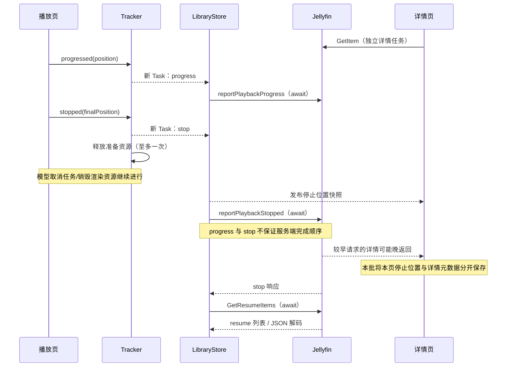

# 2026-09-14 NAS 首批：退出生命周期与断点保护

基线 `b4c789a`，本地分支 `work/nas-20260914`。关联 PX-21/PX-02/PX-20；PX-04 只隐藏手动清晰度入口，保留选项模型、`qualityRequestLoader`、换流与资源准备代码，供后续恢复 App 入口。用户于本次 NAS 接续中明确要求保留接口。

后续更新：[第二批会话隔离](2026-09-14-NAS-SESSION-ISOLATION.md) 已改变下文“上报读取当前 client”和 resume 写回行为；本文件时序保留为首批分析基线。同会话网络任务交错与 SIGBUS 根因仍未解决。

## 当前源码时序与所有权

代码位置以本批版本为准：

- `GreenfieldVideoPlayerView.swift:309` 的 `closePlayer` 先保存设备文件有效断点、取消候选换流任务，再调用 `model.stop`；`onDisappear` 可能再次调用 stop。
- 同文件 `:580` 的 `stop` 先调用 tracker，随后取消播放任务、暂停及释放模型持有的播放资源。
- `LaunchpadPlaybackCore.swift:550` 的 tracker 用锁保护状态；事件处理和资源释放回调在锁外执行。请求持有 tracker，tracker 持有两个闭包；资源闭包捕获准备时的 client/session/proxy，事件闭包弱引用 library store。
- `LaunchpadView.swift:7761` 为每个事件新建独立 MainActor Task。`reportPlayback`（`:7793`）读取 store 当时的 client，发送开始/进度/停止请求；停止请求成功后继续加载 resume 列表（`:8170`）。MainActor 任务在 await 时可以交错。
- 详情加载（`:6097`、`:9883`）是另一个异步任务。停止快照、服务器详情响应、resume 列表响应和 SwiftUI 销毁不构成一个串行事务。

转码资源释放还会单独发起 `stopEncodingProcess` 任务，它不会等待 stopped 网络上报完成。代理注销同样不等待网络上报。这里只描述已有行为，不把这个先后关系直接定性为崩溃根因。

## 已确认并修改的逻辑问题

1. **取消后迟到的开始回调。** 原 `stopped` 在 `didStart == false` 时直接返回，没有将 tracker 置为终止；资源已释放但随后 `started` 仍可产生虚假播放事件。现在 stop 即使发生于首播之前也终止生命周期，显式释放准备资源同样终止。重复 stop/release 与析构只释放一次；未开始的播放不发虚假 stopped。已在锁外投递的回调不由本修改撤回。
2. **详情响应覆盖停止快照。** 原 `onChange` 将停止位置直接写入 `detailedItem`，晚到的 `loadDetailContent` 随后整体替换它，或在错误分支清空它。本批改为详情页单独保留本页收到的停止快照，`mediaItem` 组合最新元数据与该快照。其他影片的停止事件不清掉本页快照；退出账号发布 nil 时清除。新建详情页不套用 store 历史快照，以免强行覆盖其他设备更新。详情/相似项目请求取消后不再写入该页，取消的详情响应也不再发起预探测。
3. **无效时钟与整数边界。** started/progressed 忽略 NaN/无穷值，stop 的无效目标沿用最后有效位置。tick 转换先判定上界再转 Int；原 `Int(min(..., Double(Int.max)))` 在 64 位平台边界可能因为 Double 向上舍入而越界。它属于独立数值缺陷，不与已报告的 EXC_BAD_ACCESS 混为一谈。

设备文件 `isReady && !hasPendingSeek` 保存条件、128 条上限、账号/文件版本身份和 HLS 时间偏移未修改。自动原画策略与清晰度换流实现保留。

## 回归与未完成范围

新增 4 项 `PlaybackNextCoreTests`：取消预热后迟到 start/progress/重复 stop；无效时钟后的最终有效断点；资源释放回调重入及恰好一次释放；tick 正常值、非法值和整数边界。

本环境没有 `swift`/`xcodebuild`。新增 XCTest 尚未执行，Swift 与 SwiftUI 尚未编译。NAS 检查结果见接续指南本批记录，不继承 Mac 基线 78 项通过作为本批结论。

以下问题仍须继续核查，**退出后的 JSON 解码崩溃仍未定位/验收**：

- 独立上报 Task 及其 HTTP 请求可能交错；旧进度是否覆盖停止位置，需要同会话请求开始/结束与服务器位置证据。后续若串行化，应设计单会话有界队列、过期进度合并、失败推进和取消规则，不能只用延迟规避。
- tracker 锁外回调与取消可以交错；本批防止终止后新进入的事件，不保证已经获准的回调按网络顺序送达。
- 事件闭包使用 store 当前 client，资源闭包使用准备时 client；退出登录/切账号以及旧 resume 响应晚返回的隔离需要专门回归，未在本批统一改造。
- 本页快照并非服务端同步协议；服务器 stop 失败、新建详情页、另设备继续播放后的冲突仍待验证。
- 本地无 Mac `.ips`、ASan 日志及 Get 依赖 checkout；不能据交接中的解码栈断言共享 JSONDecoder、SDK 缺陷或 KS 越界。未修改依赖解码器或 KS 内存管理。

## 回 Mac 的具体步骤

1. 带回此工作分支，执行 `scripts/xcodebuild_nastart.sh build` 和播放/非播放 XCTest。新增 4 项测试应全部执行；记录实际计数及构建结果。
2. 用测试夹具/受控响应延迟重现：详情请求尚未完成时，在同一详情页进入播放，暂停定位至已确认的 6311.8 秒并退出，再返回旧详情响应。详情按钮与下一次播放仍应使用 6311.8；再测 0 秒、回退位置和详情加载失败。另测另一影片 stop、退出账号，以及重新创建详情页能读取服务器最新位置。
3. 候选换流准备中快速退出，确认不产生后续虚假 started/progress、编码器/代理只释放一次；正常开始后退出仍只上报一次 stopped。准备接口、手动清晰度数据模型继续保留，App 按既定取舍隐藏入口。
4. 对 S19 进行已完成 seek 后退出、未完成 seek 退出、切音轨/字幕后暂停退出、快速重开、从头播放的组合；设备文件及 Jellyfin 分别记录绝对时钟、轨道、声音和字幕。核对 HLS 时间偏移。
5. 单独核对 ASan 安装包、运行进程和构建；完成退出压测，保留符号化异常线程以及触发前后的 trace/session、上报请求时序和资源释放日志。原报告为 12:41、20:44 的 SIGBUS，不混入 12:06 网页 watchdog。可先提取异常线程、相关线程及相邻事件的最小脱敏片段，无须上传完整认证日志。
6. ASan 结果只用于诊断；性能对照回到正常包，按同片/同轨/同字幕/同断点、同网络与构建做两入口重复冷/热样本，实际屏幕与听音独立验收。
