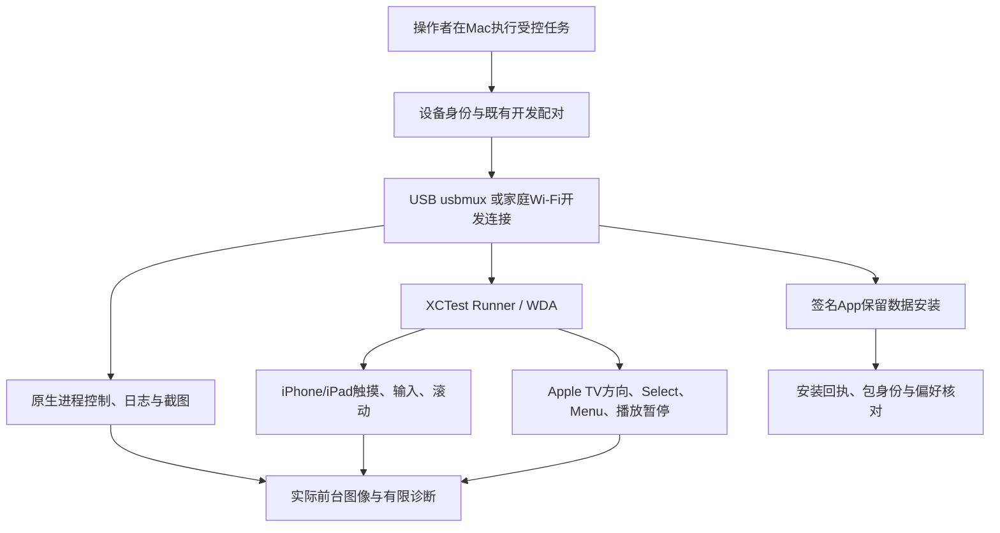

# 真机安装、连接与远程调试手册

2026-11-12 用户明确授权 Codex 在当前及后续 iPad Nastart 调试窗口用 WDA 打开已保存的 SMB 来源、选片和取证。按现场页面核对目标行和点击落点。A16 iPad 的来源行中心触摸和元素点击可能弹出上下文菜单，短触摸准确落在标题文字内已两次实际打开目标媒体库。若弹出上下文菜单则退出并核对页面。 [真机记录](../archive/handoffs/2026-11/CODEX-2026-11-12-PLAYBACK-POLICY-T3.md)

2026-11-08 当前从[阶段总交接](../archive/handoffs/2026-11/2026-11-08-0130-CLAUDE-TRANSITION-TO-CODEX.md)及[Codex接收核对](../archive/handoffs/2026-11/CODEX-2026-11-08-TRANSITION-INTAKE.md)接续。NAS业务已恢复，13/Pad的Claude窗口已按其报告收尾，下一窗fresh核独占/源包/签名。用户实际Keychain密码/令牌及密码眼睛不读取/操作，iPad的network.library.source合成点击路线有长按菜单风险。18仅用户明确要求安装，启动/测试和TV运行按独立窗口边界。旧暂停/仅离线/过期前包与旧模型表为历史，当前以总交接和当轮记录为准。

2026-11-04 有界授权与现状：[本批目录回归](../archive/handoffs/2026-11/CODEX-2026-11-04-FOLDER-PICKER-INTEGRATION.md)收到用户“允许更新两台测试Runner的签名并部署”，只为13/A16 Pad经原账号更新有效profile、复制原兼容夹具后独立重签/部署（原件未改），不是默认允许以后自动换账号/签名。两台已核XCTest/WDA ready与安全离线入口；Pad实际W3C输入通过，13子目录后超时、机制未证。所有窗口已结束、原偏好同；下方旧profile过期说明只属历史，不再当本批重签许可或有效签名的阻塞。

2026-11-03最新：[用户本次授权的18无线更新](../archive/handoffs/2026-11/CODEX-2026-11-03-IPHONE18-WIRELESS-UPDATE.md)已完成保留安装，旧hands-off仅在该有界窗口内被新请求覆盖；窗口现已收尾，不转授Claude或持续控制。NAS尚未恢复，普通根/`--launch`仍不执行；安全离线前台结果/锁屏边界以报告为准。下文较早“18 hands off”是当时状态，不否定本次授权与实际Complete。

整理日期：2026-11-02。依据项目脚本、实际安装交接和失败记录整理；本次仅阅读本机资料并编写文档，没有重新枚举、连接或操作真机。本文说明可复用的方法，不授予设备窗口，也不证明历史链路现在在线。现场以[当前交接](../handoffs/CURRENT-PLAYBACK-HANDOFF.md)、[资源登记](AGENT-RESOURCE-STATE.json)和用户最新指示为准。

## 先看当前边界

- NAS仍恢复：停止NAS发现、连接、认证、注销、目录/图片/媒体和服务探针。普通App根会自动恢复旧NAS会话，当前不能普通启动；只能使用源码确认在恢复逻辑之前分流的DEBUG安全离线入口。历史命令中的普通启动、播放和网络检测不在本轮许可内。
- iPhone18由用户使用，hands off；本文无线方法只是保留技术能力。Apple TV开发发现/配对会话未恢复且缺当前有效profile，环境无变化不重复唤醒、配对或安装。
- 最近真机记录是13与A16 iPad于11月2日保留数据安装和有限静态窗口；该包随后已落后于第五批源码。两机的当前连接/进程/签名都需要下一设备窗口重新核对。
- Codex当前负责默认设备远控与调度；双方可按额度和任务交接调整负责人。同一设备、Runner、端口和安装/采集窗口不能并发占用，不同工作目录不会隔离这些资源。

## 一、我们实际使用的是哪些层



| 层 | 用途 | 本项目使用的实现 | 不能据此认定 |
| --- | --- | --- | --- |
| Mac上的任务入口 | 执行命令、查看图像、协调窗口 | 本机CLI、必要时原生UI控制 | 不等于已取得设备信任或用户锁屏解锁权 |
| 传输与认证 | 找到并认证指定真机 | USB的usbmux/lockdown；Wi-Fi既有配对TCP；CoreDevice原生隧道/RSD | 同名设备、同路由器、AirPlay、ping通不证明开发会话可用 |
| 安装 | 更新已签名App | `ios-deploy`、`devicectl`或AFC＋installation_proxy | 无需WDA；安装完成也不证明App在前台或功能通过 |
| 原生观测/控制 | 查询、精确结束/启动App、截图、诊断 | DVT ProcessControl/DeviceInfo/Screenshot、CoreDevice、HouseArrest | 截图不提供点击能力，PID不证明前台；偏好备份不是完整容器/Keychain备份 |
| UI自动化 | 实际输入与页面操作 | XCTest；WDA把XCTest能力提供为HTTP接口 | WDA不是嵌入Nastart的业务SDK，也不是远程桌面/公网控制服务 |
| 验收 | 判断真实结果 | 实际PNG、当前AX树、同窗动作/日志、必要的显示帧时间 | HTTP成功、滑动命令成功或内部时钟不是功能/流畅度PASS |

WDA是单独签名的测试Runner及测试bundle，和Nastart App有独立的安装身份、签名有效期与运行生命周期。它通过XCTest执行操作；本机既有兼容版本须保留，不能因上游更新就自动替换。原理参见[Appium维护的WDA说明](https://github.com/appium/WebDriverAgent)，实际可用性仍以本项目已装Runner和当前系统为准。

## 二、按设备区分已用链路与未完成项

| 设备（历史型号/系统，操作前重核） | 安装与传输方法 | 远控/观测方法与已证边界 | 当前限制 |
| --- | --- | --- | --- |
| iPhone18 Pro Max：iPhone19,7 / iOS27.0 | 家庭Wi-Fi；当前Bonjour发现→既有配对TCP认证→HouseArrest备份→AFC上传IPA→installation_proxy Complete | userspace RSD＋DVT可启动/激活和截图；历史另有WDA界面窗口。11月1日安装及前台图已核，无新WDA部署 | hands off；旧成功不等于本轮在线，无线安装不承诺WDA随时可用 |
| iPhone13：iPhone14,5 / iOS16.3.1 | USB/usbmux；最近实际用ios-deploy安装，pymobiledevice3安装代理读取已装信息 | USB DVT查询/精确退出/安全离线启动/截图；既有兼容WDA＋tidevice XCTest用于触摸与输入 | CoreDevice显示unavailable不等于USB不可用；最新源包待重建/安装 |
| 当前A16 iPad：iPad15,7 / iPadOS26.6 | USB；CoreDevice/devicectl保留数据安装；原生RSD供容器/诊断服务 | 最近原生进程控制及DVT截图、主题静态窗口成立 | 新Pad完整触控自动化尚未恢复；旧Pad的过期WDA不包含此设备，不能沿用为当前证明 |
| 客厅Apple TV：AppleTV14,1 / tvOS18.2 | 家庭Wi-Fi；Xcode开发配对→CoreDevice/原生RSD→独立tvOS签名包安装 | 历史XCTest/WDA TV Runner＋遥控按键、XCUIScreen取图；DVT用于分开的诊断窗口 | 当前开发会话恢复未核实，旧TV profile已过期；不能安装iOS IPA或用模拟器通过代替真机 |

“数据线调试”只描述Mac与设备的控制连接：USB连接的13/Pad仍可通过Wi-Fi或蜂窝访问业务服务。反过来，家庭Wi-Fi开发连接也不代表App媒体必经内网。设备控制路线、App请求实际端点与网络条件须分别记录；NAS暂停期间不发业务请求来验证路线。

## 三、所有设备窗口的共同门槛

1. 先读根AGENTS、PROGRESS、当前交接、分工与资源登记。登记操作者、设备、Runner/端口、构建目录、窗口和收尾责任；未获窗口不探测或接管。用户手动输入/复现期间保留草稿，按最新窗口约定操作。
2. fresh读取目标名称、型号、系统、完整UDID及连接类型；完整身份只写私有证据。不能根据旧列表、设备营销名称、端口或旧配对文件猜目标。
3. 冻结当前含dirty的源码输入清单、HEAD/未提交差异和构建配置，记录构建起止、App/IPA路径、主程序及Debug dylib等关键二进制SHA-256。源码晚于包时重建；版本0.1.0/1不能证明同源。
4. 核Bundle ID、平台/架构、deep/strict及实际嵌入Mach-O签名、entitlements、profile到期和目标设备覆盖、IPA成员/CRC与签名App一致。不改账号、签名或拉取新profile来绕过阻塞。TV单独核tvOS依赖，手机包不能代用。
5. 保存必要现存诊断与App偏好；日志不默认flush/move/erase。HouseArrest的`VendContainer`、实际返回文件及解析结果都应确认，不能因命令exit0就声称备份成功。原始偏好/书签/凭据不进仓库。
6. 用户已授权远程结束确认属于Nastart的进程：fresh核安装bundle的实际可执行路径与PID，保存现场后、停止前再次匹配同PID/路径，再结束精确目标。未知、另一会话或身份变化则停此支线；不注销、不卸载、不清数据。单纯退出优先原生通道，无需重新装WDA。
7. 已装包身份无法可靠确定时，对已验签最新包保留数据覆盖安装。记录服务Complete或工具明确安装成功、fresh安装lookup、偏好对比；安装超时保持结果未知，先读现状再决定是否重试，避免重复提交。
8. 安装与启动分开。默认空测试环境；当前仅允许经过源审的安全离线入口，其启动参数/构建配置和结果必须标清，不能称普通首页回归。出现PID仍须看实际前台图；屏幕是用户其他App时不操作其内容。
9. 结束先停自有播放/下载、App/Runner/采集/转发/隧道，按所有权决定具体范围，恢复本轮修改的设置并核原偏好。蜂窝窗在最外层`finally`恢复原Wi-Fi且核已连接状态和Wi-Fi图标，再离线分析。记录仍阻塞的清理，不以退出脚本代替核验。

完整门槛见[播放调试规范](../handoffs/PLAYBACK-DEBUG-RUNBOOK.md)。本手册不会放宽其要求；保留安装不等于对所有客户端数据完成灾备。

## 四、iPhone18：家庭Wi-Fi无线安装与控制

### 已成功的安装路径

1. Mac与手机处于互通的家庭局域网，已有这台Mac与该手机的有效开发配对；需要用户解锁时由用户完成，不绕过锁屏。使用当前DNS-SD `_apple-mobdev2._tcp`实例，解析当前地址。
2. [发现工具](../../scripts/discover_paired_wireless_device.py)使用已有pair record，`autopair=False`，认证后读取真实UDID匹配目标。`--browse-current`最多检查四个当前广播；不扫描网段、不用旧地址、不新建配对。广播随机端口可能不是可直接访问的lockdown服务；工具只在同一解析地址尝试已有逻辑的62078，不扩成端口扫描。
3. 使用新生成的私有`verified-endpoint-private.json`；`identityMatches`与`paired`必须成立。该文件只是本次连接输入，不能提交仓库或当永久地址表。
4. [安装工具](../../scripts/install_paired_wireless_app.py)先核源码/包/目标，再通过HouseArrest及既有EscrowBag保存偏好。备份失败即停止，不能为“赶紧更新”跳过；之后AFC暂存IPA、installation_proxy Install，等待明确Complete、fresh lookup和偏好比较。
5. 启动/截图是另一阶段：CoreDeviceTunnelProxy→userspace RSD→DVT ProcessControl/Screenshot。历史曾遇启动DTX错误，也曾PID存在但仍在别的App；后来同PID显式激活并实际看图才完成前台核对。安装成功不抹去这些失败。

以下只是未来获准安装窗口的参数模板；变量须由操作者从当前私有证据赋值。**当前18 hands off，不执行。**

```sh
"$DEVICE_PYTHON" scripts/discover_paired_wireless_device.py \
  --config "$PRIVATE_DISCOVERY_CONFIG" --output "$PRIVATE_DISCOVERY_OUTPUT"
"$DEVICE_PYTHON" scripts/install_paired_wireless_app.py \
  --endpoint "$PRIVATE_ENDPOINT_JSON" --manifest "$CURRENT_PACKAGE_JSON" \
  --inputs "$SOURCE_INPUTS_JSON" --output "$PRIVATE_INSTALL_OUTPUT"
```

发现的输出路径需传入第二条对应endpoint，不能盲贴顺序执行。`--probe-only`也会读真实设备/容器，不是离线命令；`--launch`会普通启动恢复NAS，当前禁用。完整格式/私有配置见[iPhone18无线专册](IPHONE18-WIFI-UPDATE.md)。

### 无线“远控”额外需要什么

DVT能做进程/截图，不提供通用触屏输入。点击、滚动、输入需要有效的目标WDA/XCTest测试会话和可达的控制通道；要独立验证Runner签名、目标、HTTP ready、session、前台bundle/PID、图像。USB的iproxy路径不能原封不动当无线方案；无线窗口使用本机当次已验证的设备服务/隧道路径，不能凭安装端点推导WDA地址。

本项目[10月11日无线WDA恢复](../archive/handoffs/2026-10/2026-10-11-IPHONE18-WDA-RECOVERY.md)有完整成功记录：已验签且覆盖目标的独立Runner，经既有配对Wi-Fi/AFC/installation_proxy安装；进程内userspace CoreDeviceProxy/RSD接testmanagerd，完成ctrl/main初始化、Runner启动、测试授权、反向XCTestDriverInterface及test plan执行；随后当次Wi-Fi端点的`/status`、session、activeAppInfo、source和PNG实际通过。它不是只点WDA图标，也不依赖Xcode自动隧道先恢复。该次profile10月18日已到期，后续测试连接也曾ConnectionTerminatedError结束；流程可参考，旧包/会话/地址不可复用为当前有效证明。

11月1日最新安装没有部署WDA，也不能由该次安装记录证明当时完整触控可用。现有无线安装能力依赖家庭LAN、配对、有效签名和设备服务，不是iCloud/App Store/TestFlight/OTA分发，不自动具备家庭外公网控制能力；不为远控改路由器/NAS/VPN或开放WDA端口。

## 五、iPhone13：USB兼容链与WDA

- 先从usbmux读取真实USB设备，结合`idevice_id`/`ideviceinfo`/既有pair验证身份；不因新版Xcode/CoreDevice unavailable就判手机断线。`tidevice ps`的默认过滤可能漏进程，历史使用`ps --all`再精确匹配实际可执行路径。
- 安装可用已验证的`ios-deploy --id <当前UDID> --bundle <已验签App>`，不得加卸载/清容器选项；最近实际使用USB限定`--no-wifi`与`--nostart`，避免安装时普通启动恢复NAS。该批另用USB `create_using_usbmux(..., connection_type='USB', autopair=False)`及安装代理查询已装bundle路径，不把查询服务写成实际安装工具。
- 原生USB `DvtProvider`、`DeviceInfo.proclist`、`ProcessControl`与`Screenshot`可查进程、精确退出、启动安全离线场景和截图。11月2日这条路线没有新装WDA，不代表它已完成触摸/滚动验收。
- 需要UI输入时，复用私有兼容夹具目录`~/Library/Application Support/Nastart/WDA/iPhone-16.3.1`及其实际有效Runner。历史已用WDA16.8.0、Xcode26.6兼容/DDI链与`tidevice xcuitest`；必须核当前实际版本/路径，不能照版本名自动重建。
- [prepare_wda_recovery.sh](../../scripts/prepare_wda_recovery.sh)检查本机夹具、DDI、签名、描述文件的设备与 bundle 覆盖，以及实际 TestHostPath/TestBundlePath。核对设备和安装回执仍是独立步骤。续签后用 `WDA_APP` 和 `XCTESTRUN` 指向同一份有效产物与测试配置。
- [start_wda_iphone.sh](../../scripts/start_wda_iphone.sh)的 `--check-usb` 可先检查当前会话能否访问 usbmuxd、目标 USB 身份及回环端口，检查模式不会启动 XCTest。完整运行会调用开发服务、启动 iproxy 和 tidevice XCTest，并将日志写入 `WDA_RUNTIME_DIR` 下独立私有子目录。显式指定当前 `DEVICE_UDID` 与独占 `LOCAL_PORT`，确认已有 Runner、转发和端口的归属。Xcode 可见设备时，当前命令会话仍可能对 usbmuxd 返回权限错误。 [单机验证记录](../archive/handoffs/2026-11/CODEX-2026-11-20-IPHONE13-ONLY-DEBUG-CHAIN.md)
- Runner要作为XCTest运行，不能只启动Runner App图标；ready也要和目标会话/实际画面核对。需要设备开启UI自动化等系统确认时，保存阻塞并交用户处理，不擅自更改系统设置。

脚本自有PID清理与调用者清理边界都应记录；绝不能为了释放8102就kill所有iproxy/tidevice。详细兼容、观察与历史失败见[CLI真机观测](../testing/CLI-DEVICE-OBSERVATION.md)。

## 六、iPad：新A16设备与旧Pad分开

当前A16的历史成功路线是USB CoreDevice身份→`devicectl`应用/进程查询和安装→原生RSD HouseArrest偏好→DVT截图。精确结束App用已核PID的CoreDevice process terminate；每个命令通过自身`DEVELOPER_DIR`选已验证Xcode，不全局切`xcode-select`。`devicectl`的`--device`使用本轮确认对应真实UDID的CoreDevice标识，不能把另一个UUID直接当同设备。

11月2日保留数据安装、原偏好不变、安全主题静态图已成立。此前旧iPad（含18.3.1系统）的WDA/Runner成功不转移到新A16：旧profile过期且不覆盖A16，现阶段不能声称新Pad WDA已就绪。后续完整输入/旋转/滚动需要单独登记Runner准备与授权，验签/设备覆盖/原偏好后再建立会话；不要仅为退出Nastart重复部署。

App的开发者信任、App签名和WDA Runner签名是三个检查点。用户已完成App信任，不代表任意Runner可安装或长期有效；需要新信任/系统确认时如实保留阻塞。最近用于安装/取图的临时Python适配脚本在仓库外，不是稳定通用工具，不应直接复用其中旧PID/目标或普通启动逻辑。

## 七、Apple TV：无线开发配对、tvOS包与遥控器

1. 电视与Mac在同一可互通LAN；用户在电视进入“设置→遥控器与设备→遥控器App与设备”，保持可发现。Mac在当前主用Xcode/Device Hub选择真实目标，若出现PIN按电视提示完成；不能把电视的iPhone/iPad/Home Assistant已配对列表当Mac开发配对完成。
2. fresh CoreDevice详情确认型号/系统/UDID/连接，再通过既有原生隧道`establish_native_rsd(serial=...)`验证RSD同目标。AirPlay出现、同Bonjour主机或缓存paired标签都不等于这一步通过。
3. 独立构建tvOS App、核全部嵌入库/架构/签名/profile及目标覆盖，HouseArrest备份后用`devicectl device install app`保留数据安装。手机IPA、iOS开发profile或模拟器产物不能代用。
4. 历史遥控窗口通过TV XCTest/WDA Runner驱动方向键、Select、Menu和Play/Pause，按当前焦点与页面决定动作；TV不能套用触屏坐标。`XCUIRemote`为Apple提供的遥控自动化接口，参见[官方接口入口](https://developer.apple.com/documentation/xcuiautomation/xcuiremote)。
5. 同一遥控验收窗优先WDA/XCUIScreen PNG。10月27日同包A/B/C对照：XCUIScreen窗Menu返回、按键附近重复DVT截图窗三次不返回、再回XCUIScreen又能返回。具体系统机制未证，不能把所有旧返回失败都定为工具干扰。DVT取图需要另列采集窗，不在每次按键间插入。
6. 结束记录焦点/返回层级、实际画面/同App PID、是否普通退出以及自有Runner/会话/设置清理。11月2日TV模拟器四项确认框通过不等于TV真机、真实NAS断开、全遥控或播放性能通过。

当前有两个独立阻塞：已配对的「客厅」申请开发隧道时出现 RemotePairing 1005，原生开发会话仍不可用。最新签名构建缺profile，旧profile10月31日已过期。[隧道诊断](../archive/handoffs/2026-11/CODEX-2026-11-08-APPLE-TV-TUNNEL-1005-DIAGNOSIS.md)。不能靠清缓存、改菜单、复用旧包或重试无限补齐。[TV准备专册](APPLE-TV-PREPARATION.md)保存恢复现场与官方配对入口。用户报告曾清Xcode缓存，但与故障的因果未证；主用Xcode27、26.6保留兼容，不自动卸载其中一套、更新系统或反复清缓存。

## 八、WDA会话、坐标、取图与性能的操作约定

| 项目工具 | 实际职责 | 需要额外检查 |
| --- | --- | --- |
| [wda_usb_session.py](../../scripts/wda_usb_session.py) | 惰性USB连接，读取已有会话的场景/AX/PNG；不创建会话或改设置 | 先过最新包门槛；调用者绑定目标bundle/PID、session和方向，原始响应私存 |
| [wda_command_guard.py](../../scripts/wda_command_guard.py) | 区分过期元素读取与动作效果未知；需要调用者注入实时场景指纹 | 不会自动取得设备锁；超时后的动作可能已生效，先读结果，不盲重发 |
| [wda_native_actions.py](../../scripts/wda_native_actions.py) | 在已有会话做W3C touch；检查当前App、应用边界与UIKit点坐标 | 不是截图像素；旋转/缩放后重取位置，效果仍UNVERIFIED，必须看后续实际结果 |
| [wda_capture.py](../../scripts/wda_capture.py) | 场景截图/XML采集 | 核脚本版本是否改idle/cool等设置，保存原值，在最外层finally恢复，不套旧默认值 |
| [download_device_diagnostics.py](../../scripts/download_device_diagnostics.py) | 读取App已有诊断/偏好 | fresh服务连接、有界超时，确认容器/文件真实返回；服务BrokenPipe不直接定App崩溃 |

启动WDA会话可能改变App生命周期；上游创建/删除会话有清理行为，取决于具体版本和配置。需要先看已装Runner行为，不能当作无副作用只读探针；也不因`shouldTerminateApp=false`字样就保证不结束App。复用现成有效会话优先，未知会话不抢占。

每个动作前核前台bundle/PID、当前页/覆盖层、唯一且可见的目标和方向；临时控件使用短时新观察，现有守卫要求最大观察年龄不超过2秒。不能对相同图标取第一个匹配，不能在用户手动输入时持续注入。动作后保留实际页面变化；PNG需实际查看，AX不包含电影像素。

性能与UI窗口分别取证：WDA截图、DVT约1Hz FPS、内部播放器tick不能判逐帧流畅。滑动须记录实际位移和完整帧时间，竞品同条件、同计时边界，失败/超时保留；声音、音画同步、HDR/Atmos输出等仍需要合适的实际输出证据或用户现场观察。

## 九、常见失败怎么分层处理

| 现场现象 | 下一步最小核查 | 不应直接做 |
| --- | --- | --- |
| Xcode unavailable但13仍USB可见 | fresh usbmux身份、配对、已知兼容原生服务 | 判全设备断线、重装系统或全局切Xcode |
| TV AirPlay可见、开发列表为空 | 分开记录服务发现、用户配对页、原生开发会话状态 | 把AirPlay当已配对、扫网段、反复催PIN |
| HouseArrest备份失败 | 核实际provider/legacy与RSD服务选择、EscrowBag、VendContainer及返回内容 | 跳过备份直接安装；以Documents空返回声称全容器备份 |
| IPA安装失败/超时 | 保存安装代理错误；核包成员/CRC/签名、fresh lookup | 立即卸载；把AppleDouble等包问题归成配对故障 |
| WDA端口超时 | 核端口所有者、目标映射、Runner原生进程；必要时用新鲜独占USB连接分层读状态 | 杀未知进程、复用其他设备8102、直接重装Runner |
| WDA ready却点错/无变化 | 核真实session/前台/覆盖层、可见唯一目标、方向、动作是否已发生 | 按旧坐标连点、超时就重发破坏性动作 |
| App有PID但屏幕不是Nastart | 保留屏幕与进程关联；获准时显式激活同目标并实际看图 | 操作用户其他App或直接判首页通过 |
| TV按键返回失败 | 同包同路径隔离截图条件，核当前焦点/覆盖层与按键落地 | 立即修改产品焦点/加等待参数掩盖失败 |
| 签名到期/目标不在profile | 分开记录App与Runner、实际有效期及覆盖，保存阻塞 | 沿用旧包、擅自重签/改账号或用另一设备成功代替 |

“设备仍在”与“某服务失效”分别留证。长连接BrokenPipe、采集结束和主动终止也与App崩溃分开；真正异常用已有crash/watchdog/Jetsam及具体安装包dylib UUID/SHA关联。

## 十、复用工具和交接的最低记录

解释器/CLI须用本机当前已验证的绝对路径和版本。旧文档中的系统Python与后续私有pymobiledevice3环境可能不同；接口如native RSD、HouseArrest provider有版本差异。先核本地依赖和脚本输入，不自动pip升级、不安装新依赖或把临时适配器当通用CLI。

私有目录建议放在`~/Library/Application Support/Nastart/DebugEvidence/<本批唯一目录>/`；每批独有目录、日志和端口，不把原始身份、地址、pair record/EscrowBag、偏好、Keychain、截图/响应或包写入仓库。WDA控制端点仅限现有受控本机/设备通道，不提供给另一代理绕过窗口。

可分享交接至少包含：

```text
设备别名/型号/系统/USB或Wi-Fi；fresh身份核对时间（完整身份仅私存）
窗口负责人/资源登记；源码HEAD+dirty/输入清单身份；构建配置/时间
App/IPA/关键dylib SHA-256；签名/profile检查结论及有效期
安装前已装身份、必要诊断/偏好备份；残留进程精确核对/主动停止
实际安装工具/明确完成回执/安装后lookup；前后偏好对比
启动参数/环境、是否安全离线入口；实际前台PNG是否已查看
Runner版本/签名/会话/本地端口映射核对；动作与实际结果
失败、超时、未知、证据边界；自有进程/转发/隧道/设置/网络清理
尚未完成项、下一设备窗口所需条件；私有证据指针（不导出秘密）
```

共享当前交接只留摘要，详细月度报告放`docs/archive/handoffs/YYYY-MM/`，脱敏结构化结果放`docs/testing/results/YYYY-MM/`。设备请求应写源码配置、合成数据、动作、时限、验收与清理；没有实际窗口时Claude继续独立源码工作，不能因为Codex会远控就自行占设备。

## 本项目证据入口

2026-11-02补充：[app-hosted测试安全核对](../archive/handoffs/2026-11/2026-11-02-BATCH8-HOSTED-TEST-SAFETY-AND-RESULT.md)确认单元测试宿主也可能进入普通根恢复NAS。用户指定的第八批9项仅在新建、无App配置/快照/服务地址且Keychain匹配0的专用模拟器运行，通过后已删除；不能以“只跑单测”放行旧实例，也不能将此模拟器条件扩大为真机普通启动许可。RESULT筛选可能漏小写测试明细，须核原日志/xcresult实际数量。

- [11月1日18无线安装与激活](../archive/handoffs/2026-11/2026-11-01-IPHONE18-LATEST-INSTALL.md)：真实Complete、27项偏好保持、启动错误和前台核对分开；历史普通启动可能触发恢复NAS，不能复用为当前零NAS方案。
- [11月2日13/A16 Pad安装及安全静态场景](../archive/handoffs/2026-11/2026-11-02-CURRENT-NORMAL-DEVICE-UPDATE.md)：原生精确结束/保留安装/偏好保持；有限静态观察不是完整触控验收。
- [10月24日TV正式签名与安装](../archive/handoffs/2026-10/2026-10-24-TV-PARITY-AND-DEVICE-REGRESSION.md)、[10月25日遥控与层级](../archive/handoffs/2026-10/2026-10-25-TV-CONTEXT-NAVIGATION-AND-REMOTE.md)：证明历史真机开发链存在，不证明今天已恢复。
- [10月27日TV截图干扰对照](../archive/handoffs/2026-10/2026-10-27-TV-WEBDAV-SCREENSHOT-INTERFERENCE.md)：保留工具条件关联与未证机制。
- [CLI观测手册](../testing/CLI-DEVICE-OBSERVATION.md)、[无线专册](IPHONE18-WIFI-UPDATE.md)、[TV准备专册](APPLE-TV-PREPARATION.md)：详细工具和历史故障；旧日期约束不能覆盖当前交接。
