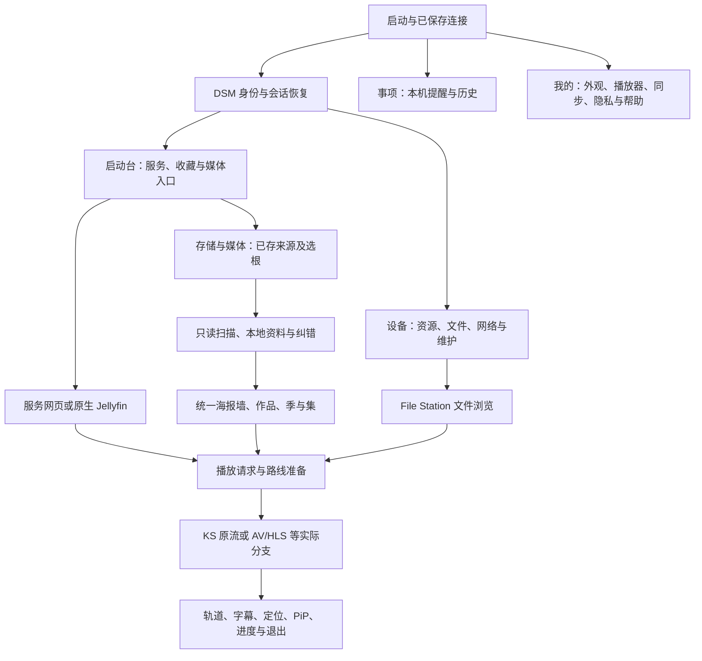
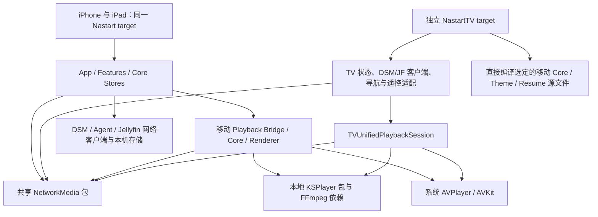

# Nastart 全面开发盘点与接续说明

盘点日期：2026-11-02（Asia/Shanghai）。面向用户及接续开发的 Claude Code。依据当前集成源码、工程引用、需求总账、结构化结果与历史交接整理；本轮没有新增真机操作、NAS 请求或发布。

这是一份日期快照与阅读地图。动态现场以[当前交接](../handoffs/CURRENT-PLAYBACK-HANDOFF.md)、[资源登记](../development/AGENT-RESOURCE-STATE.json)为准；需求编号和验收状态只在[唯一总账](PLAYBACK_EXPERIENCE_PRIORITIES.md)维护。本报告不建立另一套需求编号。

后续补充：[真机安装与远控手册](../development/PHYSICAL-DEVICE-REMOTE-CONTROL.md)说明四设备实际USB/Wi-Fi安装链、原生进程/截图与WDA/XCTest、TV遥控和收尾，供双方复用；不是新增真机验收。

## 1. 项目现在到了哪一步

Nastart 已经超出界面原型阶段：iPhone/iPad 主体、DSM 设备与文件、服务启动台、Jellyfin、只读网络媒体库、复杂播放链路和原生 Apple TV 应用均有实际代码，多个历史真机窗口也已有真实画面和操作证据。当前更适合描述为**内部开发版，功能整合、体验优化和验证仍在进行**。

尚不能认定为功能完整或可发布版本。核心缺口是：大文件及弱网体验、部分输入/焦点问题、跨端行为与生命周期、Release 路线迁移、完整声音/字幕/输出和稳定性验收，以及同步、商业化和分发收尾。

不提供一个笼统完成百分比：产品规划、代码存在、逻辑测试、模拟器、真机片段和正式验收是不同层次，混算会误导排期。

| 本文用语 | 准确含义 |
| --- | --- |
| 已实现 | 已有实际调用的代码；不自动代表各种设备和网络通过 |
| 有限验证 | 指定版本、配置、设备及操作切片成立；不能继承为当前源码全功能通过 |
| 待优化 | 已有功能但有已知失败、体验差异或证据不足 |
| 待开发/接线 | 尚未形成完整用户闭环；模型、原型或入口存在不等于交付 |
| 环境阻塞 | 需要 NAS 恢复、真机连接、签名或可用外部网络等条件 |

## 2. 源码、安装包与证据的准确位置

- 当前集成目录：`/Users/lagransun/workspace/Nastart`。
- 当前 HEAD：`4de732dd645b36671becff992cdef1d0163fd1e4`。大量已接受工作仍未提交，**HEAD 不是最新功能基线**。本轮没有提交、重置、stash、清理或改写索引。
- 07:38 重新核对 TV 第二轮冻结的 446 项输入，全部与当前文件哈希一致。这是该批声明的构建输入清单，不是全仓库每个文件的完整性证明；文档另有更新。
- 最新集成源码包括密码匿名诊断、第三批主题及后续修正、第五批 WebDAV 协议大小写修复、TV 正式确认组件复用与四项原生遥控测试。
- 13/新 iPad 最近安装的正常 Debug 包是 06:41 构建，主二进制 SHA 前缀 `56d94319`，Debug dylib `26b87a16`；曾核签名、30 个 Mach-O 和保留数据安装。**该包早于第五批，当前不再对应最新移动源码**。完整构建、冻结新正常包、逐台保留数据安装和安全启动尚待。
- 既有移动 profile 记录有效至 `2026-11-08T01:08:19Z`；后续安装仍须现场重新核签名与设备覆盖，不把历史有效期当实时可安装证明。
- 原始包、日志、设备身份、偏好和凭据在仓库外私有证据区；仓库内报告只放必要且可分享的结论。不要把整个私有证据目录交给其他会话或上传。

最近两批的事实边界：

| 批次 | 已完成 | 未完成 |
| --- | --- | --- |
| [Claude 第五批集成](../archive/handoffs/2026-11/2026-11-02-CLAUDE-BATCH5-INTEGRATION.md) | 四文件基线/补丁/SHA 核对并接入；实际类型回归修前 3 过/1 失败，修后 6/6 过；TV build-for-testing 已编译当前共享库 | 完整移动/设备/Release 构建、新正常签名包、真机连接表单与实际存储事务 |
| [TV 原生确认测试](../archive/handoffs/2026-11/2026-11-02-TV-DISCONNECT-XCTEST.md) | 第二轮 4/4 过：三类确认标准字号，加影音授权大字；实际 XCUIRemote 打开、取消、Menu、确认一次、焦点返回及保留反馈；自建实例已清理 | Apple TV 真机、真实账号/NAS 退出事务、完整无障碍/帧时间；首轮 4 个测试定位失败保留 |
| [Claude 第六批审查](../archive/handoffs/2026-11/2026-11-02-0735-CLAUDE-BATCH6-PASSWORD-CAUSAL-REVIEW.md) | 密码首次编辑与显隐焦点分因果审查、后续对照计划；无源码改动 | 根因仍未确定，没有交付密码行为修复；一次对照不能证明 UIKit 内部原因 |

## 3. 整个 App 的功能逻辑

产品核心是本地优先的 NAS/HomeLab 客户端，结合设备管理、服务启动与媒体消费。NAS Agent 是可选增强，不是所有功能的强制后端；当前也没有必须依赖自有云的完整闭环。

普通应用根会自动恢复 DSM/监测连接。**NAS 恢复期间不能用普通启动冒充离线测试**；当前使用最早 DEBUG 分支中的安全离线入口，避免创建真实 App 状态和连接副作用。

## 4. 按模块盘点：完成、开发项与优化项

| 模块 | 已实现或已有证据 | 仍待开发/接线 | 待优化或待验收 |
| --- | --- | --- | --- |
| 应用骨架 | SwiftUI 四主入口：启动台、设备、事项、我的；中英文；iOS/iPadOS 最低 16；Pad 自适应导航 | macOS/watchOS/visionOS、Widget/App Intents 等尚无本报告可确认的产品交付 | Pad 横竖/分屏、导航返回、全应用大字和完整读屏 |
| DSM 连接 | API 发现、认证/凭据保存、恢复会话、File Station 会话、固定配置地址策略、错误分类及部分恢复保护 | 更完整多 NAS/账号与统一跨端恢复；权限和证书交互继续补齐 | 间歇失败/API119、超时与状态发布；固定域名的实际会话/请求验证仍开放，尤其 iPhone18 |
| 设备与资源 | CPU/内存/磁盘、套件/容器/网络等只读信息与服务发现；缓存快照和分阶段健康更新 | 完整设备管理、更多厂商和受控写操作没有完整验收闭环 | 缓存/实时/未知语义、信息新鲜度、慢接口不阻塞已可用内容 |
| 服务启动台 | 三主题清流/栈列/流光；分类、可见管理、手动服务及网页/外部入口；共享图标和部分规则 | 各平台收藏/排序/隐藏等能力仍有差距 | 长文与大字、真实主题应用、网页返回/版本切换、滚动帧时间 |
| 文件浏览 | File Station 目录、分页/排序、文件信息、媒体读取；ISO/增长 TS 有专项代码 | 文件写操作/完整传输队列不在当前已验收范围 | 中文/大目录/元数据缺失排序、返回保位、会话失效；ISO/增长文件需单独验 |
| Jellyfin | 独立授权恢复、库/详情/搜索/季集、海报/演员资料、来源与轨道、播放协商和会话上报 | 完整同源跨端能力迁移；播放器内选季选集仍待开发 | 起播/seek/旧 cue、轨道与断点、长播/听音/实际输出；详情返回和图片闪动 |
| 网络媒体库 | WebDAV 与 File Station 只读目录源；用户选根、本地索引、电影/剧/动漫与季集、本地 NFO/图、纠错；统一海报及播放入口 | SMB 生产来源未接；FTP/FTPS 传输代码尚未形成正式 App 来源闭环；SFTP 未实现 | 连接草稿/取消/失败保旧、多个文件夹复用、扫描事务与大库、权限/路径范围、实际播放完整性 |
| 更多媒体服务 | Emby/Plex/Navidrome/Subsonic/Audio Station 等候选/身份/状态模型和部分公开探测 | 各服务原生授权、媒体库、播放/音乐队列仍需逐个实现；不能把“发现”称“支持播放” | 产品身份、端点、安装状态和授权状态分开，不向陌生服务发送 DSM 凭据 |
| 播放器 | 移动 Debug 主线、KS/AV 适配、共用控制、字幕/轨道、断点、取消与候选换源；TV 已收敛部分共享规则 | Release 默认迁移、完整清晰度/章节/片头片尾/在线字幕/投屏等见总账 | 弱网、大文件、连续供给、深 seek、无感换源、真实声音/字幕和内存稳定性 |
| 外观/设置 | 共享主题与部分设置目的地/状态组件；主题预览、Plus 状态及显示选项；TV 原生确认组件 | 真实账号、权限和偏好宿主的完整联动验收 | 第三批已修徽标挤窄与装饰图裁切；仅有限静态观察，完整 VoiceOver/触控/旋转仍待 |
| 事项 | 移动本机持久化、历史归一化、通知调度代码；TV 本机事项表单/列表 | 电视同等提醒规则、自动监测、跨端一致性与通知闭环 | 不同授权状态、重复/过期/取消、后台实际送达；本轮未新增验收 |
| 隐私与诊断 | 结构化阶段日志、部分已知敏感文本遮蔽、数据导出字段投影与规则测试、DEBUG 密码匿名诊断 | 严格匿名导出、旧缓存静态保护/迁移和完整分享/取消事务尚未完成 | 裸域名歧义、自由文本、UUID/精确时间仍可能暴露信息；不称全应用安全审计通过 |
| iCloud | `CloudSyncStore` 有 CloudKit 快照、合并/上传/重试实现；不只是空目录 | 合法签名/容器环境下的真实跨设备同步、冲突/删除/恢复；TV 同步模型 | Debug 明确 `NASTART_NO_ICLOUD`，当前测试不能证明云可用；单快照按时间取舍不是完整多端合并验收 |
| Plus/商业化 | 功能门槛与状态模型，Debug 默认开放 Plus | 未见完整 StoreKit 商品购买/恢复/订阅验证闭环 | Debug 可点高级主题不等于付费和 Release 权益交付 |
| NAS Agent | 可执行 Python、配对 token 摘要、只读接口、Docker/Compose 与测试；App 有客户端/安装相关代码 | 生产部署、更新/恢复、不同 NAS/权限全环境覆盖；自动证书完整能力 | Docker socket 风险、TLS 部署和最小权限仍需上线前专项核对；当前 NAS 上不部署/试验 |
| 自有云/网站/分发 | 架构和范围文档、预留目录 | 自有云、正式官网/隐私支持页、TestFlight/App Store 流程未形成可确认交付 | 正式发布签名、隐私、第三方依赖与许可证、体积/兼容性、商店资料 |

主要依据：[开发状态](DEVELOPMENT_STATUS.md)、[TV 功能对照](APPLE-TV-FUNCTION-PARITY.md)、[网络媒体库](../architecture/READ_ONLY_NETWORK_MEDIA_LIBRARY.md)、[统一来源设计](../architecture/UNIFIED_SOURCE_DISCOVERY_AND_ACCESS.md)、[Agent](../../agent/README.md)。这些长期文档含带日期历史段落，当前源码与最新交接优先。

## 5. 当前代码架构与实际依赖

实际实现是 SwiftUI + ObservableObject/Published + Swift Concurrency，辅以 UIKit/AVKit、URLSession、Network.framework、Keychain、UserDefaults/JSON、本地文件缓存和条件 CloudKit。初始架构文档中的理想分层尚未完全落实，不能按设计图假定所有网络/业务已移出 View。

- **iPhone 与 iPad 共用产品代码**，布局/导航/系统行为按设备和系统适配，测试结果仍须分机。
- **Apple TV 是独立工程和应用状态/协议适配**，现已真正引用同一本地 `NetworkMedia`、`KSPlayer` 及部分移动规划/主题/断点源码。早期“电视完全没有共享 Core”的结论已过时。
- 当前 TV 三种播放来源经 `TVPlaybackSourceAdapter → TVUnifiedPlaybackSession`，接 `PlaybackSessionCoordinator/PlaybackPlan`；生命周期、seek/换源边界也已有实际共同实现。**这仍不等于手机所有认证代理、弱网预热、轨道/字幕和 PiP 策略已完整迁移到 TV**。
- `NetworkMedia` 同时包含纯规则、只读源/索引和带 iOS/tvOS 条件的共享界面；它不是一个只有网络请求的小工具包。
- 两工程通过引用某些相同源文件共享规则，与通过 SwiftPM 模块共享是两种现存方式。修改后要确认两端真实编译引用及条件宏，不能只更新一份文档。

## 6. 源码导航：改什么先读哪里

以下路径均相对仓库根；是实际位置导航，不代表授予这些文件写权限。

| 职责 | 关键文件/目录 | 接续注意 |
| --- | --- | --- |
| 启动、恢复、副作用与离线根 | `ios/Nastart/Nastart/App/NastartApp.swift` | 普通根会恢复会话；安全离线分支必须位于其之前 |
| 四 Tab/Pad 导航与媒体路由 | `ios/Nastart/Nastart/App/AppTabRootView.swift` | 不通过替换整个导航树处理局部布局，避免播放退出丢详情 |
| 连接与状态/权益 | `Core/Stores/AppStateStores.swift`、`NASConnectionStore.swift`、`Core/Models/NASModels.swift` | 主会话、File Station、缓存状态、权限分开 |
| DSM 与发现/健康 | `Core/Stores/DSMClient.swift`、`LANDiscoveryService.swift`、`ServiceHealthProbe.swift`、`AgentClient.swift` | 不绕过认证/证书/所有权保护；安装/SSH 路径不在当前 NAS 授权内 |
| 启动台、JF 客户端/资料/协商 | `Features/Launchpad/LaunchpadView.swift` 及 `LaunchpadMediaLibraryViews.swift`、`LaunchpadServiceDetailViews.swift` | 多项业务仍集中大文件，动一处可能影响多个入口 |
| 文件/认证传输代理 | `Features/Devices/DevicesView.swift` | `AuthenticatedMediaStreamProxy`/Transfer 仍在页面大文件内；别误当只改 UI |
| 播放请求/桥接/规划 | `Playback/GreenfieldPlaybackBridge.swift`、`Playback/Core/` | 重点 `PlaybackIntent`、`PlaybackPlanningPolicy`、`URLPlaybackSourceResolver`、`PlaybackSessionCoordinator` |
| 播放模型/KS 与 AV | `Playback/GreenfieldVideoPlayerView.swift`、`Playback/Engines/GreenfieldKSPlayerRenderer.swift` | 控制绑定、候选准备/接手、退出与实际渲染分界 |
| 控件/字幕/ISO/音频 | `Features/Launchpad/LaunchpadPlaybackCore.swift`、`ISOPlaybackAdapter.swift`、`AudioPlayerView.swift` | 视频主线不自动代表音频也完全同路 |
| 本机断点与诊断 | `Playback/Core/LocalPlaybackResumeStore.swift`、`Playback/Diagnostics/PlaybackDiagnostics.swift`、`Core/Stores/DiagnosticLogStore.swift` | 内存提交不等磁盘耐久；诊断不等真实显示证据 |
| 主题、设置、导出 | `Core/Design/AppTheme.swift`、`Features/Mine/MineView.swift` | 正式组件和 DEBUG 安全宿主的结果要分开 |
| 事项与云 | `Core/Stores/LocalTaskStore.swift`、`CloudSyncStore.swift`、`Features/Tasks/TasksView.swift` | 云和本地提醒有代码，仍无本轮生产闭环验收 |
| 共享连接与目录 | `ios/Nastart/Packages/NetworkMedia/Sources/NetworkMedia/LibraryViews.swift`、`Models.swift`、`WebDAVConnectionFields.swift`、`WebDAV.swift`、`FileStation.swift` | 第五批仅规范 scheme 比较，不做保存地址迁移、不放宽 origin/路径 |
| 共享库/资料/展示 | 同包 `LibraryIndex.swift`、`MediaCatalog.swift`、`LocalMetadata.swift`、`LocalMediaCorrection.swift`、`LocalArtwork*`、`MediaPoster*`、`SeriesViews.swift`、`MediaDetail*` | 客户端资料/纠错不写回 NAS；未授权在线 provider 不假装已补齐资料 |
| 网络库播放桥 | 同包 `WebDAVMediaResource.swift`、`WebDAVPlaybackSession.swift`、`NetworkMediaPlaybackSource.swift`、`NetworkLibraryPlaybackView.swift` | 解码器拿可撤销 loopback 能力；源 origin/版本另行维护 |
| 共用并发规则 | 同包 `PlaybackPreparationCoordinator.swift`、`PlaybackPreparationGate.swift`、`PlaybackSessionLifetime.swift`、`PlaybackTransportState.swift`、`PlaybackSeekCommandExecutor.swift` | 迟到结果/取消/暂停意图/代次守卫已有实际接线，不重造平行状态机 |
| TV 应用/凭据/连接 | `tvos/NastartTV/Sources/NastartTVApp.swift`、`TVAccountVault.swift`、`TVDSMClient.swift`、`TVJellyfinClient.swift` | 电视独立账号，不复制手机密码/SID/token |
| TV 界面/播放 | 同目录 `TVNASViews.swift`、`TVViews.swift`、`TVUnifiedPlayback.swift`、`TVPlaybackSession.swift` | 保留遥控焦点/Menu；实际来源路径接统一会话，不恢复旧重复入口 |
| 引擎依赖 | `ios/Nastart/Packages/KSPlayer/Sources/KSPlayer/`、Podfile/工程依赖 | 有本地补丁；不得直接更新上游、清依赖或抹掉字幕/seek/PiP 修正 |
| 自动化与证据分析 | `scripts/README.md`、`scripts/preflight.py`、阶段/seek/换流报告、安装与 WDA 工具 | 先读现有工具/边界；默认历史端口、设备列表和包都不可靠 |

移动表中省略前缀的 `Core/`、`Features/`、`Playback/` 均位于 `ios/Nastart/Nastart/`。

## 7. 播放链路：目前真正做到了什么

当前移动普通 Debug 的设备文件、Jellyfin、直接视频入口走 Greenfield 主线；按认证、格式、轨道和实际供给选择 KS 原流或 AV/HLS。Release 默认入口迁移及旧链/依赖清理尚未完成。详细权威映射见[播放技术路线](../architecture/VIDEO_PLAYBACK_PIPELINE.md)。

1. **来源准备**：文件入口核 File Station/文件版本/Range，可匹配同一真实文件的 JF 原流或兼容源；JF 入口核服务身份、轨道和 PlaybackInfo。不能按电影名相同替换文件。
2. **统一计划**：请求经 Bridge 转 Intent，由 Resolver/PlanningPolicy 得到 Plan；源身份、起点、网络、轨道、时间轴和恢复意图继续保留。
3. **传输**：认证 Range、HLS 清单重写/缓存、本地代理负责可撤销读取和计量；代理不是手机本地转码器。模型里的 `RangeCacheStore/PreloadCoordinator` 不代表通用磁盘缓存/离线下载已建成。
4. **播放**：KS/FFmpeg 负责原流解复用/解码与可用硬解，AV 负责 HLS 等系统分支；ISO 只具备索引/标题映射等能力，不是完整蓝光导航菜单。
5. **换源**：候选准备、完整 VOD 清单、解码/缓冲与时钟对齐，提交前核用户意图与代次；失败释放候选。自动必要回退已有，自动升档未实现，手动清晰度入口仍按用户要求暂缓。
6. **退出/保存**：确认过的内容时钟、轨道/Off 和来源版本保存；停止本会话任务/编码及晚回调，回原详情。PiP 保留和最终退出是不同生命周期。

主要待优化：点击/首帧等待、首片首字节/持续供给、S03/S19 深 seek、旧字幕清除与新 cue、切轨后声音恢复、PiP 往返、内存/长稳与画质。内部 `playing`、ready、时钟推进和“识别到 Dolby”都不能替代实际画面/听音/设备输出。

现有 HDR PiP 字幕是**受严格条件限制的普通 Debug 候选能力**，部分真机片段有字幕呈现；Release 不沿用，HLG/完整 Dolby 动态输出也不能由该路径推定。DV/Atmos 点亮与真实输出继续独立验收。

## 8. 当前最重要的开放问题

| 问题 | 已知事实 | 正确的下一步 |
| --- | --- | --- |
| 密码首次编辑替换预填值 | 31 事件样本显示发生在显隐前；选区为空，两个 clears 标志为 false；尚不能确定 UIKit/SwiftUI 内部原因 | 区分空/预填、独立原生字段/正式表单、secure/plain、contentType、有/无 trace、ASCII/输入法；先约束原因再修 |
| 显隐切换焦点/键盘丢失 | 条件分支会换 SecureField/TextField 身份，原现象仍在；两轮旧猜测实验失败已撤回 | 针对真实表单的控件身份/焦点交接取证；不把强行追加旧密码当修复契约 |
| 大文件起播/深 seek/回退 | 历史 LAN 与蜂窝常走不同引擎/预算/字幕条件；S03 起播后再缓冲、JF 候选清单失败等保留 | NAS 恢复后冻结文件/轨道/实际路线分段归因，先补确定性本地反例，别重复调缓冲/超时 |
| 弱家庭 Wi-Fi、弱家庭外 Wi-Fi、大视频 | 属用户已明确要求覆盖的真实风险；当前只有家庭 Wi-Fi，外部验证待补 | 容量/码率、私网/公网路线、无线质量与供给分列；受控弱链路只作辅助，不能冒充真实家庭外网络 |
| 滚动卡滞/海报返回闪动 | 惰性布局、后台预解码、像素缓存已有；目前缺合格的完整显示帧时间与同条件竞品配对 | 大库/缺图/返回保位/旋转，记录真实位移与帧时间、内存；成功发手势不等于流畅 |
| 设置/主题/导出/缓存交互 | 有共用组件及部分静态/模拟器证据 | 真实偏好绑定、取消不写入、分享完成/取消、全字号/触摸/读屏；不改用户数据来方便测试 |
| TV 功能差距与连接 | 历史 TV18.2 有实际安装/播放；当前开发发现/有效签名仍是旧阻塞 | 环境变化后先 fresh 恢复连接，再核最新包；模拟器四项确认通过不关闭 TV 真机或媒体事务问题 |
| SMB/FTP 上线边界 | SMB 原型曾复现越出选根/祖先生命周期等失败，未生产接入；FTP/FTPS 有本地 wire/TLS/NFO 代码与试验 | 先解决范围、签名/协商、证书/会话复用、取消/完整提交，再做只读来源适配；不直接接 UI 宣称已支持 |

## 9. 需求总账与未开发功能

当前表内共有 **30 项开放编号：PX-01～PX-21、UX-01～UX-09**。按当前状态列统计：14 项进行中、11 项待开始、5 项待验收，没有整项已关闭。这里是盘点，不把各条当同等工作量，也不据此倒算完成率。部分旧文档“28 项”是历史口径。

| 类别 | 对应总账与状态摘要 |
| --- | --- |
| 播放核心继续优化 | PX-01/02/03/20/21：首帧、seek、自动选流、音字幕切换、断点偏好均进行中 |
| PiP 与输出 | PX-05 待开始；PX-06 待验收；PX-07/18/19 HDR 字幕、DV、Atmos 进行中 |
| 字幕功能扩展 | PX-08 字号进行中；PX-09/10/11/16 垂直偏移、延迟、本地导入、在线搜索下载待开始 |
| 播放器导航与高级功能 | PX-12/13/14/15/17：播放器内选季集、片头片尾、章节、投屏待开始 |
| 清晰度 UI | PX-04 待开始，**用户暂缓手动入口**；不要仅因接手开发自行恢复 |
| 非播放体验 | UX-01～04 标题/排序/网页与模式待验收；UX-05～09 恢复、滚动、速度展示、只读库、统一来源进行中 |

密码/离线设置、环境和构建待办由当前交接与主题报告补充，不擅自新增一套编号或把全部任务硬塞进播放总账。其他长期产品方向见[初始总计划](NASTART_MASTER_PLAN.md)，其中旧工期/技术栈推荐不是当前承诺。

## 10. 测试、证据与发布成熟度

- 仓库有移动 XCTest、TV 逻辑/UI XCTest、NetworkMedia SwiftPM 测试、Python 工具测试及多类本机只读协议夹具；本轮是读取/核对既有结果，没有新跑全套产品测试。
- 第五批 6/6 是隔离环境中复制实际相关类型及原测试的结果，不能写成完整 iOS/TV 测试套件通过。TV 当前 build-for-testing 成功也不能替代移动及 Release 编译。
- TV 第二轮 4/4 是真实 XCTest 遥控驱动下的**模拟器合成安全宿主**，使用正式 dialog modifier；真实三段退出回调保持未执行。首轮内层/外层焦点定位错误造成四项失败，保留原记录。
- 既有移动/TV 六配置成功属于各自冻结源码；当前第五批后六配置尚未统一复核，不能拼接历史绿灯声称当前全绿。
- 最新已记录的全量预检仍有五类失败：简易 Swift 括号扫描、ATS、图标注册、图标 fixture、旧播放器方向规则。某些可能是规则与实现不一致，但未逐项处理前仍记失败；本轮不改规则消除红灯，也未新跑它。
- [播放矩阵](../testing/PLAYBACK-FUNCTION-MATRIX.md)有旧 76 格加新 A16 Pad 38 格，共 114 格，仍无本批新增完整 P。多个真实短窗成立，不表示从未测试，也不等于完整单元通过。
- 完整声音/字幕、真正屏幕首帧与 seek 后新画面、帧时间/竞品、长时间稳定性和 Release 自身均是发布门槛；不能靠稀疏截图或日志替代。

发布前还需核：正式签名/CloudKit 与权益、后台与权限拒绝、隐私清单/数据处理、依赖安全与随最终包的第三方告知、安装/更新保留数据、性能/内存/体积、商店支持网页及 TestFlight。仓库的 MobileVLCKit 告知不能自动证明 KSPlayer/FFmpeg 等全部分发事项已覆盖；这里是待审库存，不给未审计依赖作法律/安全通过结论。

## 11. 设备、网络和工具链现场

下表是最近记录，不是本轮 fresh 枚举；下一次实际操作前仍逐台现场核对。

| 资源 | 最近已知情况 | 当前可做/不能做 |
| --- | --- | --- |
| iPhone 13 | iPhone14,5，iOS16.3.1，有线；用户已有蜂窝条件；上轮自有进程已停 | Codex 安排最新包与有界离线调试；本轮没有重新检测或控制 |
| 新 iPad | iPad15,7 / A16，iPadOS26.6，有线；已信任；上轮自有进程已停 | 与旧 iPad 区分；同样先更新当前源码包；不因原预留给 Claude 就双人控制 |
| Apple TV 客厅 | 历史 Apple TV4K 三代/tvOS18.2 可连接且开发过；目前发现/签名未恢复 | Codex 在环境变化后恢复；现可做隔离模拟器工作，不反复配对/唤醒电视 |
| iPhone18 | 用户晚间使用，hands off | 不安装、不启动、不采集；未来获实际窗口后再重新核设备 |
| NAS | 用户明确仍在恢复 | 两方暂停发现、连接、登录/logout、目录/图片/媒体、服务探针；不改 DSM/VPN/账户 |
| 家庭外 Wi-Fi | 用户说目前只有家庭 Wi-Fi | 保留实际外部/弱外部 Wi-Fi 验证依赖，不能拿家庭域名访问替代 |
| Xcode | 27 当前主构建；26.6 保留旧系统/WDA/Instruments 兼容用途 | 显式子命令 DEVELOPER_DIR；不全局切换、不删除工具链或批量缓存 |
| WDA/原生通道 | 曾有通道；旧 Pad WDA 已过期且不含 A16 | 核有效签名及目标后才能用/部署；**远程退出已确认 Nastart 进程不要求重复装 WDA** |

同一设备、Runner、端口和重构建窗口只允许一个操作者。普通 debug 程序残留可在核 bundle/实际执行路径、保存必要诊断与偏好后由 Codex 停止，不反复让用户手动退出；不结束未知/另一会话进程，不注销账户或清数据。蜂窝测试所有退出路径先停自有流量、恢复并核原 Wi-Fi，再离线分析。

## 12. 可维护性与接手风险

本轮读取到的 Swift 库存：移动应用 56 文件/49,968 行；TV 应用 Sources 9 文件/5,440 行；NetworkMedia Sources 51 文件/11,219 行；KSPlayer Sources 59 文件/18,983 行。仅计这些目录的 `.swift` 文本，含条件代码/注释，不是有效代码量、编译规模或质量分数；不含全部资源与第三方二进制。

`LaunchpadView.swift` 约 11,747 行、`DevicesView.swift` 5,528 行、`DSMClient.swift` 3,360 行、`GreenfieldVideoPlayerView.swift` 2,777 行、`LibraryViews.swift` 2,403 行，提示实际职责仍较集中。不要为“变清爽”先全量拆分；先围绕确定问题抽纯规则、保调用及反例，再逐批迁移。

其他接手风险：旧 README/设计和带日期文档存在历史描述；第三方源码含本地补丁；多份未提交结果和工程新文件尚未入提交；独立目录不隔离设备/缓存/网络；本地索引/Keychain/偏好迁移会伤用户状态；正式与 DEBUG/Release 能力不一致。以上应体现在每批验证与交接里。

## 13. 后续工作的依赖顺序

以下是建议执行顺序，不是新增需求编号或承诺完成时间。

| 阶段 | 当批开发负责人（双方按额度动态安排） | 集成/设备支持（当前Codex） | 完成门槛 |
| --- | --- | --- | --- |
| 接手 | 读本报告/约定/源码，确认当前 446 输入与第五/六批事实；给下一最小批方案 | 维护资源/源码现场、核接手差异 | 不从旧 HEAD/旧第五批目录续写，不重复已完成修复 |
| 当前离线第一步 | 依据第六批设计有鉴别力的密码对照，先明确预填密码编辑语义，再最小修正；一次一类原因 | 构建/签名/新正常包、受控实际输入与匿名证据、13/Pad 独占调度 | 反例可复现、修复不丢草稿/不泄露输入、无 trace 对照及 Release 排除；不能再猜延迟参数 |
| 离线体验与事务 | 真正偏好绑定、主题/设置、媒体缺资料/返回保位、连接编辑取消/失败保旧、分享/缓存取消 | 安全宿主、触控/遥控/旋转/读屏和内存取证 | 同一正式组件、明确设备/字号/配置、失败保留、原偏好一致 |
| 独立协议/公共规则 | FTP/SMB 本地反例与边界、三端实际调用的规则收敛 | 限本机夹具的资源安排/定向回归 | 不连用户 NAS；先解决已有越根/事务/证书阻塞，不能先接 UI 宣称支持 |
| NAS 恢复后 | 首帧/seek/供给/轨道的最小有据修复及跨端收敛 | 只读实际 NAS/大文件、家庭/弱家庭/蜂窝/家庭外 Wi-Fi、听音/输出与竞品 | 用户确认恢复，最新包与相同样本/路线/轨道，失败和超时计入 |
| 发布阶段 | Release 迁移、旧链/依赖整理、同步/权益与资料补齐 | Release 独立真机回归、签名/分发准备 | 关闭对应已知阻塞、规定矩阵和稳定性、正式隐私/依赖与发布门槛；不擅自发布 |

## 14. Claude Code 与 Codex 的新分工

按用户本次进一步澄清，**双方按可确认的剩余额度、任务连续性与资源情况，逐批动态确定负责人，不固定Claude或Codex长期主导**。双方都可做产品代码、架构与优化；Codex当前继续承担集成/共享状态、设备与工具链调度、真机远控和验证。额度看不到就记未知，不把线程Goal限制当会员余额。当前Claude接续任务不构成永久主导权，额度变化也不自动解除文件/设备占用。

- Claude：按当批额度与登记承担方案、实施或复核；交付补丁/测试/失败及未验条件，可覆盖播放/架构/UI，不局限某一层。
- Codex：同样可主导或协作产品代码/架构/优化；当前还维护接受基线与共享摘要、构建/包身份、13/Pad/恢复后TV远控及集成验证；源码实施仍先登记完整文件边界。
- 设备默认仍由 Codex 发起；Claude 的代码、worktree 或 Mac 权限不自动授予真机/Runner 窗口。确需交出设备时，单独登记并核实际清理。
- 第五批写入授权已释放，第六批只读审查已交付；**都不能作为继续改旧四文件的许可**。接手先读/制订下一批，再按最新接受源码准备工作区与写入清单。
- 当前共享状态文件继续由 Codex 单一维护。Claude 写独有批次交接，由 Codex接入，避免“双方分别写总进度”相互覆盖。
- 用户选择暂时保留 Claude 计算机控制权限弹窗：Codex 不点允许/拒绝，不改 Claude 设置/模式/会话。本轮没有向 Claude 发送新消息；先由用户把本报告交给它，不声称已经同步执行。

实际接续步骤见[Claude协作接续单](../development/CLAUDE-PRIMARY-DEVELOPMENT-HANDOFF.md)，可直接转发[推进指令](../development/CLAUDE-NEXT-DEVELOPMENT-PROMPT.md)，额度/资源/文件交接规则见[协作分工](../development/CODEX-CLAUDE-COLLABORATION.md)。

## 15. 建议用户以后如何判断进展

每批只看五件事：解决了哪个用户问题；真正改了哪些实际调用点；用哪个源码/包在哪台设备验证；失败/未知还剩什么；下一项依赖是什么。不要只看构建次数、代码量、截图数量或“测试全过”。

仍需用户提供的外部条件只有确实相关时再提出：NAS 恢复确认、TV 开机/配对所需人工动作、家庭外 Wi-Fi 场地、未来 iPhone18 窗口、真实听音/显示设备，以及进入商业化时的账号和产品决定。本轮无需用户再手动退出 13/iPad App，也不要求为了写汇总恢复 NAS。

## 16. 盘点验证与局限

已现场读进度/交接/登记、总账全部编号状态、架构/模块/工程引用、核心源码与相关结果；重新核当前 446 输入无变化，核 TV 第二轮 exit0/4 tests/0 failures 和清理记录，并现场确认本批命名模拟器为零、自有该批构建/运行进程未见。没有借本轮文档工作新增产品或真机通过结论。

本报告不是逐行安全审计、全量测试执行或对未来条件的保证。动态状态变化后更新当前交接；本日期报告保留为这次全面盘点的依据。
